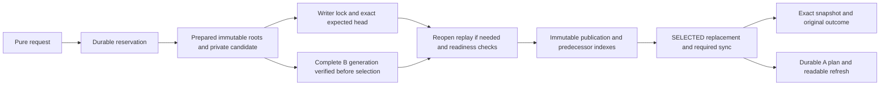

# Implemented research boundary

This standalone Cargo workspace implements an experimental local file-native
core. It does not change Handbook's root dependencies, migrate an owner, choose
A/B, integrate Dolt, freeze a public API or approve a structured-format default.
The structured-format standard remains proposed. The original baseline/control
and exact authored source bytes retain their own contracts.

## Checked state and affected work

One immutable semantic tree binds document headers (`D/`), separately addressed
outgoing edges (`E/`), reverse edges with multiplicity (`R/`), lowercase portable
path owners (`P/`) and unchanged label owners (`L/`). Its selected descriptor
binds validator version, consumer, exact document count, cost and budget.
Initialization performs complete validation and index comparison.

A transaction builds a final overlay before checking affected constraints.
It removes old namespace contributions before inserting final ones, supports
swaps, checks targets against the final batch, and consults reverse ranges for
target deletion/kind changes. Aggregate arithmetic uses checked wide deltas.
The two concrete kind adapters distinguish project decision sources from research
note/quote sources. An opaque global title rule deliberately falls back to full
validation. No arbitrary predicate language or automatic disjoint merge is added.

Incremental preservation starts from a checked selected base. It does not audit
unrelated stored pages on every commit. Full graph/index/source/projection audits
remain separate operations. An import requires an explicit captured base and
preserves supplied bytes; I1 validates its declared metadata/size constraints,
not an arbitrary domain schema or every authored source language.

The reused disk COW B+tree retains 64-entry leaves, fanout 32, batches of at most
256, tombstones and byte-driven splitting. Private C1 pages use a tagged version,
lengths, raw values and hash children. Checked reads enforce a 1 MiB object cap,
1,024-byte keys, 8,192-byte inline values and bounded tree height before allocating
from lengths. Large values use checked `@hash` indirection. Point, range, full,
audit and collection routes share the checked decoder. The separate control
retains the full baseline adapter/validator/renderer while choosing JSON or C1
page encoding; changing packing is part of that representation experiment.

## Publication and exact outcomes

The current head is read directly. A successor inserts only its already-selected
predecessor into membership and request/outcome indexes. Result bodies are
separate permanent objects, keeping large original results out of unrelated
point lookups and avoiding a self-referential publication hash. An orphan
publication or attempt hint cannot establish membership or acceptance.

An in-process `Prepared` contains private validated state. Reopened candidates
undergo pure read-only transition replay, compare derived roots and summaries,
and verify packet/B destinations. A sealed file alone is insufficient selection
authority. Its independent reservation digest also protects the roots consumed
by collection. Same-ID/same-intent accepted retries precede admission, stale-base
and cancellation checks. Accepted attempt hints retain retry routing after
candidate contents are reclaimed; the selected outcome index remains authority.

Resolution distinguishes accepted, absent-as-of (not terminal) and cancelled
fenced (terminal noncommit). Selected history/result evidence outlives document
content retirement. A checkpoint explicitly walks and verifies selected history,
rebuilds/repackages both indexes, then installs an ordinary expected-head
successor. Its full reference walker has a 200,000-predecessor research cap;
normal open/point/resolution does not walk the predecessor chain.

The library and two independently compiled consumer binaries share this core and
typed resolution. These are small concrete consumers with kind adapters, not a
general plugin ABI or a stable public security boundary for hostile in-process
callers. Writer coordination is per store, bounded and non-FIFO. Retries replay
pure store requests, not arbitrary external effects.

## Readable files and packets

A selects exact immutable state, then refreshes ordinary mutable files. Those
files may mix or lag. Stable per-document navigation sections avoid a global
listing rewrite for unrelated content. A target rename can legitimately affect
thousands of incoming navigation sections; a single edge edit can require
rendering its large adjacency even when the semantic edge update is small.

A refresh persists a target/prior-bound plan before edits, rederives its actions,
and completes pending work before advancing to another target. Indexed sequence
and path ranges coalesce skipped changes without walking publications. Pending
target changes roots are retained. Divergent source/derived bytes are durably
preserved under stable plan/path/content identities before replacement; retries
reuse those identities. Completed watermarks bind selected state, not continuing
physical integrity. Full audit/rebuild remains explicit and does not replay a
mutation or silently import an ordinary edit.

B requires a complete independent retained generation and verification of its
exact namespace and every file before selection. Readable generations are real
copies, not hardlinks to originals or other generations. A reader/copy operation
chooses one positively selected path once. Complete ordinary files retain their
materialization cost; COW metadata does not eliminate it.

Packet assembly is explicit. The fixture recipe orders the first eight sources,
retains their required transitive local closure/attachments, and records exact
paths, input hashes, recipe, renderer, omissions/errors and output hash. External
locator availability is not promised. Reopened packets independently reconstruct
expected content/namespace instead of trusting a mutable manifest. Selected-only
historical assembly has a distinct nonselectable candidate purpose and protects
only the required graph/projection/packet roots, not obsolete history indexes.

## Lifetimes, accounting and supported roots

Snapshot/resolve leases prevent overlapping collection. Explicit pins, pending
views and eligible candidate bases block retirement. Collection marks current
history evidence, live graph/projection roots, eligible candidate/checkpoint
roots and pending-refresh changes. Retiring content does not erase an accepted
result. Ordinary tools gain no hidden lease: after explicit retirement, an
unregistered reader has no continued lifetime promise.

At most eight reservations and a conservative 32 GiB candidate allowance are
admitted per store. Allocation is charged before writes/copies, including page
and namespace overhead. Selection attempts debit an additional bounded grant
before allocating. Selected publications explicitly own their conservative
allocation, intermediates and stages before reservation release. Fenced abandoned
work remains charged until private files, orphan publication/results, hints and
stages are deleted. Durable allocation journals precede public result creation.
A released lock or elapsed time never proves abandonment.

Collection requires an explicit disposable root and verifies its canonical
identity and deletion containment. Symlink entries refuse. Review found and
fixed a supported-root bug: collection must classify this store's `objects/`
subtree, not any ancestor named `objects`. Byte-role counters likewise bind to
the store root. The old failure and corrected exact-source preservation test are
retained. This is not a hostile root/lock-identity substitution qualification.

The separate experiment watchdog limits actual new logical files across owned
Windows/WSL roots to 32 GiB, with host/guest free-space reserves; native hosts
have their own finite allocation. These are separate from conservative candidate
admission and permanent selected ownership. Explicit audit/checkpoint/collection
may scale with retained history and are timed separately.

## Durability envelope

The I/O reuses the baseline native protocol. Unix installs a fully written and
synced private immutable stage with no-replace hard-link installation and parent
directory synchronization. Windows uses write-through `MoveFileExW`, including
extended absolute paths, and reports directory synchronization as unsupported.
Native macOS probes/disassembly and Linux execution are retained separately.

The selection boundary, original reply and A completion are distinct events.
Process interruption leaves kernel/device caches alive. No reboot, power-cut,
hostile namespace, freshness-after-coherent-rollback or physical-device flush
qualification follows. WSL additionally retains its Windows-host/VHDX stack.
Fresh process is not device-cold; cross-machine observations do not isolate an
operating-system cause. Both A and B remain available research contracts.
