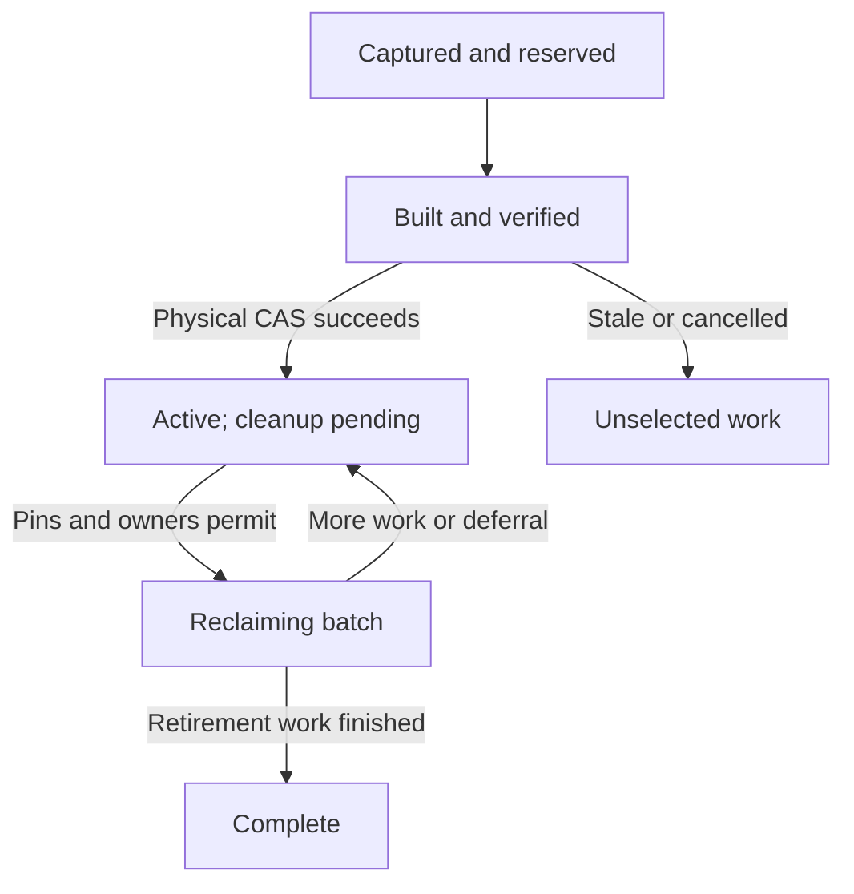

# Recommendation: adjust the physical protocol and keep the core

**Keep the immutable COW core and selected-publication transaction model. Adjust the next experiment around one shared protocol for physical catalog capture, incremental maintenance, and authenticated lookup.**

The three reported obstacles are credible. The main adjustment is to settle their shared lifecycle and routing rules before implementing them separately. Otherwise, cleanup can become unsafe when rolling segments arrive, or rolling compaction can invalidate the assumptions used by the new reader.

- **Immediate deliverable:** a decision-ready implementation brief, protocol proposal, and validation plan.
- **Intended outcome:** controlled maintenance overhead and storage growth under an admitted concurrent workload, while preserving readable files, exact accepted outcomes, and recovery.
- **Next decision:** whether to authorize the bounded experiment described below. This review does not authorize dispatch, implementation, migration, or continuing automation.

Throughout this review, **hard invariants** come from the packet, **measured facts** describe its completed evidence, **inferences** explain possible causes, and **proposed targets** are prospective acceptance criteria. Omitted code remains an inspection dependency.

## 1. What the evidence supports—and what to change first

### The diagnosis is substantially right, with two qualifications

| Packet evidence | What it establishes | What remains an inference or design question |
|---|---|---|
| Cleanup held the writer lock for approximately **187.285 seconds**, with almost all elapsed time in deletion. A separate barrier test caused an ordinary resolve to return `busy:physical-readers`. | The implementation retains exclusion through reclamation, and that mechanism can block ordinary operations. | The original large run did not separately measure a concurrent 187-second outage. |
| A later accepted publication remained loose and unmapped after another build/repack. | The frozen cohort does not provide rolling compaction. | This was an intentional comparison policy; it is not evidence that the underlying transaction model cannot support incremental discovery. |
| First access reads, authenticates, and parses the complete relevant index. Fresh-process packed medians were approximately **18–45 ms**, versus **1.0–1.4 ms** loose. | First-operation work includes a substantial index operation absent from the loose path. | Its share of latency is not isolated. Capture, catalog work, opens, hashing, parsing, allocation, and decoding need separate counters. |
| Long-history cleanup reduced 504,833 eligible files to 33; the small A/B cohorts missed their original 95% file-reduction gate. | Packing is useful at the demonstrated large scale, with meaningful small-store overhead. | A universal activation policy or indefinitely sustainable growth has not been demonstrated. |

These conclusions are grounded in the packet’s completed measurements and actual excerpts, rather than inferred excluded implementation. bounded-review-packet

**Qualification one: sustainable storage cannot mean a constant total footprint.** Permanent accepted outcomes require continuing retained information. B additionally requires a loose publication binding for every accepted publication. The experiment can control obsolete representations, temporary duplication, compaction lag, and amplification relative to that retained-data floor. It cannot remove the floor while preserving the stated contracts.

**Qualification two: rolling compaction and lookup routing are coupled.** Today’s resolver selects one role/range descriptor. New chronological segments can overlap existing key ranges. Appending them without changing routing could produce incorrect misses or select the wrong physical representation. This must be resolved before the rolling checkpoint.

### The higher-level simplification

Use a narrow physical-store abstraction with four responsibilities:

1. Capture a physical catalog generation and protect its lifetime.
2. Locate an authenticated representation under that captured generation.
3. Prepare and select a replacement physical catalog.
4. Resume bounded retirement and cleanup work.

Semantic acceptance remains entirely with the existing selected publication and logical indexes. This abstraction should also expose maintenance status: discovery cutoff, deferred eligibility, unreclaimed bytes, blockers, and reserved headroom. That provides a durable basis for future caller-driven maintenance without introducing a daemon or scheduling system now.

Its practical costs are additional catalog/retirement metadata, temporary coexistence, and conservative retention behind old readers. Those costs belong in admission and measurement.

Keep every packet invariant: whole-publication conflicts; exact outcome/intent/dedup/cancellation semantics; retirement protections; A’s live-view contract; B’s selected-once, engine-free browsing; exact ordinary payload bytes and meaningful paths; existing packing exclusions; and native-platform obligations. The completed native recovery and later B comparisons remain completed baseline evidence. The missing N10k-B navigation matrix remains a separate follow-up. bounded-review-packet

## 2. Minimal viable protocol, state machine, and recovery

### Authorities

| Authority | Responsibility |
|---|---|
| **Selected semantic publication and logical indexes, S** | Acceptance, request/intent identity, exact outcomes, membership, retirement, and transaction conflicts. |
| **Selected physical catalog generation, C** | Authenticated physical routing, format version, selected compaction cutoff, and references to unfinished maintenance work. |
| **Existing durable lifetime protections** | Pending preparations, retained snapshots, saved packets, protected originals, and other persistent owners. |
| **Scoped cross-process generation pins** | Protect physical representations that a live operation or maintenance builder may still use. |
| **Immutable transition plans and resumable journals** | Identify candidate ownership, expected physical parent, deferred eligibility, retirement work, and progress. Journal status does not establish activation. |

A complete pack or candidate catalog is still not acceptance. Physical maintenance must leave S unchanged.

Each selected catalog should provide bounded read routing without requiring a walk through all predecessor catalogs. Successors must carry forward references to unfinished retirement and deferred work, so a second activation cannot orphan cleanup from the first.

### Reader capture

Introduce a short capture gate, **Q**, plus a lifetime pin for each physical generation.

An ordinary operation should:

1. Acquire Q shared.
2. Read the bounded selected physical binding.
3. Acquire the selected generation’s shared lifetime pin and establish that the pinned identity matches the binding.
4. Release Q.
5. Perform catalog/index authentication and ordinary work using that generation, alongside the existing semantic snapshot and content-lifetime protections.
6. Release the pin after all associated I/O has stopped.

Holding Q across complete catalog/index loading, decoding, historical traversal, or waiting for the writer would defeat the design.

Opening an old semantic snapshot later should normally use the **current physical catalog** with that snapshot’s semantic protections. It should not arbitrarily acquire an obsolete, already sealed physical generation.

Cancellation must release the pin only after outstanding work can no longer access the files. Process death may end an operation pin, but it must not erase an independently durable preparation or saved packet. The actual native lock and handle behavior requires inspection and testing.

### Activation and lock order

Let **W** be the existing semantic writer lock. Use a small maintenance serialization mechanism for activation and retirement claims; candidate preparation can remain independent when its resources and inputs are protected.

The proposed activation sequence is:

1. Build and fully verify the candidate outside Q and W.
2. Persist the immutable transition information needed to interpret activation and resume cleanup.
3. Acquire Q exclusively.
4. **Try W. If unavailable, release Q and retry outside it.** Do not block new captures while waiting for an ordinary writer.
5. Revalidate the expected physical parent, selected cutoff, relevant lifetime/admission conditions, and candidate bindings using bounded work.
6. Select the new physical catalog and seal its predecessor against new acquisition.
7. Release W and Q immediately.

The universal ordering rules are:

- Readers release Q before requesting W.
- Activation never waits for old operation pins.
- Cleanup never holds Q or W while waiting for readers or deleting files.
- No path upgrades a retained operation lease into an exclusive drain while holding a lock needed by those operations.

**Physical CAS and semantic conflicts must remain separate.** A newer semantic publication after the compaction cutoff should remain a loose tail or later segment. It should not automatically invalidate otherwise valid packing. The cutoff must still be authenticated selected history, and the expected physical parent must still match.

The packet does not establish whether `STORE.json` mixes physical and semantic updates in a way that complicates that comparison. Inspect it before defining the exact CAS token.

### The precise deletion rule

Use a conservative retirement frontier across sealed generations, rather than per-reader/per-record reference tracking.

A loose duplicate can be deleted only when:

- Selected semantic authority establishes its eligibility.
- It is outside all protected-original, readable-view, active-work, and required-control exclusions.
- A selected, verified replacement preserves the exact raw identity and required availability.
- **Every older generation whose reader could still use that loose path has drained.**
- Persistent owners and direct-path consumers remain protected.
- The exact physical instance is claimed for retirement and cannot become live again during deletion.

The fourth condition includes older catalogs in which the key was **unmapped**, permitting loose fallback. Waiting only for the immediately preceding catalog is insufficient.

For a pack or index, require absence from selected physical reachability and from every remaining reader, builder, or durable owner that can use it. A container shared by several catalog generations cannot be deleted merely because one generation drained.

Make retirement irreversible for that physical instance. Prevent an in-flight deletion target from being re-adopted under the same pathname. Whether existing content-addressed naming already supports a safe implementation is an inspection question.

Perform nonblocking lifetime checks and defer blocked work. Use bounded resumable batches outside global exclusion. Generation identities and lock objects must not be reused unsafely; their bookkeeping should itself become reclaimable once no protection or recovery proof needs it.

On Windows, incompatible open-handle sharing can prevent deletion. Treat that as an explicit deferral with no reclaimed-space credit. Microsoft documents that delete access depends on sharing flags and that deletion can remain pending until handles close. [Win32 apps](https://learn.microsoft.com/en-us/windows/win32/api/fileapi/nf-fileapi-createfilew?utm_source=chatgpt.com)

### Rolling discovery and routing

Capture both the current physical parent and an authenticated semantic cutoff. Prefer an existing selected-order cursor or a structural diff of immutable membership roots that skips unchanged authenticated subtrees.

A cursor alone is insufficient. Distinguish:

- **Discovered through cutoff:** accepted publications already examined.
- **Physically covered:** eligible records represented in packs, with explicit deferred holes.

Older records may become eligible after a preparation finishes or a protection ends. Preserve that work in a durable, bounded deferred set or consume the relevant authoritative lifecycle changes. Advancing the cutoff must not strand those records permanently.

Physical mapping, discovery progress, and deferred-work identity should advance together. Each deferred item must be rechecked against semantic authority; the work queue never establishes acceptance.

For routing, my starting recommendation is **a bounded number of overlapping segments**, with disjoint ranges inside each segment:

- Start with a proposed maximum of **four relevant segments per key**, within the existing 64-pack catalog limit.
- A negative physical lookup must prove absence in every relevant segment.
- Conflicting identities for the same immutable key refuse.
- Consolidation or explicit admission backpressure must occur before either limit is exceeded.
- Consolidation work is bounded, resumable, and measured, including collateral rewriting of older records.

This avoids immediately adding a second general key-to-location database. If its read or rewrite amplification fails the gates, compare an authenticated physical directory as an explicit next architectural decision.

### Proposed state machine

Cancellation after activation cannot turn the active catalog back into unselected work.

### Crash and recovery matrix

| Interruption or schedule | Required result |
|---|---|
| During build or after verification, before selection | Old catalog remains selected. Partial or complete candidate output is owned, unaccepted work. |
| During selected-binding replacement | Existing native replacement/recovery rules determine the selected state. Do not infer activation from file presence. |
| After selection, before journal advancement | Recover activation from the selected binding and immutable transition information. Never delete selected output because journal status is stale. |
| After sealing, before deletion | Resume protection checks. No new acquisition of the retired generation may invalidate the eventual deletion proof. |
| Mid-cleanup, including deletion before accounting update | Reconcile present/absent instances idempotently. Never double-credit deletion or count deferred work as free capacity. |
| Reader cancellation, reader death, or maintenance death | Release only the protections actually ended; preserve durable owners and resumable work. |
| Two prepared candidates with the same physical parent | One activation wins. The loser cannot silently rebase, delete shared inputs, or reclaim the winner’s output. |
| Publications and lifetime changes cross the cutoff | Later accepted work remains readable; deferred eligibility remains discoverable; retired bytes do not regain semantic accessibility. |
| Old reader survives multiple later activations | New-generation operations progress. Dependent reclamation waits and consumes admitted headroom. |
| Windows sharing refusal, then handle release | No deletion credit while blocked; later retry reclaims safely. |

After every critical recovery phase, check exact outcomes and current graph/source/navigation, plus ordinary extraction from an old B binding selected once.

These are process-crash and native file-lifetime tests. They do not establish device-cold performance, physical power-loss durability, or Windows directory-sync support.

### Mandatory source inspections

Before implementation, produce a short protocol map covering:

1. Every lock acquisition, cancellation/drop path, native sharing flag, and handle inheritance rule.
2. All reads of eligible files, including resolve, recovery, backup, extraction, preparations, and direct-path consumers.
3. `STORE.json` replacement, physical comparison, and preservation of concurrent semantic state.
4. Membership ordering/diff APIs, retained roots, and retirement-related index changes.
5. Durable ownership and protection acquisition/release.
6. Journal interpretation after activation and across multiple later activations.
7. Container/path reuse and deletion-versus-recreation races.
8. Existing pack/range routing, full-scan helpers, allocation accounting, and startup recovery work.

If incremental discovery requires new semantic commit metadata, expose the publisher/recovery implications during local brief reconciliation. Do not hide that addition inside the packing implementation.

## 3. One staged experiment, with ordered checkpoints

**Use one experiment with a shared design and final qualification, implemented through separately reviewable checkpoints.** Three independent projects would risk different catalog, lifetime, and compatibility rules. One undifferentiated patch would make causal attribution difficult.

| Checkpoint | Narrow work and tracer | Completion criterion |
|---|---|---|
| **0. Inspect, admit, and freeze** | Preserve the exact baseline; map locks, lifetimes, discovery, routing, and recovery; profile first lookup; census resources; freeze candidate targets and deadlines. | Protocol and resource plan are concrete. Excluded-source questions have answers or explicit blockers. |
| **1. Online cleanup** | Change capture/retirement and the packing registration/deletion path while retaining the existing index reader. Hold an old reader while activating successors and running cleanup. | Ordinary operations progress; deletion remains safe, bounded, resumable, and recoverable. |
| **2. Rolling tail** | Replace frozen discovery with selected deltas plus deferred eligibility; add bounded segment routing/consolidation. | Three real publish/compact/reopen cycles preserve outcomes and absorb newly eligible work without a full historical publication walk each cycle. |
| **3. Fresh-process reader** | Compare the existing reader with at most two smaller authenticated designs. Keep codec effects separately identifiable. | The chosen reader meets correctness, work, file/headroom, and proposed latency gates. |
| **Final integration** | Run the required capsules and focused new schedules on one final pin; verify compatibility, restore, and an accepted successor. | All three outcomes and required native evidence are complete, or remaining censors are explicitly reported. |

The principal implementation areas are the packet’s `packing.rs` and `pack.rs` modules, plus the locally identified lifetime, membership, native-I/O, recovery, and measurement paths. This is not an invitation to refactor the whole core.

### Reader candidates

**Candidate 1: smaller completely authenticated ranges.**

First determine whether smaller existing-format indexes can meet the lookup target while preserving the 64-pack limit, file benefit, and rolling headroom. Measure actual index bytes per key before choosing the size.

This is the simplest candidate. Its costs are more files/descriptors and possible old-range rewriting when new keys are scattered. If authenticated size data proves it cannot fit the envelope, document that rejection without implementing a predictably failing variant.

**Candidate 2: authenticated pages inside immutable index containers.**

Use an explicit private format version whose catalog descriptor authenticates a root, routing pages, bounded sorted leaves, and record bindings. Keep pages within a small number of containers; avoid one ordinary file per page.

A positive read authenticates its route and record. A negative read authenticates a complete relevant routing decision and a leaf gap or empty range. Missing or corrupt required metadata refuses. An authenticated physical miss permits the established loose path; it does **not** prove that a request was never accepted.

Complete structural validation belongs in candidate verification before activation and the explicit full verifier. A hash root alone does not establish correct routing, ordering, coverage, or cross-page boundaries.

**There is a verification-scope difference:** the current reader checks the whole relevant index on first access; a paged reader can leave unrelated corruption undiscovered until a full audit. Returned identities and required-path integrity stay exact, but eager corruption detection covers less data. Record that explicitly in the experiment.

Non-goals remain navigation edge-range optimization, the larger B navigation matrix, source-format migration, automatic merging, distributed coordination, a daemon, broad dependency research, public format/API stabilization, and power-loss qualification.

## 4. Discriminating measurements, gates, admission, and censors

### Small measurement matrix

The sizes below are proposed starting points to freeze after admission.

| Cell | Fixture and workload | Main discrimination |
|---|---|---|
| **S: protocol** | Small A/B stores, approximately N64/H64; three cycles adding at least 16 accepted publications each. Full adversarial schedules on Windows/Linux; focused recovery/lifetime coverage on macOS. | Capture, lifetime, outcome, browsing, and crash correctness. |
| **H: history growth** | A at fixed N128, actual H≈1k and H≈10k; three cycles adding 100 accepted publications each. One and four publishers, four reader processes, and an old reader held beyond the current 15-second wait. | History dependence, concurrent availability, tail absorption, and cleanup progress. |
| **D: document count** | A/B at N64 and N1k with shallow fixed history; matched payload/title operations with and without maintenance on one primary platform. | Separate readable-view cost from maintenance effects. |
| **L: first lookup** | H1k/H10k and retained H101007; same logical cohort and requests across baseline and reader candidates. | Authentication work, startup, file count, and lookup latency. |
| **Q: limits** | Small authentic stores with deliberately reduced quotas and descriptor limits; Windows sharing blockers. | Consolidation, bounded backpressure, deferred reclamation, and subsequent recovery. |

Use PZ for integrated maintenance and a small matched P0 format/correctness control. A broad repeat of the compression comparison is unnecessary.

For lookup, retain all six original categories: early, middle, recent, missing, cancelled, and lost reply. Use at least the prior **20 fresh processes per category** and **500 warm lookups per category**; increase fresh samples to 50 if admitted. Report every fresh sample and observed maximum. Twenty or fifty samples do not support a strong p99 claim.

Separate engine operation time from spawned-process latency. Record cache conditions honestly; a new process is not device-cold I/O.

### Hard correctness gates

These are non-negotiable:

- **Outcome oracle:** every accepted request retains its exact result, publication identity, request/intent match, retry/dedup behavior, and lost-reply resolution.
- **Authority oracle:** physical maintenance does not change semantic roots, membership decisions, cancellation semantics, or whole-publication conflicts.
- **Lifetime oracle:** held readers, preparations, snapshots, packets, and protected originals retain their required access. Retired content remains refused even when bytes survive.
- **Readable-content oracle:** exact authored bytes, graph/source/navigation, and A provenance/recovery remain correct. Old B bindings continue to support ordinary selected-once extraction.
- **Integrity oracle:** corrupt mapped data or required routing metadata refuses even when a valid loose duplicate exists. Physical absence cannot become a false semantic “never accepted.”
- **Recovery oracle:** selected state determines activation; partial cleanup is idempotent; stale candidates cannot damage selected or shared data.
- **Compatibility oracle:** old images remain readable/restorable under the stated compatibility behavior. Unknown/new formats refuse safely where unsupported. Restore qualification includes full verification and an accepted successor.

Run full oracles after critical crashes in the small corpus, at scaled-cycle boundaries, and after final restore. Verify the complete chosen long-history representation, not merely its sampled lookup results.

Include corruption in touched pages, untouched pages, range boundaries, lengths/offsets, and raw records. The untouched-page case should demonstrate the declared audit scope rather than conceal it.

### Proposed work and performance gates

Freeze these before evaluating candidate results. The structural requirements are stronger evidence than any single timing ratio.

| Area | Proposed gate |
|---|---|
| **Global exclusion** | Zero historical-publication enumeration, full-index authentication, duplicate verification, pack rewriting, or deletion calls while holding semantic/global capture exclusion. |
| **Activation** | Initial targets: p95 ≤10 ms, p99 ≤25 ms, observed maximum ≤100 ms. Calibrate against native authority replacement before candidate evaluation; retain sample counts and every hold. |
| **Ordinary availability** | Zero maintenance-induced timeout/refusal at the admitted workload. Count expected semantic conflicts, maintenance-contender contention, and intentional quota backpressure separately. |
| **Ordinary latency** | Provisional p95 ≤1.25× and p99 ≤1.5× matched no-maintenance controls, with adequate samples and absolute latency reported. |
| **Cleanup scheduling** | Start with ≤1,000 deletion candidates or 50 ms of cooperative work per batch. Check between filesystem calls; record a blocking native call that exceeds the slice. |
| **Discovery** | No reopening unchanged historical publication bodies except explicitly deferred work. Charge authenticated index-page visits separately. At fixed delta, target H10k discovery work ≤2× H1k. |
| **Tail completion** | Every eligible record through the selected cutoff is represented or explicitly deferred. In the small growth workload, after producers stop and blockers release, target zero unprotected backlog within two admitted maintenance passes. |
| **Lookup work** | Proposed envelope: ≤64 KiB startup/routing metadata plus ≤192 KiB index metadata per physical-key lookup—e.g. at most four relevant descriptors and three 16-KiB pages each. Report complete-operation totals too. |
| **Fresh lookup latency** | Target at least 2× lower long-history engine-operation median for categories traversing the changed index path, without unexplained category regressions. |
| **Warm lookup** | Provisional regression tolerance: 20% or 0.2 ms, whichever is larger. |
| **Memory and format limits** | Preserve the existing 64-MiB index-cache bound including transient allocation, plus existing pack/index/record/catalog limits. Bound new maintenance bookkeeping by streaming; start with a proposed 64-MiB bookkeeping ceiling and retain the existing harness RSS ceiling. |

The lookup envelope excludes payload decoding, which retains its existing bounds. It is a finite admitted-height/segment guarantee, not constant work for unlimited history.

Inspect whole-operation startup as well. Moving a complete scan into catalog reconstruction, retirement-journal recovery, or a verification-cache load would fail the purpose of the reader experiment.

### Activation policy and file benefit

Keep the historical small-cohort results unchanged: **A achieved 60.71% and B 32.14%; both failed the former 95% gate.** bounded-review-packet

For the new experiment, start with an automatic-packing threshold of:

- At least **128 removable loose records**.
- At least **four removable files per added representation file**.
- Positive projected benefit after all new metadata and temporary coexistence are charged.

Allow forced packing only in labeled correctness fixtures below that threshold.

At H≥1k, a prospective ≥95% reduction in **replaceable historical representation files** is reasonable to test. Report the original whole-cohort denominator beside it, along with whole-store counts and B’s mandatory loose controls. This is a new scale-specific criterion, not a reinterpretation of the old failure.

Count catalogs, indexes, lifetime files, journals, deferred-work metadata, and abandoned candidates. Logical bytes, native allocated bytes where available, and actual successful deletion credit must remain distinct.

### Resource admission and native qualification

The previous forecast left only **5,600,492 bytes unassigned**. That is a forecast, not a current free-space measurement. Execution requires a fresh census before assuming any new allocation. bounded-review-packet

Admission must include:

- Protected originals, backups, and retained evidence.
- Actual consumption and still-valid reservations.
- Old/new containers coexisting behind readers.
- Candidate indexes, clones, builds, branches, samples, and closeout.
- File counts and native allocation where available.

Keep the **40-GiB / 5,000,000-file ceiling**, with **1 GiB / 100,000 files reserved inside it** for closeout. Do not credit planned deletion or silently release retained fixtures.

The retained H101007 source stays read-only. New-format artifacts require explicitly admitted derivatives or disposable clones. If the existing reader mutates lock or recovery state on open, even baseline access needs an appropriate admitted harness or clone.

Run existing workspace and applicable packing/recovery capsules on the new final pin. Windows and native Linux carry the primary correctness/availability evidence; macOS receives the same pin’s required recovery, compatibility, and focused lifetime checks. Large performance matrices need not be duplicated everywhere.

The completed Mac recovery evidence remains complete. Its missing persisted aggregate RSS peak remains missing; neither that value nor the historical loose allocated-space baseline should be reconstructed by assumption. bounded-review-packet

### Clock and censor policy

I propose **16 hours of functional work and verification, followed by a protected two-hour closeout window**, starting only after admission and native-host readiness. Set per-cell watchdogs during baseline calibration and freeze them before candidate runs.

At the deadline, preserve partial evidence, selected roots, actual accepted counts, and reasons for censoring. Do not extend clocks silently.

If required H1k/H10k or long-history derivative evidence cannot be admitted, finish safely admitted work and report the experiment **incomplete with named censors**. The next decision is specific resource relief, an explicit allocation change, or stopping.

## 5. Consequential human decisions and the useful library pattern

The core, readable contracts, permanent outcomes, and protected lifetimes are already settled. Three terms should be explicit in dispatch authorization.

| Decision | Recommendation | Tradeoff |
|---|---|---|
| **Availability under long-held protections** | Preserve valid protections, allow new-generation operations, and apply explicit admission backpressure when retained generations consume headroom. | A paused or hung reader can postpone reclamation. Continuous unlimited writes cannot be promised under a fixed quota. |
| **Lookup verification scope** | Permit authenticated touched-path lookup with complete candidate validation and an explicit full verifier if smaller fully verified ranges cannot meet the gates. | Unrelated index corruption may be detected later than under current whole-relevant-index loading. |
| **Resource horizon** | Keep the current ceiling and reserve; require a fresh census. Make any release of protected resources or allocation increase a separate concrete decision if needed. | Required evidence may be censored when coexistence cannot fit. |

Block sizes, batching constants, function decomposition, and which viable candidate is simpler are routine implementation choices within the frozen gates.

**An embedded library pattern is useful; a database migration is not justified by this packet.** Reuse the pattern of immutable physical versions, scoped reader handles, expected-parent activation, and deferred reclamation. Inspect the existing COW primitives as possible donors for authenticated point lookup and bounded decoding.

A process-local reference-counting or epoch helper would not, by itself, settle cross-process file lifetime, durable preparations, Windows sharing, or restart. Those obligations remain explicit in the protocol. A broad dependency search would add little before these bounded trials reveal whether any component is actually missing.

## 6. Falsifiers, subsequent decisions, and the draft brief

### What would falsify the adjusted approach?

Treat the following as meaningful negative results:

1. **Correct capture still requires a history-sized global barrier**, or reclamation requires revoking valid readers.
2. **Small tail updates repeatedly scan or rewrite most of history**, including scans hidden in startup, activation, or deferred-work handling.
3. **Lookup work grows with every segment or catalog generation**, or smaller indexes merely move the cost into files, descriptors, or startup metadata.
4. **The admitted backlog cannot recover after blockers release**, despite a bounded offered workload.
5. **Exact outcomes or browsing contracts fail** under stale candidates, partial cleanup, cutoff crossings, corruption, or process crashes.
6. **Mandatory retained information and B controls dominate the intended operating horizon**, leaving insufficient room for useful maintenance coexistence.

An explicit maintenance window becomes a legitimate alternative if correct online operation has more protocol/resource cost than the intended users will accept. It would be a new product contract and would not count as passing the requested online outcome.

A different physical storage abstraction becomes justified if the bounded segment approach repeatedly fails routing, rewrite, or file-count gates, or if lifecycle machinery expands into a general storage system without delivering the target benefit. The next comparison should then be narrow: the specific failed responsibility, not a broad database survey.

Defer navigation optimization, the larger B navigation matrix, device-cold benchmarks, power-loss qualification, permanent scheduling, public format stabilization, and broader storage comparisons until this evidence review. Preserve all three current outcomes in the experiment’s completion criteria.

### Concise draft implementation brief

> **Objective.** Determine whether the standalone file-native engine can support online cleanup, rolling eligible-history compaction, and lower-cost fresh-process lookup under bounded concurrent local-agent workloads, while preserving all existing semantic, readability, lifetime, conflict, and recovery invariants.
>
> **Baseline.** Preserve core `d70f3864f2888d46d9112213b4a03f8d82745a8e` and authenticated retained evidence. Historical passes, failures, missing measurements, and qualification limits remain unchanged.
>
> **Execution structure.** One experiment with inspection/admission, online cleanup, rolling tail, and reader checkpoints, followed by integrated qualification on one final pin. Passing an individual checkpoint does not complete the three-outcome scope.
>
> **Protocol.** Implement bounded physical-generation capture, scoped cross-process pins, short expected-parent activation, irreversible retirement of physical instances, and resumable cleanup outside global exclusion. Protect all older generations that can use a retiring representation, including loose fallback. Retain persistent owners independently of process pins.
>
> **Rolling maintenance.** Discover accepted deltas from authenticated semantic authority; preserve deferred eligibility; atomically advance mapping and maintenance progress. Complete three publish/compact/reopen cycles. Bound overlapping segment probes and consolidation within existing limits.
>
> **Reader comparison.** Profile current first-operation costs. Evaluate at most smaller fully authenticated ranges and a versioned paged authenticated index. Preserve exact identities, required-path refusal, valid positive/negative proofs, and explicit complete verification. Disclose the scope of eager corruption detection.
>
> **Evidence.** Use small A/B adversarial fixtures, fixed-document H1k/H10k growth, a separate shallow document-count comparison, and read-only retained H101007 evidence with admitted derivatives where necessary. Include concurrent publishers/readers, an old reader, two maintenance candidates, cutoff crossings, lost replies, cancellation, protected retirement, sharing deferrals, crashes, quota pressure, compatibility, restore, and an accepted successor.
>
> **Acceptance.** Require all hard correctness oracles; no history-sized work under global exclusion; incremental discovery; bounded authenticated lookup work; safe backpressure and later reclamation; and the frozen prospective performance/resource gates.
>
> **Admission and closeout.** Census first. Preserve the current ceiling, protected originals, and internal closeout reserve. Use the proposed 16-hour functional plus two-hour closeout budget, with frozen workload deadlines. Report required evidence that cannot finish as censored/incomplete. Deliver the final pin, raw measurements, protocol/recovery map, resource accounting, and a direct recommendation on whether the demonstrated operating envelope justifies continuation.