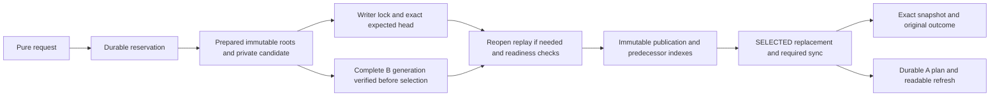

# Bounded source and evidence packet for packing guidance

Date: 2026-10-19. Approach review, fresh independent conversation.

Advisory only; verify against local project truth and authoritative docs; do not reduce scope without user approval.

## Reading order and boundary

Read the prompt facts first, then the sections below in order. Current experiment source is pinned to f0904a63cb2500b9bea3a4034d19cbe38bfac729. The coordinator review and earlier research are separately labeled local evidence. Older research states observed dates and is not current upstream qualification. This is not a repository audit, patch request, live store, full backup, complete repository or prior Pro response. Excluded source cannot be inferred. Paths are redacted.

All current engine excerpts are complete files except as explicitly described; no external host identifiers, connection configuration, credentials, user sessions, raw logs or datasets are included.


## Pinned current file: docs/research/file-native-recovery-reclamation-2026-10-19/report.md

# File-native recovery and initial reclamation results

October 19, 2026. Standalone experimental engine research. The Windows
preservation/restore/reclamation trial succeeded. Platform coverage is qualified
below; this is not production qualification or a Handbook migration.

## Result

The original H101003 store remains at its original path and selector. It was
read for provenance, verification and capture, and was never renamed, repaired,
published into or collected. Collection used one independently restored clone.

The clone passed full operational restoration, fresh reopening/recovery, a valid
successor, collection without retirement, an interrupted collection and restart,
a prospectively bounded 100-publication retirement cohort, and a distinct-source
publication followed by restoration of the prior bytes. The distinct source was
actually removed while its original accepted result remained exact.

All 101,003 original accepted publications/results and membership/outcome
coverage survived. Final history has 101,006 publications, including the three
new operational/reclamation publications. The 101 intentionally retired content
snapshots are unavailable by contract; they are not counted as retained-content
passes. The final current graph equals the untouched original graph, and exact
retained source/index obligations passed independent verification.

| Clone state | Regular files | Logical file bytes |
| --- | ---: | ---: |
| After operational reopening/successor, before GC | 1,413,495 | 5,465,011,991 |
| After collection without retirement | 510,713 | 888,599,719 |
| After retirement pilot and distinct-source collection | 510,583 | 887,923,682 |

Thus the first stage reduced the observed logical footprint by about 4.58 GB
(83.7%). Windows cluster allocation was **not measured**. File lengths, unlink
counts and physical allocation are different quantities.

## Source, build and measurement identities

| Purpose | Commit |
| --- | --- |
| Pinned prior result and source baseline | `3396092cbf20f593e36b9640c6a76e5afd2f2a09` |
| Prior Rust/Cargo core, verified unchanged at that result | `5a65a2155f9eb297d2cbb1b7c900fa749629605c` |
| Initial corrected core and first complete native lanes | `40509a90a015de84bd12d26e152a52c92721baa0` |
| Operational transport used for H101003 capture/restore | `3d3f7b47264029dd1a8a3a1298cb1c740c0e7ae9` |
| Recreated-directory preservation correction | `ec544776255c6eafb06700c40c04b1e27fdf8898` |
| Core used for operational reopening and actual long GC | `fe1ee22a82d65dc88a14e38b7e77c921538c4bc4` |
| Final core, adding the external-empty-directory guard | `07a8574e581e66ba58d7caac87238aa5f93918be` |

The last core change restricts A repair pruning and corrects a packet comment.
The GC/accounting implementation is identical to the measured `fe1ee22a` core.
The final Windows capsule, probes and matched small costs use `07a8574e`.
Later report/harness commits do not change the Rust/Cargo core.

Windows long-trial executable SHA-256:
`4d8ecb0ff2c29b42bf83161803336fadfc6dd9cfbd2ae6594c05d9358adbac0b`.
Final Windows executable SHA-256:
`cbd9b0352c52998ae7e6c9a2cd160bc3cbc16ea3d1b40c339eb570450d765cca`.
Complete source/build hashes are in
[the measurement binding](evidence/final-build-binding.json) and
[the final binding](evidence/final-code-build-binding.json).

Original selector, verified before capture and after collection:

```json
{"publication":"publication-74796-1792371048916760700-13","digest":"9b80c0b54b15af6457ee50290f266684bed6c06223cbe105a2654da7bb368546"}
```

The source baseline was also confirmed against the pushed origin ref. The shared
Handbook checkout remains on `379af4eda9b95ee82be9d3afcfdcdca2d6d132f9`;
this work is isolated on `codex/file-native-recovery-20261019`.

## Correctness and compatibility

A refresh retains the original sealed plan representation, but executes removals
deepest first and installations shallowest first. It removes obsolete managed
files and empty managed parents, preserves divergent bytes and obstructing
subtrees, and completes a pending plan before advancing to a successor. A user
recreating an obstructing directory after an exit produces a second preserved
incarnation. Untracked external parent directories are retained during repair.
Valid ancestor/descendant transitions work in both directions; impossible final
file namespaces, including case-folded collisions, refuse before selection.

New ordinary preparations target projection profile 2, including on a legacy
store. Exact authored files and existing packet/provenance files remain, with
one supplementary `collection.yaml` for missing graph metadata: membership,
stable IDs, current titles/kinds/paths, and ordered directed typed relationships.
There are no new Markdown navigation/index files and no compulsory document
guide. This is not a one-for-one Markdown-to-YAML conversion. The metadata is
needed because the fixture graph stores these facts independently of source
bytes. A complete logical export is a different interface.

Historical profile-1 objects remain byte-for-byte unchanged. The immutable
projection identifies its reader profile; already-sealed legacy preparations
replay under their original profile. New targets use profile 2. Checkpoints carry
their selected snapshot unchanged. New standalone packets use their existing
source/provenance information without an extra guide. Windows tests also reopen
legacy packet preparations, preserving their original retained manifests.
The independent legacy verifier now checks actual root destinations; the new
oracle checks the complete backing-file hashes and B manifest binding. Legacy
stored navigation bytes, including historical defects, are not rewritten.

The new oracle checks graph discovery/membership, source locations, relationship
direction/type/order/multiplicity, exact extraction, backing-file integrity and
selected-once B reading. It distinguishes immutable correctness from an A tree
that is lagging or interrupted. It does not mistake an A completion marker for
an external-edit integrity guarantee. Ordinary PowerShell and Bash listing,
search, copy and SHA-256 extraction passed for A/B N16/N128 without engine calls.

Checkpoint and collection now reconcile selected allocation transfers before
candidate evidence can be removed. Transfer still requires the original accepted
attempt/intent and permanent allocation-owner binding. The original
accounting-transfer/checkpoint/retire/two-collections sequence passes in A and B,
with the accepted result unchanged. This repairs the recoverable accounting
inconsistency; it does not establish that the old observation lost accepted data.

The final Windows capsule passed 24 cases / 282 process events. Additional final
checks passed for same-ID/different-intent handling, replay dependencies across
GC, packet ownership, strict missing/corrupt evidence refusal, independent
whitespace-corruption refusal, and external empty-directory preservation.
Small restored A cases now contain a genuinely interrupted path transition with
different target/prior watermarks; their pending/completed obligations survive
byte-for-byte before recovery. Restored fences and intent bindings were also
explicitly exercised. These event counts are not independent statistical trials.

## Full operational preservation gate

The quiescent cooperating contract excludes active mutators during capture.
Durable eligible and half-prepared work is permitted. Every regular file is
captured, including fences, pins, reservations, candidates, packets, A obligations,
B generations, sources and indexes. OS lock files and the root-bound disposable
permission are excluded. No portable deletion authority is imported.

The transport has a complete per-file inventory/hash, an inventory hash, and a
transport hash. A partial capture has no completed manifest. Restore requires a
new destination, checks every framed record and digest, and explicitly reports
that operational reopening is still required. Missing/corrupt required evidence
cannot establish an operational restore-success claim.

Small A/B N16/N128 tests cover pins, terminal fences, packet ownership, eligible
selection after restore, half-preparation refusal/fencing/cleanup, pending and
completed A state, B generation integrity and a subsequent valid publication.
The old original-renaming GC continuation now refuses; its proof-only caller no
longer launches collection.

| H101003 preservation stage | Observation |
| --- | --- |
| Original census | 1,413,491 files / 5,464,941,402 logical bytes |
| Operational capture | 1,413,489 files / same logical bytes; two zero-byte OS locks excluded |
| Compressed transport | 2,466,253,310 bytes |
| Per-file inventory | 248,280,348 bytes |
| Capture | 546.825 s controller; 75,075,584-byte sampled peak RSS |
| Restore to new root | 328.626 s; 23,355,392-byte sampled peak RSS |
| Independent restored verification | 518.212 s controller; all original history and retained obligations passed |
| Fresh operational reopening | recovery, audit, lost-reply resolution, valid successor: success |

The original independent check had two superseded development attempts stopped
within its original 900-second deadline. Removing redundant reads and using four
bounded result-read workers retained every hash/body/index check. The completed
attempt took 278.532 s with a warmed prefix; total original verification elapsed
about 729 s. These are not isolated performance ratios.

Capture uses at most 16 workers / 64 pending small files; large files stream.
It visits each captured regular file once rather than following repeated logical
historical roots. This is full operational preservation, not a relabeled success
for the old censored `pack_history.py` proof. The old proof censor remains.

The full transport and inventory remain at
`<RECOVERY_RUN>/history-operational-backup`.
Their manifest and exact hashes are committed in
[operational-backup-manifest.json](evidence/operational-backup-manifest.json).

## Actual collection

The only collection root was
`<RECOVERY_RUN>/history-restored/disposable/store`.
Its literal resolved path was checked against the newly owned destination and
the restoration gate. Disposable permission was established anew there.

| Pass | Result | Time | Peak engine memory |
| --- | --- | ---: | ---: |
| Controlled interruption | Exit 86 after first actual reclaimed file | 29.748 s | 347,901,952 B |
| Restart, no content retirement | Completed; 902,782 further files / 4,576,395,870 B removed | 243.345 s | 347,893,760 B |
| 100-publication pilot + distinct snapshot | Completed; 270 files / 819,541 B removed | 13.565 s | 186,388,480 B |

The interrupted prefix removed one 16,481-byte object. The whole first stage
therefore removed 902,783 object files / 4,576,412,351 bytes. The before/after
table also includes the new 79-byte disposable marker. No content was retired
before that completed pass.

GC retains all permanent selected publication/result evidence and current
membership/outcome/change roots, with typed protections for readers, pins,
reservations, packets and A obligations. Checked reuse is only for identical
`(graph tree ID, projection tree ID)` pairs; each unique traversal keeps the
existing hash/version/parent-bound checks. The first pass reduced 101,005 root
visits to 129 unique checked pairs; the second used 89 pairs from 100,906 visits.
No unoptimized long-GC timing exists, so this is not a causal speedup ratio.

The first completed pass recorded 8,322 page reads, 109,339 instrumented opens,
902,782 namespace removals, 215,514,692 bytes read and no engine bytes written.
The second recorded 8,003 page reads, 109,022 opens and 270 removals.
Windows recorded unsupported directory-sync operations for these deletions.
These counters are instrumented API work, not a complete syscall trace.

The cohort was fixed at the first 100 ledger publications before retirement;
the prospective pilot limit was 100, not 1,000. Two subsequent source publications
introduced distinct bytes and restored the prior bytes. The distinct publication
was retired, its unreferenced source disappeared, and its original accepted result
remained exact. New publication/retirement bookkeeping is included in net counts.

### Residual roles

Cells are **files / logical bytes**. The final column is a net state comparison,
including two new publications and retirement markers; the pass counters above
are gross removals. Per-role gross deletions for the second pass were not traced.

| Role | Before first GC | After no-retirement GC | Final |
| --- | ---: | ---: | ---: |
| Objects | 908,406 / 4,638,738,285 | 5,623 / 62,325,934 | 5,584 / 62,012,279 |
| Attempts | 202,008 / 403,012,724 | same | 201,810 / 402,632,280 |
| Publications | 101,004 / 135,593,838 | same | 101,006 / 135,596,518 |
| Results | 101,004 / 25,919,709 | same | 101,006 / 25,920,251 |
| Attempt hints | 101,004 / 14,862,069 | same | 101,006 / 14,862,355 |
| Originals | 17 / 155,648 | same | same |
| Derived files | 20 / 5,610 | same | same |
| Current readable view | 19 / 154,329 | same | same |
| Fences | 3 / 60 | same | same |
| Retirement markers | 0 / 0 | 0 / 0 | 101 / 14,554 |
| Root files | 10 / 246,569,719 | 11 / 246,569,798 | same |

The test ledger alone is 246,560,316 bytes, separate from engine retention
requirements. There are still 303,018 publication/result/hint files and 201,810
content-lifetime attempt files. These measured residuals inform a later human
decision; live packing/compression and retention-horizon changes were not made.

## Post-GC preservation proof

The independent final walker compared **all** current membership/outcome entries
against the complete selected predecessor chain and original result hashes. It
also checked every ledger result, all retained graph/index/source obligations,
retirement identities and current control roots. It verified the original
101,003-publication suffix digest after the three new publications. Final
verification took 30.561 s controller / 502,173,696-byte sampled peak RSS;
its cache state was warm after collection.

Fresh-process probes compared with the untouched original for initial, early,
middle, recent and lost-reply requests. All original results were exact. Positive
point reads and source bytes passed for retained snapshots; `history-000001`
correctly returned `retired:snapshot`. All three original fences remained exact
and refused new publications. There were 14 successful probes and four expected
refusals. The distinct retired source's absence and accepted result were checked
separately in the trial.

[The final verification](evidence/post-gc-operational-verification-result.json),
[original/control preservation check](evidence/original-preservation-and-final-state.json)
and raw bundles retain the complete commands/responses. Original selector,
STORE, history-source metadata and ledger hashes still match capture.

## Small cost controls and platform coverage

Matched release builds used N16/N128, three edits per cell, with A refresh timed
separately. At N128, final A selection was 16.8–23.6 ms and explicit refresh about
16 ms; whole publication was about 78 ms. Final B whole publications were
453–500 ms, with 27.2–56.3 ms selection. Baseline B publications in this small run
were 781–844 ms. This combines fewer view files with complete B construction;
caches were uncontrolled and samples are sparse. There are no SLA, p95,
device-cold or cross-OS causal claims.

Profile 2 performs an O(N) metadata scan into one small map. At N128 its ordinary
publication metadata reads were about 0.58–0.88 MB. The existing
`documents_visited` metric counts point-header calls and does not count this
range scan; it must not be used to claim that navigation visited two documents.
See [the captured small costs](evidence/matched-small-final-summary.json).

| Source qualification | Windows | Native Linux/ext4 | WSL2/ext4 | macOS/APFS |
| --- | --- | --- | --- | --- |
| Initial corrections: build/tests, protocol/faults, paired intent, replay, backup/lifecycle | success | success | success | unperformed |
| `ec544776`: recreated-directory recovery capsule + strict/packet checks | success | success | success | unperformed |
| `fe1ee22a`: legacy replay/new-target transition | success | success, A/B | success, A/B; strict extras also passed | unperformed |
| Latest complete capsule at `fe1ee22a` | success | unperformed: full cap did not fit inherited deadline | unperformed: same reason | unperformed |
| Final `07a8574e` guard, strengthened pending-backup/oracle checks, paired intent/replay | success | unperformed: host lane closed | unperformed: host lane closed | unperformed |
| Long preservation and reclamation | success | unperformed by allocation | unperformed by allocation | unperformed |

Linux and WSL build/source hashes were checked against the exact core files;
the final Linux `fe1ee22a` binary is
`13e368f6f46e3781f32bf73616477de9fa3828ec762e4e08001f8b0e769aa6db`,
WSL is `a4b728862b86df5940abf9379f995706d155a5e46a9f9aeafec6ccdfb9818d36`.
Native work kept the original 1,800-second host deadlines; rejected late-case
admission was not reset. Evidence collection afterward is closeout, not another
functional lane. This session had no configured Mac shell route and created no
additional top-level platform task. These missing lanes remain actual gaps.

## Bounds, review and remaining limitations

The execution budget was six hours with 30 minutes reserved for termination and
closeout. Ordinary children were bounded, large stages had finite admission,
verifiers were monitored against 2 GiB RSS, and only one new full-history clone
was created. Capture and restore each stayed under their original 1,800-second
caps; the long trial controller finished in 482.860 s.

The preflight admitted a 33.34 GB logical upper forecast under the 32 GiB
(34,359,738,368-byte) ceiling. Closeout recorded 24.59 GB of combined local/WSL
logical files, using fixed preserved inventories plus current owned/guest
censuses. Adding gross removed bytes and a 512 MiB evidence/build reserve gives
a conservative 29.70 GB peak reconstruction, and 4.31 million files including a
100,000-file reserve, below the five-million-file cap. Native Linux new work was
about 592 MB, below its separate 6 GiB allowance. Recorded Windows free space
was 216.90 GB at closeout, above 140 GiB; WSL had 516.23 GB above 40 GiB and
native Linux 49.81 GB above 20 GiB. Directory/FS metadata and physical writes are
not logical file lengths.

Conservative cumulative owner allowances were 6,788,903,037,184 bytes before
the new operations and 6,789,104,628,864 after them. Active reservations are empty.
These repeated allowances include shared/intermediate allocation and are not
physical terabytes of storage.

The focused author causal review is in [review.md](review.md). Qualifying findings
were fixed: namespace ordering/incarnations, external-directory pruning,
legacy/new-target routing, transfer recovery, bounded restore reads and independent
oracle integrity checks. GitNexus impact/detect-changes attempts were made against
the actual worktree, but its stale index lacks this engine and the worktree is
unregistered; schema degradation was also observed. Risk is UNKNOWN from the
graph, with manual caller tracing and focused tests substituted. No clean graph
verdict or comprehensive independent audit is claimed.

The first small backup harness attempt reached no exit hook because refresh was
already current. Its raw failed attempt remains. Superseded verifier attempts,
native admission refusals, and the old proof-export censor also remain; none was
silently relabeled. Raw initial census fields that mislabeled the Windows
compressed-size API as allocated bytes are explicitly superseded by corrected
records. Actual Windows cluster allocation and second-pass per-role gross removal
traces remain unmeasured.

Process exits do not establish reboot/power-loss/SIGKILL durability. Windows
directory synchronization remains unsupported. No broad layout competition,
A100k/B100k render completion, live-history packing/compression, new backend,
production integration, API freeze or successor experiment was performed.

## Evidence and review posture

[evidence/index.json](evidence/index.json) hashes the bounded committed evidence.
`windows-raw.tar.gz`, `linux-raw.tar.gz` and `wsl-raw.tar.gz` contain exact
process inputs/outputs, source bindings, failures and stage receipts. The full
operational transport stays in the owned runtime with authenticated manifest
hashes; it is intentionally not committed as a multi-gigabyte Git object.

The final clone's current readable entry point is
`<RECOVERY_RUN>/history-restored/disposable/store/view/collection.yaml`.
The legacy root README is captured historical boilerplate; current discovery is
the profile-2 tree. Historical profile-1 projections retain their original bytes.
The original store, operational archive, restored clone and task worktree remain
available for human/meta review. No next experiment was dispatched.


## Coordinator evidence or historical research: docs/research/file-native-recovery-reclamation-review-2026-10-19.md

# Recovery, operational backup and reclamation review

October 19, 2026. Coordinator review of the completed standalone engine experiment. This is an evidence review, not production qualification, an engine migration, or authorization to start packing/compression.

## Reviewed revision and scope

- Completed task: `01a154db-2cea-7d70-97e5-bac2a0832b8c`, titled `Fix file-native recovery and measure…`.
- Pushed branch: `codex/file-native-recovery-20261019`.
- Final head: `f0904a63cb2500b9bea3a4034d19cbe38bfac729`, checked against the remote ref.
- Baseline: `3396092cbf20f593e36b9640c6a76e5afd2f2a09`.
- Final Rust/Cargo core: `07a8574e581e66ba58d7caac87238aa5f93918be`.
- Actual long restoration/collection core: `fe1ee22a82d65dc88a14e38b7e77c921538c4bc4`. The final correction adds an external-empty-directory guard to projection repair; its GC/accounting implementation is unchanged.
- Worktree: `<REPOSITORY>`.

The scoped diff changes three existing Rust files, two older proof/continuation scripts, the projection verifier, and the bounded new research harness/evidence. The shared checkout was not reset, merged, or used to collect the original history store. No engine code was changed by this review.

Primary author report: [report.md](<REPOSITORY>/docs/research/file-native-recovery-reclamation-2026-10-19/report.md).

## Assessment

No additional blocking recovery defect was confirmed in this scoped review. The fixes and operational backup substantially improve the experimental baseline. This does not establish production durability or large-collection navigation performance.

The largest remaining performance concern is explicit in both the source and report: the new single `collection.yaml` is regenerated by scanning all document headers and outgoing relationships on ordinary preparation. Small graph validation and COW updates may be incremental while this projection preparation remains O(N + edges). The old small-edit timings and `documents_visited` count cannot establish the scalability of the final navigation layout.

The other important qualification gap is platform coverage of the exact final core. Earlier corrected cores have native Linux and WSL2 evidence, but the final guard and strengthened complete capsule are Windows-only in this task. No macOS lane ran in this task.

## Recovery and navigation changes

- A projection repair executes removals deepest first and installations shallowest first while preserving the sealed plan's identity. File-to-directory and directory-to-file transitions recover in both directions.
- Pending plans finish before a successor advances. Divergent file bytes and obstructing external subtrees are preserved. Recreated directories after interruption receive separate preservation incarnations. Purely external empty parent directories are retained.
- Impossible final namespaces, including case-folded collisions, refuse before selection.
- Checkpoint and collection reconcile accepted allocation transfers before deleting candidate evidence. Transfer retains accepted attempt/intent and permanent owner checks.
- New ordinary targets use projection profile 2: exact authored sources, existing packet/provenance files, and one supplementary `collection.yaml` carrying graph facts absent from fixture source bytes. There are no new generated Markdown navigation files or mandatory per-document guides.
- Old profile-1 immutable bytes and sealed preparations retain their original rendering/replay semantics. A checkpoint carries its selected projection unchanged. Frozen historical Markdown is compatibility evidence, not the new navigation recommendation.

The single YAML file is justified by metadata missing from this fixture's authored files. It does not establish that every future kind needs a separate index. The user's preference remains YAML only where necessary, with no extra navigation document when source files and directory structure suffice.

## Full operational backup and restore

The new preservation artifact captures operational state, rather than treating a logical/proof export as a restorable database. It includes selected history, receipts, content, candidate/reservation state and required control files. OS lock files and the disposable-authorization marker are excluded. The capture profile requires a quiescent store with cooperating mutators excluded; it is not an online backup protocol.

The original 101,003-publication store remains at `<PRIOR_RUN>/history-common-pin/store`. Collection occurred only in an independently restored clone at `<RECOVERY_RUN>/history-restored/disposable/store`.

Measured full-history operations:

| Operation | Recorded result |
| --- | --- |
| Captured files | 1,413,489 regular files, 5,464,941,402 logical bytes |
| Compressed transport | 2,466,253,310 bytes |
| Separate file inventory | 248,280,348 bytes |
| Capture | About 547 seconds |
| Restore bytes into a fresh root | About 329 seconds |
| Independent restored operational verification | About 518 seconds |

The restored clone reopened, recovered, and accepted a valid successor. Small A/B cases also exercised backups with pins, reservations, fences, packets, incomplete preparations and genuinely interrupted projection transitions. Negative missing/corrupt evidence cases refused. Restoring bytes alone is not declared successful operational recovery; the reopening and verification gates are separate.

This gzip transport is an offline backup artifact. It is not a live-history packing implementation. It does not preserve a full filesystem image, permissions contract, or power-loss guarantee. The older selected-history proof-export censor remains recorded separately.

## Actual reclamation

| Clone stage | Regular files | Logical bytes |
| --- | ---: | ---: |
| After restoration/reopening and successor, before collection | 1,413,495 | 5,465,011,991 |
| After collection without retiring content history | 510,713 | 888,599,719 |
| After the bounded retirement pilot and distinct-source case | 510,583 | 887,923,682 |

The first collection removed about 4.58 GB, or 83.7% of logical bytes, without retiring content snapshots. This is reclamation of obsolete internal objects, not evidence that permanent accepted outcomes were discarded.

The interrupted first pass removed one object before the injected exit; the restart took about 243 seconds and completed the remaining first-stage deletions. Together they removed 902,783 objects totaling 4,576,412,351 bytes. A later pass gross-deleted 270 files / 819,541 bytes in about 13.6 seconds. Net stage differences also include new test publications and control changes.

GC deduplicates checked content traversal for identical graph/projection pairs: the first trial saw 101,005 root visits but 129 unique content-root pairs. This avoids redundant content walks; it does not make all history enumeration constant-time. No unoptimized long-GC timing establishes a causal speedup ratio.

All 101,003 original accepted outcomes and publication evidence survived exactly. Three test publications bring the final total to 101,006. The 101 explicitly retired content snapshots are unavailable by contract; their accepted outcome receipts remain verifiable. The distinct retired source was actually removed, providing evidence beyond deletion of unused historical wrappers. The final current graph matches the original.

Final footprint detail:

| Role | Files | Logical bytes |
| --- | ---: | ---: |
| Immutable objects | 5,584 | 62,012,279 |
| Attempt records | 201,810 | 402,632,280 |
| Publication records | 101,006 | 135,596,518 |
| Result records | 101,006 | 25,920,251 |
| Hints | 101,006 | 14,862,355 |
| Test ledger, already included in the overall total | 1 | 246,560,316 |

Excluding that test-only ledger, the final clone contains about 641 MB of engine/runtime data. The ledger must not be presented as an unavoidable production retention cost. The 303,018 publication/result/hint files are a clear remaining namespace cost. The 201,810 attempt files have content-lifetime retention obligations; they are not automatically part of a permanent accepted-outcome minimum. Further selected content retirement may reclaim some of them.

Actual Windows cluster allocation, directory/FS metadata, physical write amplification and second-pass gross deletions by role were not measured. Logical bytes cannot substitute for those quantities.

## Fresh coordinator verification

Review artifacts are under:

`<USER_HOME>/.codex/visualizations/2026/10/18/01a14f52-1f53-7990-9b84-ebb0af672ff5/recovery-results-review-1792432843600368200`.

Independent actions during this review:

1. Built and tested the final workspace with `cargo test --locked --offline --workspace` and a fresh target directory. Both meaningful Rust bounds tests passed. A fresh debug harness build passed.
2. Ran the complete recovery/operational-backup capsule against that new binary: 24 cases, 282 recorded process operations/checks, all successful or expected refusals. This is functional coverage, not a statistical performance sample.
3. Ran the read-only independent operational walker over the existing final reclaimed clone, compared to the original verification baseline. All 101,006 publications, 100,000 ledger rows, exact original outcome suffix, 101 retirement identities and 89 unique retained content roots passed. Its semantic result matches the committed post-GC verification apart from elapsed time.
4. Verified all 31 file entries in the committed evidence index by length and SHA-256, and all 13 Rust plus two Cargo file hashes against the final binding.
5. Independently hashed the full 2.47 GB backup transport and 248 MB inventory: both match the committed capture manifest.
6. Rechecked original `SELECTED.json`, `STORE.json`, history-source metadata and the entire test-ledger hash against capture. They remain unchanged.

Fresh debug binary SHA-256: `232d8a6b0ae212287cdb56678dade4a10e60b895e2e85fbfae79da1769813bb6`.

Receipts: `capsule/summary.json`, `capsule/events.json`, `fresh-post-gc-verification.json`, `artifact-integrity.json`, and `backup-transport-integrity.json` under the review-artifact directory. This review did not duplicate the multi-gigabyte restore or run GC again, and did not rerun native Linux/macOS lanes.

## Remaining gaps before stronger claims

- **Navigation scaling:** profile 2 performs an O(N + edges) metadata scan. At N128, ordinary publication read about 0.58-0.88 MB of metadata. The point-header `documents_visited` counter excludes that range scan and needs honest interpretation. Packing does not solve this algorithmic cost.
- **Small timing limits:** sparse release measurements at N128 were roughly 78 ms for A publication plus separately reported refresh behavior, and 453-500 ms for full B publication. Layout/file count changed, caches were uncontrolled and there were three edits per cell. No large-collection, p95, device-cold or SLA claim follows.
- **Exact final platform coverage:** native Linux/ext4 and WSL2/ext4 passed earlier corrections, including `fe1ee22a` A/B legacy-to-new transitions. Their full final capsule/last guard reruns did not fit inherited host deadlines. macOS/APFS was unperformed. Long-history reclamation ran on Windows only.
- **Durability:** process-exit recovery is tested; reboot, physical power loss, SIGKILL and Windows directory synchronization remain unqualified. Windows directory sync is still unsupported.
- **Operational backup boundary:** quiescent regular-file capture with explicit reopening verification, not a general concurrent backup or filesystem-metadata preservation contract.
- **Production lifecycle:** no API/disk-format freeze, actual Handbook migration, broad layout competition or production retention policy was completed here. GitNexus could not provide a trustworthy engine blast radius because the indexed graph lacked this experimental code; manual tracing and focused checks provide scoped evidence instead.

## Implication for a possible packing experiment

The appropriate baseline is the reclaimed store, not the 5.46 GB pre-GC tree. File-count pressure remains substantial even after successful GC, so a bounded packing comparison still has a clear question to answer.

If authorized next, compare loose versus packed retained publication/result/hint records and any separately justified retained attempt data, leaving current authored YAML/JSON files readable. Preserve request/outcome identity and content-retirement distinctions. Measure physical allocation as well as logical bytes, cold point lookup, recovery and interruption of pack publication, reader lifetimes and Windows deletion behavior, and reclamation of old loose/pack storage.

Navigation's full metadata scan and the exact-final native platform gaps are separate concerns that must remain visible. The present review does not dispatch a successor experiment or choose a packing format.


## Pinned current file: docs/research/file-native-recovery-reclamation-2026-10-19/protocol.md

# Bounded recovery and reclamation follow-up

Standalone experimental engine; no Handbook production integration. Parent source
3396092cbf20f593e36b9640c6a76e5afd2f2a09 has identical Rust/Cargo bytes to
5a65a2155f9eb297d2cbb1b7c900fa749629605c. The shared checkout is untouched.

Navigation profile is identified by the immutable projection namespace:
`collection.yaml` identifies profile 2; its absence identifies frozen legacy
profile 1. The store's optional `navigation_version` records its initialization
profile (missing means 1). Historical readers and already-sealed legacy
preparations preserve existing hashes and pure candidate replay. Every new
ordinary preparation targets profile 2, including when its base is legacy; only
the new target changes. A checkpoint carries its selected snapshot unchanged.
Profile 2 supplies exact authored files, existing packet files and one `collection.yaml` for
stable identity, current title/kind/location and directed ordered relationships.
There are no generated Markdown navigation files or compulsory document guides
in profile 2. JSON-quoted YAML scalars preserve arbitrary fixture strings. This
small collection map deliberately performs whole-collection metadata work; large
layout/performance competition is outside this unit. Existing historical roots
are never rewritten. New standalone packets use existing provenance/source files
without an additional navigation guide; sealed legacy packet preparations replay
against their original retained manifests.
The independent legacy verifier now rejects dangling root destinations. A full
logical graph export and packet composition are separate from this discovery map.

A retains immutable selection plus a mutable tree that can lag/mix. Its sealed
lexical action list remains byte-compatible with old pending plans. Execution
removes obsolete files deepest first, then installs shallowest first; empty
parents are pruned without recursive deletion. Divergent files are retained by
stable digest; obstructing external subtrees move to a plan-bound divergence
directory before replacement. Pending plans finish before successors. New
namespace layouts with file ancestors (including case-folded graph paths) refuse
before selection. B still verifies a complete independent generation before
selection and supports retained selected-once ordinary reading.

Checkpoint and collection reconcile selected transfers before retiring/deleting
candidate evidence. Reservation transfer still requires exact accepted attempt,
intent and permanent allocation-owner binding. GC reuses a content traversal only
for equal `(graph tree ID, projection tree ID)` pairs. Each unique traversal still
uses the existing checked tree walker and parent/version bindings. Current
membership/outcome/change roots and replay dependencies retain their lifetimes.

Operational backup is explicitly quiescent and cooperating: no mutator runs
during capture. Durable prepared/half-prepared work can exist. The profile copies
every regular file, including controls, fences, pins, reservations, attempts,
packets, pending/completed A state, B generations and unrelated private stages.
Only the two OS lock files and destination-bound `DISPOSABLE.json` are excluded.
Per-file hashes, a full ordered inventory hash and transport hash bind a complete
manifest. No manifest means incomplete capture. Restore requires a new root,
verifies every record and whole-file digest and never imports deletion authority.
Successful byte restoration is explicitly insufficient: independent operational
verification and fresh engine reopening/recovery must pass before collection.
Permission for deletion is established anew with lifecycle setup at that exact
owned destination. Transport compression changes no live-history layout.

The old original-renaming continuation now refuses. Its proof-only caller cannot
authorize operational collection. The original H101003 store is read-only;
collection is allowed only on one independent full operational restore.

Bounds are in bounds.json; the execution clock is recorded once in evidence.
Process exits do not certify reboot/power-loss/SIGKILL durability. Windows
directory synchronization remains unsupported. Windows compressed-file-size API
values are not cluster allocation measurements; physical allocation is separately
unavailable in this census. Logical file bytes and conservative publication-owner
allowances must never be conflated.


## Pinned current file: docs/research/file-native-incremental-engine-experiment-2026-10-18/design-and-scope.md

# Implemented research boundary

This standalone Cargo workspace implements an experimental local file-native
core. It does not change Handbook's root dependencies, migrate an owner, choose
A/B, integrate Dolt, freeze a public API or approve a structured-format default.
The structured-format standard remains proposed. The original baseline/control
and exact authored source bytes retain their own contracts.

## Checked state and affected work

One immutable semantic tree binds document headers (`D/`), separately addressed
outgoing edges (`E/`), reverse edges with multiplicity (`R/`), lowercase portable
path owners (`P/`) and unchanged label owners (`L/`). Its selected descriptor
binds validator version, consumer, exact document count, cost and budget.
Initialization performs complete validation and index comparison.

A transaction builds a final overlay before checking affected constraints.
It removes old namespace contributions before inserting final ones, supports
swaps, checks targets against the final batch, and consults reverse ranges for
target deletion/kind changes. Aggregate arithmetic uses checked wide deltas.
The two concrete kind adapters distinguish project decision sources from research
note/quote sources. An opaque global title rule deliberately falls back to full
validation. No arbitrary predicate language or automatic disjoint merge is added.

Incremental preservation starts from a checked selected base. It does not audit
unrelated stored pages on every commit. Full graph/index/source/projection audits
remain separate operations. An import requires an explicit captured base and
preserves supplied bytes; I1 validates its declared metadata/size constraints,
not an arbitrary domain schema or every authored source language.

The reused disk COW B+tree retains 64-entry leaves, fanout 32, batches of at most
256, tombstones and byte-driven splitting. Private C1 pages use a tagged version,
lengths, raw values and hash children. Checked reads enforce a 1 MiB object cap,
1,024-byte keys, 8,192-byte inline values and bounded tree height before allocating
from lengths. Large values use checked `@hash` indirection. Point, range, full,
audit and collection routes share the checked decoder. The separate control
retains the full baseline adapter/validator/renderer while choosing JSON or C1
page encoding; changing packing is part of that representation experiment.

## Publication and exact outcomes



The current head is read directly. A successor inserts only its already-selected
predecessor into membership and request/outcome indexes. Result bodies are
separate permanent objects, keeping large original results out of unrelated
point lookups and avoiding a self-referential publication hash. An orphan
publication or attempt hint cannot establish membership or acceptance.

An in-process `Prepared` contains private validated state. Reopened candidates
undergo pure read-only transition replay, compare derived roots and summaries,
and verify packet/B destinations. A sealed file alone is insufficient selection
authority. Its independent reservation digest also protects the roots consumed
by collection. Same-ID/same-intent accepted retries precede admission, stale-base
and cancellation checks. Accepted attempt hints retain retry routing after
candidate contents are reclaimed; the selected outcome index remains authority.

Resolution distinguishes accepted, absent-as-of (not terminal) and cancelled
fenced (terminal noncommit). Selected history/result evidence outlives document
content retirement. A checkpoint explicitly walks and verifies selected history,
rebuilds/repackages both indexes, then installs an ordinary expected-head
successor. Its full reference walker has a 200,000-predecessor research cap;
normal open/point/resolution does not walk the predecessor chain.

The library and two independently compiled consumer binaries share this core and
typed resolution. These are small concrete consumers with kind adapters, not a
general plugin ABI or a stable public security boundary for hostile in-process
callers. Writer coordination is per store, bounded and non-FIFO. Retries replay
pure store requests, not arbitrary external effects.

## Readable files and packets

A selects exact immutable state, then refreshes ordinary mutable files. Those
files may mix or lag. Stable per-document navigation sections avoid a global
listing rewrite for unrelated content. A target rename can legitimately affect
thousands of incoming navigation sections; a single edge edit can require
rendering its large adjacency even when the semantic edge update is small.

A refresh persists a target/prior-bound plan before edits, rederives its actions,
and completes pending work before advancing to another target. Indexed sequence
and path ranges coalesce skipped changes without walking publications. Pending
target changes roots are retained. Divergent source/derived bytes are durably
preserved under stable plan/path/content identities before replacement; retries
reuse those identities. Completed watermarks bind selected state, not continuing
physical integrity. Full audit/rebuild remains explicit and does not replay a
mutation or silently import an ordinary edit.

B requires a complete independent retained generation and verification of its
exact namespace and every file before selection. Readable generations are real
copies, not hardlinks to originals or other generations. A reader/copy operation
chooses one positively selected path once. Complete ordinary files retain their
materialization cost; COW metadata does not eliminate it.

Packet assembly is explicit. The fixture recipe orders the first eight sources,
retains their required transitive local closure/attachments, and records exact
paths, input hashes, recipe, renderer, omissions/errors and output hash. External
locator availability is not promised. Reopened packets independently reconstruct
expected content/namespace instead of trusting a mutable manifest. Selected-only
historical assembly has a distinct nonselectable candidate purpose and protects
only the required graph/projection/packet roots, not obsolete history indexes.

## Lifetimes, accounting and supported roots

Snapshot/resolve leases prevent overlapping collection. Explicit pins, pending
views and eligible candidate bases block retirement. Collection marks current
history evidence, live graph/projection roots, eligible candidate/checkpoint
roots and pending-refresh changes. Retiring content does not erase an accepted
result. Ordinary tools gain no hidden lease: after explicit retirement, an
unregistered reader has no continued lifetime promise.

At most eight reservations and a conservative 32 GiB candidate allowance are
admitted per store. Allocation is charged before writes/copies, including page
and namespace overhead. Selection attempts debit an additional bounded grant
before allocating. Selected publications explicitly own their conservative
allocation, intermediates and stages before reservation release. Fenced abandoned
work remains charged until private files, orphan publication/results, hints and
stages are deleted. Durable allocation journals precede public result creation.
A released lock or elapsed time never proves abandonment.

Collection requires an explicit disposable root and verifies its canonical
identity and deletion containment. Symlink entries refuse. Review found and
fixed a supported-root bug: collection must classify this store's `objects/`
subtree, not any ancestor named `objects`. Byte-role counters likewise bind to
the store root. The old failure and corrected exact-source preservation test are
retained. This is not a hostile root/lock-identity substitution qualification.

The separate experiment watchdog limits actual new logical files across owned
Windows/WSL roots to 32 GiB, with host/guest free-space reserves; native hosts
have their own finite allocation. These are separate from conservative candidate
admission and permanent selected ownership. Explicit audit/checkpoint/collection
may scale with retained history and are timed separately.

## Durability envelope

The I/O reuses the baseline native protocol. Unix installs a fully written and
synced private immutable stage with no-replace hard-link installation and parent
directory synchronization. Windows uses write-through `MoveFileExW`, including
extended absolute paths, and reports directory synchronization as unsupported.
Native macOS probes/disassembly and Linux execution are retained separately.

The selection boundary, original reply and A completion are distinct events.
Process interruption leaves kernel/device caches alive. No reboot, power-cut,
hostile namespace, freshness-after-coherent-rollback or physical-device flush
qualification follows. WSL additionally retains its Windows-host/VHDX stack.
Fresh process is not device-cold; cross-machine observations do not isolate an
operating-system cause. Both A and B remain available research contracts.

The final private Candidate record is version 2. It records the exact sets of
intermediate COW objects and immutable source/derived files emitted by deterministic
replay, including reused objects and overwritten intermediate imports. Eligible
candidate collection verifies and retains these dependencies. Reopened selection
recomputes and compares the sets, so a resealed altered list cannot authorize a
transition. Publication and selected-store versions remain 1; accepted retries
resolve through the permanent hint/outcome before reading reclaimed candidates.
Unselected version-1 candidates from earlier capsules are refused conservatively.
The pre-correction GC/reopen failure and corrected A/B regressions are retained.


## Pinned current file: docs/research/file-native-incremental-engine-experiment-2026-10-18/src/api.rs

use crate::{io::{self,Metrics,Result},objects,graph,store::{Store,Preparation},projection,lifetime,model::{Request,Op,Selector}};
use serde_json::{Value,json};
use serde::Deserialize;
use std::{io::{Read,Write},path::PathBuf,time::Instant,fs::OpenOptions};
pub fn run(v:Value,m:&mut Metrics,consumer:Option<&str>)->Result<Value>{
    let root=PathBuf::from(v["root"].as_str().ok_or("root")?);let action=v["action"].as_str().ok_or("action")?;
    m.store_root=Some(root.clone());
    if action=="differential"{return crate::differential::run(&root,v["count"].as_u64().ok_or("count")? as usize,v["seed"].as_u64().ok_or("seed")?,m);}
    if action=="init"{
        return Store::init(&root,v["mode"].as_str().unwrap_or("A"),consumer.or(v["consumer"].as_str()).unwrap_or("project"),
            v["count"].as_u64().ok_or("count")? as usize,v["fallback"].as_bool().unwrap_or(false),m);
    }
    let store=Store::open(&root,m)?;
    if consumer.is_some_and(|c|c!=store.config.consumer){return Err("refused:consumer-kind".into());}
    match action{
        "validation-trace"=>{
            let snapshot=store.snapshot(m)?;let ops:Vec<Op>=serde_json::from_value(v["ops"].clone())?;
            let mut full_metrics=Metrics::default();let started=Instant::now();
            let mut o=objects::object_store(&root,&mut full_metrics);
            let mut full=graph::all(&mut o,&snapshot.publication.graph)?;drop(o);
            crate::model::apply(&root,&mut full,&ops,&mut full_metrics)?;
            let full_ns=started.elapsed().as_nanos();
            let mut incremental_metrics=Metrics::default();let started=Instant::now();
            let p=match store.prepare(Request{request:io::unique("trace"),base:Some(snapshot.selected),ops,packet:false},&mut incremental_metrics)?{
                Preparation::Ready(p)=>p,_=>return Err("trace:unexpected-dedup".into())
            };
            let incremental_ns=started.elapsed().as_nanos();
            full_metrics.finish();incremental_metrics.finish();
            let path=Store::candidate_path(&p);
            let c:crate::store::Candidate=serde_json::from_slice(&io::read(&root.join(&path),m)?)?;
            let mut o=objects::object_store(&root,m);
            if serde_json::to_vec(&full)?!=serde_json::to_vec(&graph::all(&mut o,&c.graph)?)?{return Err("trace:oracle-mismatch".into());}
            graph::audit(&mut o,&c.graph)?;
            Ok(json!({"full_load_semantic_validation_ns":full_ns,"incremental_complete_preparation_ns":incremental_ns,
                "full_metrics":full_metrics,"incremental_metrics":incremental_metrics,"candidate":path,
                "scope":"reference includes full load+semantic validation; incremental includes graph/projection persistence, reservation and sealing; explicit comparison audit excluded from these clocks"}))
        },
        "publish"=>store.publish(serde_json::from_value(v["request"].clone())?,m),
        "prepare"=>match store.prepare(serde_json::from_value(v["request"].clone())?,m)?{
            Preparation::Existing(result)=>Ok(json!({"status":"deduplicated","result":result})),
            Preparation::Ready(p)=>Ok(json!({"candidate":Store::candidate_path(&p)}))
        },
        "select"=>store.select_file(v["candidate"].as_str().ok_or("candidate")?,m),
        "resolve"=>if v["intent"].is_string(){store.resolve(v["request_id"].as_str().ok_or("request_id")?,v["intent"].as_str(),m)}
            else{Ok(serde_json::to_value(store.resolve_typed(v["request_id"].as_str().ok_or("request_id")?,m)?)?)},
        "checkpoint"=>store.checkpoint(v["request_id"].as_str().ok_or("request_id")?,m),
        "cancel"=>store.cancel(v["request_id"].as_str().ok_or("request_id")?,m),
        "cancel-signal"=>{
            let _lease=store.preparation_gate(false)?;
            let id=v["request_id"].as_str().ok_or("request_id")?;
            io::atomic(&root.join(format!("cancel-signals/{}",io::digest(id.as_bytes()))),b"signal",m)?;
            Ok(json!({"status":"signal-only-not-terminal"}))
        },
        "lifecycle"=>lifetime::run(&store,&v,m),
        "inspect"=>{
            let s=store.snapshot(m)?;
            Ok(json!({"selected":s.selected,"publication":s.publication,"history_depth":s.publication.sequence+1}))
        },
        "point"=>{
            let head=store.snapshot(m)?;
            io::checkpoint("reader-opened")?;
            let sel:Selector=if v["selected"].is_object(){serde_json::from_value(v["selected"].clone())?}else{head.selected};
            let p=store.member(&sel,m)?;lifetime::live(&root,&sel)?;
            let mut o=objects::object_store(&root,m);
            let h=graph::header(&mut o,&p.graph,v["id"].as_str().ok_or("id")?)?;
            Ok(json!({"selected":sel,"value":h}))
        },
        "audit"=>{
            projection::full_oracle(&store,m)?;
            let s=store.snapshot(m)?;let mut o=objects::object_store(&root,m);
            for (_,h) in objects::range::<graph::Header>(&mut o,&s.publication.graph.tree,"D/")?{
                io::checked(&root.join(h.doc.original),&h.doc.digest,o.metrics)?;
            }
            Ok(json!({"status":"full-graph-index-source-projection-audit","selected":s.selected}))
        },
        "dump"=>{
            let s=store.snapshot(m)?;let mut o=objects::object_store(&root,m);
            Ok(json!({"state":graph::all(&mut o,&s.publication.graph)?,"graph":s.publication.graph}))
        },
        "view-audit"=>projection::audit_view(&store,m),
        "resume"|"refresh"=>{
            let _guard=store.lock(m)?;projection::refresh(&store,action=="resume",m)?;
            Ok(json!({"status":if action=="resume"{"audited-rebuilt"}else{"pending-refreshed"}}))
        },
        "packet"=>{
            let sel:Selector=if v["selected"].is_object(){serde_json::from_value(v["selected"].clone())?}else{store.snapshot(m)?.selected};
            store.assemble_snapshot(&sel,m)
        },
        "history"=>history(&store,&v,m),
        _=>Err("unknown-action".into())
    }
}
fn history(store:&Store,v:&Value,m:&mut Metrics)->Result<Value>{
    let count=v["count"].as_u64().ok_or("count")?;if count>100_000{return Err("history-count-cap".into());}
    let offset=v["start"].as_u64().unwrap_or(0);
    let mut options=OpenOptions::new();options.write(true);
    if offset==0{options.create_new(true);}else{options.append(true);}
    let mut ledger=options.open(store.root.join("expected-ledger.jsonl"))?;
    let head=store.snapshot(m)?;let mut o=objects::object_store(&store.root,m);
    if head.publication.sequence!=offset{return Err("history:exact-depth-required".into());}
    let doc=graph::header(&mut o,&head.publication.graph,"d000000")?.ok_or("history-doc")?.doc;drop(o);
    let source_path=store.root.join("HISTORY-SOURCE.json");
    if offset==0{io::write_new(&source_path,&io::json(&doc)?,m)?;}
    let origin:crate::model::Doc=serde_json::from_slice(&io::read(&source_path,m)?)?;
    let original=io::checked(&store.root.join(&origin.original),&origin.digest,m)?;
    let mut variants=[original.clone(),original.clone()];let last=variants[1].len()-1;
    variants[1][last]=if variants[1][last]==b' ' {b'\n'}else{b' '};
    let started=Instant::now();let mut selected=head.selected;let mut counts=std::collections::BTreeMap::new();
    for i in offset+1..=offset+count{
        let category=match i%5{0=>"maintenance",1=>"content",2=>"metadata",3=>"equal-content",_=>"restore"};
        *counts.entry(category).or_insert(0u64)+=1;
        let ops=match i%5{
            1|4=>vec![Op{kind:"import".into(),id:"d000000".into(),text:String::from_utf8(variants[usize::from(i%5==1)].clone())?,target:String::new(),value:0}],
            2=>vec![Op{kind:"label".into(),id:format!("d{:06}",i%16),text:format!("history-{}-{}",i%16,(i/80)%2),target:String::new(),value:0}],
            3=>vec![Op{kind:"cost".into(),id:format!("d{:06}",i%16),text:String::new(),target:String::new(),value:0}],
            _=>vec![]
        };
        let request=Request{request:format!("history-{i:06}"),base:Some(selected.clone()),ops,packet:false};
        let t=Instant::now();let mut per=Metrics::default();per.store_root=Some(store.root.clone());let out=store.publish(request,&mut per)?;
        if out["status"]!="published"||out["result"]["outcome"]!="accepted"{return Err(format!("history:uncompleted-boundary:{out}").into());}
        selected=serde_json::from_value(out["selected"].clone())?;
        per.finish();
        let row=json!({"index":i,"category":category,"result":out["result"],"selected":selected,"engine_ns":t.elapsed().as_nanos(),"metrics":per});
        serde_json::to_writer(&mut ledger,&row)?;ledger.write_all(b"\n")?;ledger.sync_all()?;
        if i%100==0{eprintln!("history-progress:{i}:{}",started.elapsed().as_secs());}
        if i==1000||i==10000{io::checkpoint(&format!("history-depth-{i}"))?;}
    }
    Ok(json!({"completed":count,"selected":selected,"categories":counts,"resident_ns":started.elapsed().as_nanos(),"independent_ledger":"expected-ledger.jsonl"}))
}
pub fn main_for(consumer:Option<&str>){
    std::env::set_var("EXP_CODEC","compact");std::env::set_var("EXP_LAYOUT","sharded");
    let t=Instant::now();let mut m=Metrics::default();let mut bytes=vec![];
    let parsed=(||->Result<Value>{
        std::io::stdin().take(4*1024*1024+1).read_to_end(&mut bytes)?;
        if bytes.len()>4*1024*1024{return Err("request-cap".into());}
        let v=strict_json(std::str::from_utf8(&bytes)?)?;run(v,&mut m,consumer)
    })();
    let (status,result,error)=match parsed{Ok(v)=>("ok",v,None),Err(e)=>("error",Value::Null,Some(e.to_string()))};
    m.finish();
    println!("{}",json!({"status":status,"result":result,"error":error,"metrics":m,"wall_ns":t.elapsed().as_nanos(),"peak_memory_bytes":io::peak_memory()}));
    if status=="error"{std::process::exit(2);}
}
fn strict_json(text:&str)->Result<Value> {
    // Parse before Value can collapse duplicate fields, including nested ops.
    struct Strict(Value);
    impl<'de> Deserialize<'de> for Strict {
        fn deserialize<D:serde::Deserializer<'de>>(d:D)->std::result::Result<Self,D::Error>{
            struct Visitor;
            impl<'de> serde::de::Visitor<'de> for Visitor {
                type Value=Strict;
                fn expecting(&self,f:&mut std::fmt::Formatter)->std::fmt::Result{f.write_str("JSON without duplicate keys")}
                fn visit_bool<E:serde::de::Error>(self,v:bool)->std::result::Result<Strict,E>{Ok(Strict(json!(v)))}
                fn visit_i64<E:serde::de::Error>(self,v:i64)->std::result::Result<Strict,E>{Ok(Strict(json!(v)))}
                fn visit_u64<E:serde::de::Error>(self,v:u64)->std::result::Result<Strict,E>{Ok(Strict(json!(v)))}
                fn visit_f64<E:serde::de::Error>(self,v:f64)->std::result::Result<Strict,E>{Ok(Strict(json!(v)))}
                fn visit_str<E:serde::de::Error>(self,v:&str)->std::result::Result<Strict,E>{Ok(Strict(json!(v)))}
                fn visit_unit<E:serde::de::Error>(self)->std::result::Result<Strict,E>{Ok(Strict(Value::Null))}
                fn visit_seq<A:serde::de::SeqAccess<'de>>(self,mut a:A)->std::result::Result<Strict,A::Error>{let mut v=vec![];while let Some(x)=a.next_element::<Strict>()?{v.push(x.0);}Ok(Strict(Value::Array(v)))}
                fn visit_map<A:serde::de::MapAccess<'de>>(self,mut a:A)->std::result::Result<Strict,A::Error>{
                    let mut v=serde_json::Map::new();while let Some(k)=a.next_key::<String>()? {
                        if v.contains_key(&k){return Err(serde::de::Error::custom(format!("duplicate-key:{k}")));}v.insert(k,a.next_value::<Strict>()?.0);
                    } Ok(Strict(Value::Object(v)))
                }
            } d.deserialize_any(Visitor)
        }
    }
    let mut d=serde_json::Deserializer::from_str(text);let v=Strict::deserialize(&mut d)?.0;d.end()?;Ok(v)
}


## Pinned current file: docs/research/file-native-incremental-engine-experiment-2026-10-18/src/store.rs

//! I1: selected head direct, predecessor-only immutable history indexes.
use crate::{io::{self,Metrics,Result},objects::{self,Id},graph::{self,GraphRoot},model::{self,Selector,Request},lifetime,projection};
use serde::{Serialize,Deserialize};
use serde_json::{json,Value};
use fs2::FileExt;
use std::{collections::BTreeMap,fs::{self,File,OpenOptions},path::{Path,PathBuf},time::{Instant,Duration}};
#[derive(Clone,Serialize,Deserialize)]
#[serde(deny_unknown_fields)]
pub struct StoreConfig{pub version:u32,pub store_id:String,pub mode:String,pub consumer:String,pub fallback:bool,#[serde(default="legacy_navigation")] pub navigation_version:u32}
fn legacy_navigation()->u32{1}
pub struct Store{pub root:PathBuf,pub config:StoreConfig}
pub struct LockGuard{_file:File,started:Instant,counter:std::sync::Arc<std::sync::atomic::AtomicU64>}
impl Drop for LockGuard{
    fn drop(&mut self){self.counter.fetch_add(self.started.elapsed().as_nanos().min(u64::MAX as u128) as u64,std::sync::atomic::Ordering::Relaxed);}
}
#[derive(Clone,Serialize,Deserialize,PartialEq,Eq)]
#[serde(deny_unknown_fields)]
pub struct OutcomeRef{pub request:String,pub intent:String,pub selected:Selector,pub result_hash:Id,pub attempt:String}
#[derive(Clone,Serialize,Deserialize,PartialEq,Eq)]
#[serde(deny_unknown_fields)]
pub struct Checkpoint{pub source:Selector,pub coverage:u64,pub version:u32,pub membership:Option<Id>,pub outcomes:Option<Id>}
#[derive(Clone,Serialize,Deserialize)]
#[serde(deny_unknown_fields)]
pub struct Candidate{
    pub purpose:String,pub version:u32,pub store_id:String,pub attempt:String,pub expected:Option<Selector>,pub request:Request,pub intent:String,
    pub graph:GraphRoot,pub projection:Option<Id>,pub changes:Option<Id>,pub changed:Vec<String>,pub removed:Vec<String>,
    pub generation_manifest:Option<Id>,pub checkpoint:Option<Checkpoint>,
    pub packet_ref:Option<PacketRef>,
    pub replay_objects:Vec<Id>,pub replay_files:BTreeMap<String,Id>,
}
#[derive(Clone,Serialize,Deserialize,PartialEq,Eq)]
#[serde(deny_unknown_fields)]
pub struct PacketRef{pub attempt:String,pub manifest:Id,pub graph_digest:Id}
pub struct Prepared{candidate:Candidate}
pub enum Preparation{Existing(Value),Ready(Prepared)}
#[derive(Clone,Serialize,Deserialize)]
#[serde(deny_unknown_fields)]
pub struct Publication{
    pub version:u32,pub store_id:String,pub id:String,pub sequence:u64,pub predecessor:Option<Selector>,
    pub graph:GraphRoot,pub projection:Option<Id>,pub changes:Option<Id>,pub membership:Option<Id>,pub outcomes:Option<Id>,
    pub request:String,pub intent:String,pub result_hash:Id,pub attempt:String,pub generation_manifest:Option<Id>,
    pub allocation_owner:AllocationOwner,
    pub packet_ref:Option<PacketRef>,
}
#[derive(Clone,Serialize,Deserialize)]
#[serde(deny_unknown_fields)]
pub struct AllocationOwner{pub attempt:String,pub conservative_bytes:u64,pub includes_intermediates_and_stages:bool}
impl Publication{
    pub fn selector(&self)->Result<Selector>{Ok(Selector{publication:self.id.clone(),digest:io::digest(&io::json(self)?)})}
    fn outcome_ref(&self)->Result<OutcomeRef>{Ok(OutcomeRef{request:self.request.clone(),intent:self.intent.clone(),selected:self.selector()?,result_hash:self.result_hash.clone(),attempt:self.attempt.clone()})}
}
pub struct Snapshot{pub selected:Selector,pub publication:Publication,_lease:Option<File>}
pub type Transaction=Request;
#[derive(Clone,Serialize,Deserialize)]
#[serde(tag="outcome",deny_unknown_fields)]
pub enum Resolution{
    #[serde(rename="accepted")]
    Accepted{request:String,publication:String,state_digest:String,changed:Vec<String>,removed:Vec<String>},
    #[serde(rename="absent-as-of")]
    AbsentAsOf{terminal_noncommit:bool},
    #[serde(rename="cancelled-fenced")]
    CancelledFenced{terminal_noncommit:bool},
}
impl Store{
    pub fn resolve_typed(&self,id:&str,m:&mut Metrics)->Result<Resolution>{
        Ok(serde_json::from_value(self.resolve(id,None,m)?)?)
    }
}
impl Store{
    pub fn open(root:&Path,m:&mut Metrics)->Result<Self>{
        m.store_root=Some(root.into());
        let config:StoreConfig=serde_json::from_slice(&io::read_bounded(&root.join("STORE.json"),65536,m)?)?;
        if config.version!=1||![1,2].contains(&config.navigation_version)||!["A","B"].contains(&config.mode.as_str())||!["project","research"].contains(&config.consumer.as_str()){
            return Err("integrity:store-version-kind".into());
        }
        Ok(Self{root:root.into(),config})
    }
    pub fn lock(&self,m:&mut Metrics)->Result<LockGuard>{
        m.store_root=Some(self.root.clone());
        let t=Instant::now();let f=OpenOptions::new().create(true).truncate(false).read(true).write(true).open(self.root.join("writer.lock"))?;
        loop{match f.try_lock_exclusive(){
            Ok(())=>break,Err(e)=>{
                if let Ok(id)=std::env::var("EXP_CANCEL_ID"){
                    if self.root.join(format!("cancel-signals/{}",io::digest(id.as_bytes()))).exists(){
                        m.elapsed("lock-wait",t);return Err("cancelled:while-waiting".into());
                    }
                }
                let cap=std::env::var("EXP_WAIT_MS").ok().and_then(|s|s.parse().ok()).unwrap_or(15000);
                if t.elapsed()>Duration::from_millis(cap){m.elapsed("lock-wait",t);return Err(format!("busy:lock-timeout:{e}").into());}
                std::thread::sleep(Duration::from_millis(2));
            }
        }}
        m.elapsed("lock-wait",t);io::checkpoint("lock-acquired")?;
        Ok(LockGuard{_file:f,started:Instant::now(),counter:m.lock_hold_counter.clone()})
    }
    pub fn preparation_gate(&self,exclusive:bool)->Result<File>{
        let f=OpenOptions::new().create(true).truncate(false).read(true).write(true).open(self.root.join("preparation.lock"))?;
        if exclusive{FileExt::try_lock_exclusive(&f).map_err(|e|format!("busy:active-preparation:{e}"))?;}
        else{FileExt::lock_shared(&f)?;}
        Ok(f)
    }
    fn selected(&self,m:&mut Metrics)->Result<Option<Selector>>{
        m.store_root=Some(self.root.clone());
        let p=self.root.join("SELECTED.json");
        if !p.exists(){return Ok(None);}
        Ok(Some(serde_json::from_slice(&io::read_bounded(&p,65536,m)?)?))
    }
    pub fn publication(&self,s:&Selector,m:&mut Metrics)->Result<Publication>{
        m.store_root=Some(self.root.clone());
        if !model::safe_id(&s.publication)||!objects::valid_hash(&s.digest){return Err("integrity:selector".into());}
        let p:Publication=serde_json::from_slice(&io::checked(&self.root.join(format!("publications/{}.json",s.publication)),&s.digest,m)?)?;
        if p.version!=1||p.store_id!=self.config.store_id||p.id!=s.publication||p.graph.version!=1{return Err("integrity:publication-version-binding".into());}
        Ok(p)
    }
    pub(crate) fn head_unleased(&self,m:&mut Metrics)->Result<Snapshot>{
        let selected=self.selected(m)?.ok_or("integrity:missing-selected")?;
        let publication=self.publication(&selected,m)?;
        let mut o=objects::object_store(&self.root,m);
        for root in [&publication.graph.tree,&publication.projection,&publication.membership,&publication.outcomes,&publication.changes]{
            crate::disk::DiskIndex::open(&mut o,root.clone())?;
        }
        if publication.sequence>0&&(publication.membership.is_none()||publication.outcomes.is_none()){return Err("integrity:history-coverage".into());}
        Ok(Snapshot{selected,publication,_lease:None})
    }
    pub fn snapshot(&self,m:&mut Metrics)->Result<Snapshot>{
        let lease=self.preparation_gate(false)?;
        let mut head=self.head_unleased(m)?;
        lifetime::live(&self.root,&head.selected)?;
        head._lease=Some(lease);Ok(head)
    }
    pub(crate) fn member(&self,s:&Selector,m:&mut Metrics)->Result<Publication>{
        let head=self.head_unleased(m)?;
        if head.selected!=*s{
            let mut o=objects::object_store(&self.root,m);
            let digest:Option<String>=objects::point(&mut o,&head.publication.membership,&s.publication)?;
            if digest.as_deref()!=Some(s.digest.as_str()){return Err("refused:not-selected-history".into());}
        }
        self.publication(s,m)
    }
    pub(crate) fn accepted(&self,id:&str,intent:Option<&str>,m:&mut Metrics)->Result<Option<OutcomeRef>>{
        let Some(sel)=self.selected(m)? else{return Ok(None)};
        let head=self.publication(&sel,m)?;
        if head.sequence>0&&(head.membership.is_none()||head.outcomes.is_none()){return Err("integrity:history-coverage".into());}
        {
            let mut o=objects::object_store(&self.root,m);
            crate::disk::DiskIndex::open(&mut o,head.membership.clone())?;
            crate::disk::DiskIndex::open(&mut o,head.outcomes.clone())?;
        }
        io::checkpoint("resolve-history-captured")?;
        let found=if head.request==id{Some(head.outcome_ref()?)}else{
            let mut o=objects::object_store(&self.root,m);
            let found:Option<OutcomeRef>=objects::point(&mut o,&head.outcomes,&io::digest(id.as_bytes()))?;
            if let Some(r)=&found{
                let digest:Option<String>=objects::point(&mut o,&head.membership,&r.selected.publication)?;
                if digest.as_deref()!=Some(r.selected.digest.as_str())||r.request!=id{return Err("integrity:outcome-membership".into());}
            }found
        };
        if found.as_ref().is_some_and(|r|intent.is_some_and(|s|s!=r.intent)){return Err("refused:request-id-intent-mismatch".into());}
        Ok(found)
    }
    fn result(&self,r:&OutcomeRef,m:&mut Metrics)->Result<Value>{
        let b=io::checked(&self.root.join(format!("results/{}.json",r.result_hash)),&r.result_hash,m)?;
        Ok(serde_json::from_slice(&b)?)
    }
    pub fn resolve(&self,id:&str,intent:Option<&str>,m:&mut Metrics)->Result<Value>{
        let _lease=self.preparation_gate(false)?;io::checkpoint("resolve-opened")?;
        if let Some(r)=self.accepted(id,intent,m)?{return self.result(&r,m);}
        let fence=self.root.join(format!("fences/{}",io::digest(id.as_bytes())));
        if fence.exists(){
            let bound:String=serde_json::from_slice(&io::read_bounded(&fence,65536,m)?)?;
            if bound!=id{return Err("integrity:fence-binding".into());}
            return Ok(json!({"outcome":"cancelled-fenced","terminal_noncommit":true}));
        }
        Ok(json!({"outcome":"absent-as-of","terminal_noncommit":false}))
    }
    pub(crate) fn membership_entries(&self,m:&mut Metrics)->Result<Vec<(String,Selector)>>{
        let head=self.head_unleased(m)?;let mut o=objects::object_store(&self.root,m);let mut out=vec![];
        for (id,b) in objects::entries(&mut o,&head.publication.membership)?{
            let digest:String=objects::decode(&b,&mut o)?;out.push((id.clone(),Selector{publication:id,digest}));
        }Ok(out)
    }
    fn predecessor_established(&self,m:&mut Metrics)->Result<()>{
        if self.selected(m)?.is_some(){io::sync_file(&self.root.join("SELECTED.json"),m)?;io::sync_dir(&self.root,m)?;}
        io::checkpoint("predecessor-established")
    }
    fn refuse_cancel(&self,id:&str,m:&mut Metrics)->Result<()>{
        if self.resolve(id,None,m)?["outcome"]=="cancelled-fenced"||self.root.join(format!("cancel-signals/{}",io::digest(id.as_bytes()))).exists(){
            return Err("refused:cancelled-fenced".into());
        }Ok(())
    }
    pub fn prepare(&self,r:Request,m:&mut Metrics)->Result<Preparation>{
        let t=Instant::now();let intent=io::digest(&io::json(&r)?);
        let _gate=self.preparation_gate(false)?;
        let guard=self.lock(m)?;let hold=Instant::now();self.predecessor_established(m)?;
        if let Some(found)=self.accepted(&r.request,Some(&intent),m)?{return Ok(Preparation::Existing(self.result(&found,m)?));}
        self.refuse_cancel(&r.request,m)?;
        lifetime::recover_transfers(self,m)?;
        let head=self.head_unleased(m)?;
        if r.base.as_ref().is_some_and(|s|s!=&head.selected){return Err("conflict:captured-base".into());}
        if r.base.is_none()&&r.ops.iter().any(|o|o.kind=="import"){return Err("refused:import-base-required".into());}
        if r.ops.len()>256||r.request.len()>256{return Err("refused:request-limit".into());}
        let attempt=io::unique("attempt");
        let per_document=u64::from(self.config.mode=="B")*300_000+u64::from(r.packet)*160_000;
        let allowance=head.publication.graph.count.checked_mul(per_document).ok_or("quota:overflow")?
            +64*1024*1024+r.ops.iter().map(|o|o.text.len() as u64*64).sum::<u64>();
        lifetime::reserve(&self.root,&attempt,lifetime::Reservation{request:r.request.clone(),intent:intent.clone(),base:Some(head.selected.clone()),bytes:allowance,state:"preparing".into(),used:0,candidate_digest:None},m)?;
        m.quota_limit=Some(allowance);m.quota_spent=0;m.replay_objects.clear();m.replay_files.clear();
        m.elapsed("lock-hold",hold);drop(guard);io::checkpoint("allocation")?;
        let mut c=self.compute(&head,r,intent,attempt,m)?;
        self.save_candidate(&mut c,m)?;let _guard=self.lock(m)?;lifetime::mark_sealed(&self.root,&c.attempt,m)?;
        m.elapsed("preparation-inclusive",t);Ok(Preparation::Ready(Prepared{candidate:c}))
    }
    fn compute(&self,head:&Snapshot,r:Request,intent:String,attempt:String,m:&mut Metrics)->Result<Candidate>{
        let mut o=objects::object_store(&self.root,m);
        let graph_started=Instant::now();
        let delta=graph::transition(&self.root,&mut o,&head.publication.graph,&r.ops)?;
        o.metrics.elapsed("graph-transition-inclusive",graph_started);
        io::checkpoint("semantic-root")?;
        let projection_started=Instant::now();
        let (projection,changed_paths)=projection::delta(&self.root,&mut o,&head.publication.projection,&delta,2)?;
        o.metrics.elapsed("projection-prepare-inclusive",projection_started);
        io::checkpoint("projection-root")?;
        let mut changes=BTreeMap::new();
        for path in changed_paths{changes.insert(format!("{:020}/{path}",head.publication.sequence+1),serde_json::to_vec(&true)?);}
        let changes=objects::update(&mut o,&head.publication.changes,changes)?;
        drop(o);
        let removed=delta.old.iter().filter_map(|(id,h)|h.as_ref().filter(|old|delta.final_docs[id].as_ref().is_none_or(|n|n.doc.path!=old.doc.path)).map(|h|h.doc.path.clone())).collect();
        let mut c=Candidate{purpose:"publication".into(),version:2,store_id:self.config.store_id.clone(),attempt,expected:Some(head.selected.clone()),request:r,intent,
            graph:delta.graph,projection,changes,changed:delta.changed.into_iter().collect(),removed,generation_manifest:None,checkpoint:None,packet_ref:None,replay_objects:vec![],replay_files:BTreeMap::new()};
        if c.request.packet{
            c.projection=projection::packet(self,&c.graph,&c.projection,&c.attempt,m)?;
            c.packet_ref=Some(PacketRef{attempt:c.attempt.clone(),manifest:io::digest(&io::read(&self.root.join(format!("attempts/{}/packet/MANIFEST.json",c.attempt)),m)?),graph_digest:io::digest(&io::json(&c.graph)?)});
            // Packet/provenance dependencies may change without document/path delta.
            let mut o=objects::object_store(&self.root,m);let mut updates=BTreeMap::new();
            for p in ["packet/context.md","packet/provenance.json"]{updates.insert(format!("{:020}/{p}",head.publication.sequence+1),serde_json::to_vec(&true)?);}
            c.changes=objects::update(&mut o,&c.changes,updates)?;
        }
        if self.config.mode=="B"{c.generation_manifest=Some(projection::generation(self,&c,m)?);}
        Ok(c)
    }
    fn save_candidate(&self,c:&mut Candidate,m:&mut Metrics)->Result<()>{
        c.replay_objects=m.replay_objects.iter().cloned().collect();c.replay_files=m.replay_files.clone();
        io::write_new(&self.root.join(format!("attempts/{}/candidate.json",c.attempt)),&io::json(c)?,m)?;
        io::checkpoint("candidate-ready")
    }
    pub fn candidate_path(p:&Prepared)->String{format!("attempts/{}/candidate.json",p.candidate.attempt)}
    pub fn select_file(&self,path:&str,m:&mut Metrics)->Result<Value>{
        if Path::new(path).components().any(|c|!matches!(c,std::path::Component::Normal(_))){return Err("refused:candidate-path".into());}
        let parts:Vec<_>=path.split('/').collect();
        if parts.len()!=3||parts[0]!="attempts"||!model::safe_id(parts[1])||parts[2]!="candidate.json"{return Err("refused:candidate-path".into());}
        let guard=self.lock(m)?;let t=Instant::now();self.predecessor_established(m)?;
        let hint=self.root.join(format!("attempt-hints/{}.json",parts[1]));
        if hint.exists(){
            let selected:Selector=serde_json::from_slice(&io::read_bounded(&hint,65536,m)?)?;
            let p=self.publication(&selected,m)?;
            if p.attempt!=parts[1]{return Err("integrity:attempt-hint-binding".into());}
            if let Some(found)=self.accepted(&p.request,Some(&p.intent),m)?{
                if found.attempt==parts[1]{return self.result(&found,m);}
            }
        }
        let c:Candidate=serde_json::from_slice(&io::read(&self.root.join(path),m)?)?;
        if c.attempt!=parts[1]{return Err("integrity:candidate-path-binding".into());}
        if let Some(found)=self.accepted(&c.request.request,Some(&c.intent),m)?{return self.result(&found,m);}
        self.check_candidate(&c,m)?;
        let head=self.head_unleased(m)?;
        if c.expected.as_ref()!=Some(&head.selected){return Err("conflict:expected-publication".into());}
        if let Some(cp)=&c.checkpoint{
            let valid_op=c.request.ops.len()==1&&c.request.ops[0].kind=="checkpoint"&&c.request.ops[0].value==1&&c.request.ops[0].id.is_empty()&&c.request.ops[0].text.is_empty()&&c.request.ops[0].target.is_empty();
            if !valid_op||c.request.packet||cp.source!=head.selected||cp.coverage!=head.publication.sequence||cp.version!=1||
                c.graph!=head.publication.graph||c.projection!=head.publication.projection||c.changes!=head.publication.changes||
                c.packet_ref!=head.publication.packet_ref||!c.changed.is_empty()||!c.removed.is_empty(){
                return Err("integrity:checkpoint-replay-binding".into());
            }
            let mut o=objects::object_store(&self.root,m);
            for (prepared,selected) in [(&cp.membership,&head.publication.membership),(&cp.outcomes,&head.publication.outcomes)]{
                let a=objects::entries(&mut o,prepared)?;let b=objects::entries(&mut o,selected)?;
                fn decoded(o:&mut objects::Objects,entries:BTreeMap<String,Vec<u8>>)->Result<BTreeMap<String,Value>>{
                    entries.into_iter().map(|(k,b)|Ok((k,objects::decode(&b,o)?))).collect()
                }
                if decoded(&mut o,a)?!=decoded(&mut o,b)?{return Err("integrity:checkpoint-replay-indexes".into());}
            }
            drop(o);return self.select_locked(c,m);
        }
        let replay_start=Instant::now();
        m.verify_only=true;
        // Replay only pure graph/projection changes. A distinct scratch attempt
        // avoids trusting/replacing prepared B/packet destinations.
        let mut o=objects::object_store(&self.root,m);
        let d=graph::transition(&self.root,&mut o,&head.publication.graph,&c.request.ops)?;
        let version=projection::profile(&mut o,&c.projection)?;
        let (projection,paths)=projection::delta(&self.root,&mut o,&head.publication.projection,&d,version)?;
        let mut updates=BTreeMap::new();for p in paths{updates.insert(format!("{:020}/{p}",head.publication.sequence+1),serde_json::to_vec(&true)?);}
        let mut changes=objects::update(&mut o,&head.publication.changes,updates)?;
        drop(o);
        let mut expected_projection=projection.clone();
        if c.request.packet{
            expected_projection=projection::packet_verify_replay(self,&d.graph,&projection,&c.attempt,m)?;
            let mut o=objects::object_store(&self.root,m);let mut updates=BTreeMap::new();
            for p in ["packet/context.md","packet/provenance.json"]{updates.insert(format!("{:020}/{p}",head.publication.sequence+1),serde_json::to_vec(&true)?);}
            changes=objects::update(&mut o,&changes,updates)?;
        }
        if c.graph!=d.graph||c.projection!=expected_projection||c.changes!=changes||c.changed!=d.changed.into_iter().collect::<Vec<_>>(){
            return Err("integrity:candidate-replay".into());
        }
        let removed:Vec<_>=d.old.iter().filter_map(|(id,h)|h.as_ref().filter(|old|d.final_docs[id].as_ref().is_none_or(|n|n.doc.path!=old.doc.path)).map(|h|h.doc.path.clone())).collect();
        if c.removed!=removed{return Err("integrity:candidate-summary".into());}
        if c.request.packet!=c.packet_ref.is_some(){return Err("integrity:packet-ref-required".into());}
        if c.request.packet{
            let expected_packet=PacketRef{attempt:c.attempt.clone(),manifest:io::digest(&io::read(&self.root.join(format!("attempts/{}/packet/MANIFEST.json",c.attempt)),m)?),graph_digest:io::digest(&io::json(&d.graph)?)};
            if c.packet_ref.as_ref()!=Some(&expected_packet){return Err("integrity:packet-ref-replay".into());}
        }
        if c.replay_objects!=m.replay_objects.iter().cloned().collect::<Vec<_>>()||c.replay_files!=m.replay_files{return Err("integrity:candidate-replay-dependencies".into());}
        m.verify_only=false;
        m.elapsed("incremental-replay",replay_start);
        let out=self.select_locked(c,m);m.elapsed("lock-hold",t);drop(guard);out
    }
    fn check_candidate(&self,c:&Candidate,m:&mut Metrics)->Result<()>{
        if c.purpose!="publication"||c.version!=2||c.store_id!=self.config.store_id||!model::safe_id(&c.attempt)||io::digest(&io::json(&c.request)?)!=c.intent{return Err("integrity:candidate-version-intent".into());}
        if self.root.join(format!("abandoned/{}",c.attempt)).exists(){return Err("refused:abandoned".into());}
        let all=lifetime::reservations(&self.root,m)?;let r=all.get(&c.attempt).ok_or("refused:unreserved")?;
        if r.request!=c.request.request||r.intent!=c.intent||r.base!=c.expected||r.state!="sealed"||r.candidate_digest.as_deref()!=Some(io::digest(&io::read(&self.root.join(format!("attempts/{}/candidate.json",c.attempt)),m)?).as_str()){return Err("integrity:reservation-binding-or-unsealed".into());}
        m.quota_limit=Some(r.bytes);m.quota_spent=0;m.replay_objects.clear();m.replay_files.clear();self.refuse_cancel(&c.request.request,m)
    }
    pub fn select_prepared(&self,p:Prepared,m:&mut Metrics)->Result<Value>{
        let _guard=self.lock(m)?;let t=Instant::now();
        let out=self.select_locked(p.candidate,m);m.elapsed("lock-hold",t);out
    }
    fn select_locked(&self,c:Candidate,m:&mut Metrics)->Result<Value>{
        let t=Instant::now();self.predecessor_established(m)?;
        if let Some(found)=self.accepted(&c.request.request,Some(&c.intent),m)?{return self.result(&found,m);}
        self.check_candidate(&c,m)?;
        let selected=self.selected(m)?;
        if selected!=c.expected{return Err("conflict:expected-publication".into());}
        io::checkpoint("expected-checked")?;
        lifetime::selection_grant(&self.root,&c.attempt,m)?;
        if self.config.mode=="B"{projection::verify_generation(self,&c,m)?;}
        if let Some(packet)=&c.packet_ref{projection::verify_capsule(self,&c.graph,packet,m)?;}
        let head=selected.as_ref().map(|s|self.publication(s,m)).transpose()?;
        let mut membership=head.as_ref().and_then(|p|p.membership.clone());
        let mut outcomes=head.as_ref().and_then(|p|p.outcomes.clone());
        if let Some(cp)=&c.checkpoint{
            if selected.as_ref()!=Some(&cp.source)||cp.version!=1||cp.coverage!=head.as_ref().unwrap().sequence{return Err("conflict:checkpoint-source".into());}
            membership=cp.membership.clone();outcomes=cp.outcomes.clone();
        }
        if let Some(p)=&head{
            let mut o=objects::object_store(&self.root,m);
            membership=objects::update(&mut o,&membership,BTreeMap::from([(p.id.clone(),serde_json::to_vec(&selected.as_ref().unwrap().digest)?)]))?;
            io::checkpoint("membership-root")?;
            let outcome_bytes=objects::encode(&p.outcome_ref()?,&mut o)?;
            outcomes=objects::update(&mut o,&outcomes,BTreeMap::from([(io::digest(p.request.as_bytes()),outcome_bytes)]))?;
            io::checkpoint("outcome-root")?;
        }
        let id=io::unique("publication");
        let result=json!({"outcome":"accepted","request":c.request.request,"publication":id,"state_digest":io::digest(&io::json(&c.graph)?),"changed":c.changed,"removed":c.removed});
        let result_bytes=io::json(&result)?;let result_hash=io::digest(&result_bytes);
        io::atomic(&self.root.join(format!("attempts/{}/allocations/{id}.json",c.attempt)),&io::json(&json!({"publication":id,"result":result_hash}))?,m)?;
        io::write_new(&self.root.join(format!("results/{result_hash}.json")),&result_bytes,m)?;io::checkpoint("result-installed")?;
        let p=Publication{version:1,store_id:self.config.store_id.clone(),id:id.clone(),sequence:head.as_ref().map_or(0,|p|p.sequence+1),predecessor:selected,
            graph:c.graph,projection:c.projection,changes:c.changes,membership,outcomes,request:c.request.request,intent:c.intent,result_hash,attempt:c.attempt.clone(),generation_manifest:c.generation_manifest,
            allocation_owner:AllocationOwner{attempt:c.attempt.clone(),conservative_bytes:lifetime::reservations(&self.root,m)?.get(&c.attempt).ok_or("integrity:allocation-owner")?.bytes,includes_intermediates_and_stages:true},packet_ref:c.packet_ref};
        let bytes=io::json(&p)?;let selected=p.selector()?;
        io::write_new(&self.root.join(format!("publications/{id}.json")),&bytes,m)?;io::checkpoint("publication-installed")?;
        io::atomic(&self.root.join(format!("attempt-hints/{}.json",c.attempt)),&io::json(&selected)?,m)?;io::checkpoint("attempt-hint")?;
        let stage=self.root.join(format!("attempts/{}/{}",c.attempt,io::unique("selector-stage")));io::write_new(&stage,&io::json(&selected)?,m)?;io::checkpoint("selector-staged")?;
        let mut boundary=false;
        let delivery=(||->Result<()>{
            io::replace(&stage,&self.root.join("SELECTED.json"),m)?;io::checkpoint("selector-visible")?;
            io::sync_dir(&self.root,m)?;boundary=true;io::checkpoint("selection-boundary")?;m.elapsed("selection-inclusive",t);
            lifetime::transfer(&self.root,&c.attempt,m)?;
            m.quota_limit=None;
            if self.config.mode=="A"&&std::env::var("EXP_DEFER_REFRESH").is_err(){projection::refresh(self,false,m)?;}
            io::checkpoint("reply")?;Ok(())
        })();
        Ok(json!({"status":if delivery.is_ok(){"published"}else if boundary{"published/delivery-pending"}else{"selection-uncertain"},
            "selected":selected,"result":if boundary{result}else{Value::Null},"delivery_error":delivery.err().map(|e|e.to_string()),
            "readable":if self.config.mode=="B"{format!("generations/{}",p.attempt)}else{"view".into()}}))
    }
    pub fn publish(&self,r:Request,m:&mut Metrics)->Result<Value>{
        match self.prepare(r,m)?{Preparation::Existing(result)=>Ok(json!({"status":"deduplicated","result":result})),Preparation::Ready(p)=>self.select_prepared(p,m)}
    }
    pub fn assemble_snapshot(&self,selected:&Selector,m:&mut Metrics)->Result<Value>{
        let _gate=self.preparation_gate(false)?;let _guard=self.lock(m)?;
        let p=self.member(selected,m)?;lifetime::live(&self.root,selected)?;
        let attempt=io::unique("packet");let request=Request{request:io::unique("assembly"),base:Some(selected.clone()),ops:vec![],packet:true};
        let intent=io::digest(&io::json(&request)?);
        let allowance=p.graph.count.checked_mul(160_000).ok_or("quota:overflow")?+64*1024*1024;
        lifetime::reserve(&self.root,&attempt,lifetime::Reservation{request:request.request.clone(),intent:intent.clone(),base:Some(selected.clone()),bytes:allowance,state:"preparing".into(),used:0,candidate_digest:None},m)?;
        m.quota_limit=Some(allowance);m.quota_spent=0;m.replay_objects.clear();m.replay_files.clear();
        let projection=projection::packet(self,&p.graph,&p.projection,&attempt,m)?;
        let manifest=io::digest(&io::read(&self.root.join(format!("attempts/{attempt}/packet/MANIFEST.json")),m)?);
        let packet_ref=PacketRef{attempt:attempt.clone(),manifest:manifest.clone(),graph_digest:io::digest(&io::json(&p.graph)?)};
        let mut c=Candidate{purpose:"packet".into(),version:2,store_id:self.config.store_id.clone(),attempt:attempt.clone(),expected:Some(selected.clone()),request,intent,
            graph:p.graph,projection,changes:None,changed:vec![],removed:vec![],generation_manifest:None,checkpoint:None,packet_ref:Some(packet_ref),replay_objects:vec![],replay_files:BTreeMap::new()};
        self.save_candidate(&mut c,m)?;lifetime::mark_sealed(&self.root,&attempt,m)?;
        Ok(json!({"path":format!("attempts/{attempt}/packet"),"candidate":format!("attempts/{attempt}/candidate.json"),"selected":selected,
            "manifest_digest":manifest,"selection_unchanged":true}))
    }
    pub fn init(root:&Path,mode:&str,consumer:&str,n:usize,fallback:bool,m:&mut Metrics)->Result<Value>{
        m.store_root=Some(root.into());
        if root.exists()||!["A","B"].contains(&mode)||!["project","research"].contains(&consumer)||n<10||n>100_000{return Err("refused:init-arguments-existing".into());}
        io::mkdir(root,m)?;
        let config=StoreConfig{version:1,store_id:io::unique("store"),mode:mode.into(),consumer:consumer.into(),fallback,navigation_version:2};
        io::write_new(&root.join("STORE.json"),&io::json(&config)?,m)?;
        io::write_new(&root.join("README.md"),b"# File-native collection\n\nRead SELECTED.json once and verify its publication digest. The publication binds exact immutable state. B: retain generations/<attempt>/ once and read collection.yaml and exact source paths. A: view/ may mix/lag; VIEW.json names completed state and PENDING.json records unfinished work. Ordinary edits are not automatically admitted.\n",m)?;
        let store=Self{root:root.into(),config};let _guard=store.lock(m)?;
        let attempt=io::unique("attempt");let request=Request{request:"initial".into(),base:None,ops:vec![],packet:false};let intent=io::digest(&io::json(&request)?);
        let allowance=n as u64*300_000+64*1024*1024;
        lifetime::reserve(root,&attempt,lifetime::Reservation{request:"initial".into(),intent:intent.clone(),base:None,bytes:allowance,state:"preparing".into(),used:0,candidate_digest:None},m)?;
        m.quota_limit=Some(allowance);m.quota_spent=0;m.replay_objects.clear();m.replay_files.clear();
        let s=model::fixture(root,consumer,n,m)?;let mut o=objects::object_store(root,m);
        let graph=graph::build(&mut o,&s,fallback)?;io::checkpoint("semantic-root")?;
        let projection=projection::full(root,&mut o,&graph,store.config.navigation_version)?;
        io::checkpoint("projection-root")?;drop(o);
        let mut c=Candidate{purpose:"publication".into(),version:2,store_id:store.config.store_id.clone(),attempt,expected:None,request,intent,graph,projection,changes:None,
            changed:s.docs.keys().cloned().collect(),removed:vec![],generation_manifest:None,checkpoint:None,packet_ref:None,replay_objects:vec![],replay_files:BTreeMap::new()};
        if mode=="B"{c.generation_manifest=Some(projection::generation(&store,&c,m)?);}
        store.save_candidate(&mut c,m)?;lifetime::mark_sealed(root,&c.attempt,m)?;store.select_locked(c,m)
    }
    pub fn checkpoint(&self,id:&str,m:&mut Metrics)->Result<Value>{
        let _guard=self.lock(m)?;self.predecessor_established(m)?;
        lifetime::recover_transfers(self,m)?;
        let head=self.snapshot(m)?;
        let request=Request{request:id.into(),base:None,ops:vec![model::Op{kind:"checkpoint".into(),id:String::new(),text:String::new(),target:String::new(),value:1}],packet:false};
        let intent=io::digest(&io::json(&request)?);
        if let Some(found)=self.accepted(id,Some(&intent),m)?{return self.result(&found,m);}
        let attempt=io::unique("checkpoint");let allowance=256*1024*1024;
        lifetime::reserve(&self.root,&attempt,lifetime::Reservation{request:id.into(),intent:intent.clone(),base:Some(head.selected.clone()),bytes:allowance,state:"preparing".into(),used:0,candidate_digest:None},m)?;
        m.quota_limit=Some(allowance);m.quota_spent=0;m.replay_objects.clear();m.replay_files.clear();
        let mut members=BTreeMap::new();let mut outcomes=BTreeMap::new();let mut next=head.publication.predecessor.clone();let mut count=0;
        while let Some(s)=next{
            count+=1;if count>200_000{return Err("refused:reference-walker-cap".into());}
            let p=self.publication(&s,m)?;next=p.predecessor.clone();
            if members.insert(p.id.clone(),serde_json::to_vec(&s.digest)?).is_some(){return Err("integrity:history-cycle".into());}
            outcomes.insert(io::digest(p.request.as_bytes()),serde_json::to_vec(&p.outcome_ref()?)?);
        }
        let mut o=objects::object_store(&self.root,m);
        let decoded_outcomes: BTreeMap<_,_>=objects::entries(&mut o,&head.publication.outcomes)?.into_iter().map(|(k,b)|Ok((k,serde_json::to_vec(&objects::decode::<OutcomeRef>(&b,&mut o)?)?))).collect::<Result<_>>()?;
        if members!=objects::entries(&mut o,&head.publication.membership)?||outcomes!=decoded_outcomes||count!=head.publication.sequence{
            return Err("integrity:checkpoint-coverage".into());
        }
        let membership=objects::bulk(&mut o,members)?;let outcomes=objects::bulk(&mut o,outcomes)?;
        io::checkpoint("checkpoint-built")?;io::checkpoint("checkpoint-verified")?;drop(o);
        let mut c=Candidate{purpose:"publication".into(),version:2,store_id:self.config.store_id.clone(),attempt,expected:Some(head.selected.clone()),request,intent,
            graph:head.publication.graph.clone(),projection:head.publication.projection.clone(),changes:head.publication.changes.clone(),
            changed:vec![],removed:vec![],generation_manifest:head.publication.generation_manifest.clone(),
            checkpoint:Some(Checkpoint{source:head.selected,coverage:count,version:1,membership,outcomes}),packet_ref:head.publication.packet_ref.clone(),replay_objects:vec![],replay_files:BTreeMap::new()};
        if self.config.mode=="B"{c.generation_manifest=Some(projection::generation(self,&c,m)?);}
        self.save_candidate(&mut c,m)?;lifetime::mark_sealed(&self.root,&c.attempt,m)?;self.select_locked(c,m)
    }
    pub fn cancel(&self,id:&str,m:&mut Metrics)->Result<Value>{
        let _guard=self.lock(m)?;self.predecessor_established(m)?;
        if let Some(found)=self.accepted(id,None,m)?{return self.result(&found,m);}
        io::atomic(&self.root.join(format!("fences/{}",io::digest(id.as_bytes()))),&io::json(&id)?,m)?;
        io::checkpoint("cancel-durable")?;self.resolve(id,None,m)
    }
}


## Pinned current file: docs/research/file-native-incremental-engine-experiment-2026-10-18/src/lifetime.rs

//! Bounded live reservations; permanent terminal evidence is point addressed.
use crate::{io::{self,Metrics,Result},model::Selector,store::{Store,Candidate,Publication},objects};
use serde::{Serialize,Deserialize};
use serde_json::{json,Value};
use std::{collections::{BTreeMap,BTreeSet},fs,path::{Path,PathBuf}};
const MAX_RESERVATIONS:usize=8;
const MAX_BYTES:u64=32*1024*1024*1024;
#[derive(Clone,Serialize,Deserialize)]
#[serde(deny_unknown_fields)]
pub struct Reservation{pub request:String,pub intent:String,pub base:Option<Selector>,pub bytes:u64,pub state:String,pub used:u64,pub candidate_digest:Option<String>}
pub fn reservations(root:&Path,m:&mut Metrics)->Result<BTreeMap<String,Reservation>>{
    let p=root.join("RESERVATIONS.json");
    if !p.exists(){return Ok(BTreeMap::new());}
    let r:BTreeMap<String,Reservation>=serde_json::from_slice(&io::read_bounded(&p,65536,m)?)?;
    if r.len()>MAX_RESERVATIONS||r.values().map(|r|r.bytes as u128).sum::<u128>()>MAX_BYTES as u128{
        return Err("integrity:quota-registry".into());
    }Ok(r)
}
fn write_reservations(root:&Path,r:&BTreeMap<String,Reservation>,m:&mut Metrics)->Result<()>{
    io::atomic(&root.join("RESERVATIONS.json"),&io::json(r)?,m)
}
pub fn reserve(root:&Path,attempt:&str,r:Reservation,m:&mut Metrics)->Result<()>{
    let mut all=reservations(root,m)?;
    if all.len()>=MAX_RESERVATIONS||all.values().map(|r|r.bytes as u128).sum::<u128>()+r.bytes as u128>MAX_BYTES as u128{
        return Err("quota:admission-full".into());
    }
    if all.insert(attempt.into(),r).is_some(){return Err("integrity:attempt-reuse".into());}
    write_reservations(root,&all,m)?;io::checkpoint("reservation-durable")
}
pub fn mark_sealed(root:&Path,attempt:&str,m:&mut Metrics)->Result<()>{
    let mut all=reservations(root,m)?;let r=all.get_mut(attempt).ok_or("integrity:missing-reservation")?;
    r.state="sealed".into();r.used=m.quota_spent.checked_add(65536).ok_or("quota:overflow")?;
    r.candidate_digest=Some(io::digest(&io::read(&root.join(format!("attempts/{attempt}/candidate.json")),m)?));
    write_reservations(root,&all,m)?;io::checkpoint("seal")
}
pub fn selection_grant(root:&Path,attempt:&str,m:&mut Metrics)->Result<()>{
    const GRANT:u64=8*1024*1024;
    let mut all=reservations(root,m)?;let r=all.get_mut(attempt).ok_or("integrity:missing-reservation")?;
    r.used=r.used.checked_add(GRANT+65536).ok_or("quota:overflow")?;
    if r.used>r.bytes{return Err("quota:selection-reservation-exhausted".into());}
    m.quota_limit=None;write_reservations(root,&all,m)?;
    m.quota_limit=Some(GRANT);m.quota_spent=0;io::checkpoint("selection-budget")
}
pub fn transfer(root:&Path,attempt:&str,m:&mut Metrics)->Result<()>{
    io::checkpoint("accounting-transfer")?;
    let mut all=reservations(root,m)?;all.remove(attempt);
    write_reservations(root,&all,m)?;io::checkpoint("accounting-release")
}
pub fn recover_transfers(store:&Store,m:&mut Metrics)->Result<()>{
    let all=reservations(&store.root,m)?;
    for (attempt,r) in all{
        if let Some(found)=store.accepted(&r.request,None,m)?{
            // A different attempt accepting the same request does not transfer
            // this attempt's private allocations. Keep those charged.
            if found.attempt==attempt{
                if found.intent!=r.intent{return Err("integrity:allocation-transfer-intent".into());}
                let p=store.member(&found.selected,m)?;
                if p.allocation_owner.attempt!=attempt||p.allocation_owner.conservative_bytes<r.bytes||!p.allocation_owner.includes_intermediates_and_stages{
                    return Err("integrity:allocation-transfer-binding".into());
                }
                transfer(&store.root,&attempt,m)?;
            }
        }
    }Ok(())
}
pub fn live(root:&Path,selector:&Selector)->Result<()>{
    if root.join(format!("retired/{}.json",selector.publication)).exists(){return Err("retired:snapshot".into());}Ok(())
}
fn pins(root:&Path,m:&mut Metrics)->Result<BTreeMap<String,Selector>>{
    let p=root.join("PINS.json");
    if !p.exists(){return Ok(BTreeMap::new());}
    Ok(serde_json::from_slice(&io::read_bounded(&p,128*1024,m)?)?)
}
pub fn files(dir:&Path,out:&mut Vec<PathBuf>)->Result<()>{
    if !dir.exists(){return Ok(());}
    for e in fs::read_dir(dir)?{
        let p=e?.path();let md=fs::symlink_metadata(&p)?;
        if md.file_type().is_symlink(){return Err("refused:symlink".into());}
        if md.is_dir(){files(&p,out)?;}else{out.push(p);}
    }Ok(())
}
pub fn remove_checked(root:&Path,path:&Path,m:&mut Metrics)->Result<u64>{
    let base=root.canonicalize()?;let resolved=path.canonicalize()?;
    if resolved==base||!resolved.starts_with(&base)||fs::symlink_metadata(path)?.file_type().is_symlink(){
        return Err("refused:unsafe-delete".into());
    }
    let n=path.metadata()?.len();fs::remove_file(path)?;io::sync_dir(path.parent().unwrap(),m)?;m.namespace_ops+=1;Ok(n)
}
pub fn run(store:&Store,v:&Value,m:&mut Metrics)->Result<Value>{
    let _guard=store.lock(m)?;let root=&store.root;
    let head=store.head_unleased(m)?;
    let op=v["operation"].as_str().ok_or("operation")?;
    if op=="quota"{return Ok(json!({"reservations":reservations(root,m)?}));}
    if op=="setup"{
        if !root.components().any(|c|c.as_os_str()=="disposable"){return Err("refused:disposable-root".into());}
        io::atomic(&root.join("DISPOSABLE.json"),&io::json(&root.canonicalize()?.to_string_lossy())?,m)?;
        return Ok(json!({"status":"disposable"}));
    }
    if op=="abandon"{
        let gate=store.preparation_gate(true)?;
        let attempt=v["attempt"].as_str().ok_or("attempt")?;
        if !crate::model::safe_id(attempt){return Err("refused:attempt".into());}
        let mut all=reservations(root,m)?;let r=all.get_mut(attempt).ok_or("refused:no-reservation")?;
        if store.accepted(&r.request,None,m)?.is_some_and(|a|a.attempt==attempt){return Err("refused:selected-attempt".into());}
        io::atomic(&root.join(format!("abandoned/{attempt}")),b"fenced",m)?;io::checkpoint("abandonment-fenced")?;
        r.state="abandoned".into();write_reservations(root,&all,m)?;drop(gate);
        return Ok(json!({"status":"abandoned-charged-until-gc"}));
    }
    if op=="collect"{return collect(store,m);}
    let selected:Selector=if v["selected"].is_object(){serde_json::from_value(v["selected"].clone())?}else{head.selected.clone()};
    store.member(&selected,m)?;
    let mut p=pins(root,m)?;
    match op{
        "pin"=>{
            live(root,&selected)?;let name=v["name"].as_str().ok_or("name")?;
            if !crate::model::safe_id(name)||p.len()>=256&&!p.contains_key(name){return Err("refused:pin-limit".into());}
            if p.get(name).is_some_and(|old|old!=&selected){return Err("refused:pin-rebind".into());}
            p.insert(name.into(),selected);io::atomic(&root.join("PINS.json"),&io::json(&p)?,m)?;
            io::checkpoint("pin-registered")?;Ok(json!({"status":"pinned"}))
        },
        "release"=>{
            p.remove(v["name"].as_str().ok_or("name")?);io::atomic(&root.join("PINS.json"),&io::json(&p)?,m)?;
            io::checkpoint("pin-release")?;Ok(json!({"status":"released"}))
        },
        "retire"=>{
            let _readers=store.preparation_gate(true)?;
            if selected==head.selected||p.values().any(|s|s==&selected)||crate::projection::protects(store,&selected,m)?{
                return Err("refused:protected-snapshot".into());
            }
            for r in reservations(root,m)?.values(){if r.state!="abandoned"&&r.base.as_ref()==Some(&selected){return Err("refused:candidate-base".into());}}
            io::atomic(&root.join(format!("retired/{}.json",selected.publication)),&io::json(&selected)?,m)?;
            io::checkpoint("retirement-durable")?;Ok(json!({"status":"retired"}))
        },
        _=>Err("unknown-lifecycle".into())
    }
}
fn collect(store:&Store,m:&mut Metrics)->Result<Value>{
    let _gate=store.preparation_gate(true)?;let root=&store.root;
    let allowed:String=serde_json::from_slice(&io::read(&root.join("DISPOSABLE.json"),m)?)?;
    if allowed!=root.canonicalize()?.to_string_lossy(){return Err("refused:disposable-identity".into());}
    recover_transfers(store,m)?;
    let head=store.head_unleased(m)?;let mut keep=BTreeSet::new();
    let mut o=objects::object_store(root,m);
    for r in [&head.publication.membership,&head.publication.outcomes,&head.publication.changes]{
        keep.extend(objects::reachable(&mut o,r)?);
    }
    drop(o);
    let mut contents=vec![];let mut evidence=vec![head.publication.clone()];
    for (_,r) in store.membership_entries(m)?{evidence.push(store.publication(&r,m)?);}
    for p in &evidence{if live(root,&p.selector()?).is_ok(){contents.push((p.graph.clone(),p.projection.clone()));}}
    contents.extend(crate::projection::protected_roots(store,m)?);
    if let Some(changes)=crate::projection::pending_changes(store,m)?{
        let mut o=objects::object_store(root,m);keep.extend(objects::reachable(&mut o,&changes)?);
    }
    let mut keep_files=BTreeSet::new();
    let all=reservations(root,m)?;
    let mut abandoned=vec![];
    for (attempt,r) in &all{
        if r.state=="abandoned"||root.join(format!("abandoned/{attempt}")).exists(){abandoned.push(attempt.clone());continue;}
        let path=root.join(format!("attempts/{attempt}/candidate.json"));
        if r.state!="sealed"||!path.exists(){return Err("refused:uncharged-or-unsealed-root-unknown".into());}
        let bytes=io::read(&path,m)?;
        if r.candidate_digest.as_deref()!=Some(io::digest(&bytes).as_str()){return Err("integrity:sealed-candidate-digest".into());}
        let c:Candidate=serde_json::from_slice(&bytes)?;
        if c.version!=2||c.attempt!=*attempt||c.intent!=r.intent||c.request.request!=r.request||c.expected!=r.base||!["publication","packet"].contains(&c.purpose.as_str()){
            return Err("integrity:sealed-candidate-binding".into());
        }
        {
            let mut o=objects::object_store(root,m);
            for id in &c.replay_objects{o.read(id)?;keep.insert(id.clone());}
        }
        for (path,hash) in &c.replay_files{
            if !(path.starts_with("originals/")||path.starts_with("derived/"))||Path::new(path).components().any(|p|!matches!(p,std::path::Component::Normal(_))){return Err("integrity:replay-file-path".into());}
            io::checked(&root.join(path),hash,m)?;keep_files.insert(root.join(path));
        }
        contents.push((c.graph.clone(),c.projection.clone()));
        if let Some(base)=&c.expected{
            let p=store.publication(base,m)?;
            contents.push((p.graph,p.projection));
            if c.purpose=="publication"{
                let mut o=objects::object_store(root,m);
                for r in [&p.membership,&p.outcomes,&p.changes]{keep.extend(objects::reachable(&mut o,r)?);}
            }
        }
        let mut o=objects::object_store(root,m);
        keep.extend(objects::reachable(&mut o,&c.changes)?);
        if let Some(cp)=&c.checkpoint{keep.extend(objects::reachable(&mut o,&cp.membership)?);keep.extend(objects::reachable(&mut o,&cp.outcomes)?);}
    }
    let content_visits=contents.len();
    let mut unique_contents=BTreeSet::new();
    for (g,projection) in contents{
        if !unique_contents.insert((g.tree.clone(),projection.clone())){continue;}
        let mut o=objects::object_store(root,m);
        keep.extend(objects::reachable(&mut o,&g.tree)?);keep.extend(objects::reachable(&mut o,&projection)?);
        for (_,h) in objects::range::<crate::graph::Header>(&mut o,&g.tree,"D/")?{keep_files.insert(root.join(h.doc.original));}
        for (_,b) in objects::entries(&mut o,&projection)?{
            let f:crate::projection::FileSpec=objects::decode(&b,&mut o)?;keep_files.insert(root.join(f.source));
        }
    }
    let mut paths=vec![];for name in ["objects","originals","derived"]{files(&root.join(name),&mut paths)?;}
    let mut removed=0;let mut bytes=0;
    for path in paths{
        let is_object=path.starts_with(root.join("objects"));
        let retained=if is_object{keep.contains(path.file_name().unwrap().to_string_lossy().as_ref())}else{keep_files.contains(&path)};
        if !retained{bytes+=remove_checked(root,&path,m)?;removed+=1;io::checkpoint("reclaim-file")?;}
    }
    // Atomic control replacement may die with a private stage. Both writer and
    // exclusive preparation gates are held, so no cooperating operation uses it.
    for dir in [root.clone(),root.join("attempt-hints"),root.join("abandoned"),root.join("fences"),root.join("retired"),root.join("cancel-signals")]{
        if !dir.exists(){continue;}
        for entry in fs::read_dir(dir)?{
            let path=entry?.path();
            if path.file_name().unwrap().to_string_lossy().starts_with("stage-")&&path.is_file(){
                bytes+=remove_checked(root,&path,m)?;removed+=1;
            }
        }
    }
    // Readable copies/attempt staging for retired or fenced work have independent
    // lifetime. Accepted publication/result evidence lives outside these trees.
    let packet_owners:BTreeSet<_>=evidence.iter().filter(|p|live(root,&p.selector().unwrap()).is_ok()).filter_map(|p|p.packet_ref.as_ref().map(|r|r.attempt.clone())).collect();
    for p in &evidence{
        if live(root,&p.selector()?).is_err(){
            for name in [format!("generations/{}",p.attempt),format!("attempts/{}",p.attempt)]{
                if name.starts_with("attempts/")&&packet_owners.contains(&p.attempt){continue;}
                let mut paths=vec![];files(&root.join(name),&mut paths)?;
                for path in paths{bytes+=remove_checked(root,&path,m)?;removed+=1;io::checkpoint("reclaim-file")?;}
            }
        }
    }
    // Unselected result/publication evidence and selector stages belong to the
    // allocating attempt, including death before publication installation.
    let accepted:BTreeSet<_>=evidence.iter().map(|p|p.id.clone()).collect();
    for attempt in abandoned{
        let mut orphan_results=BTreeSet::new();
        let mut owned=vec![];files(&root.join(format!("attempts/{attempt}/allocations")),&mut owned)?;
        for path in owned{
            if path.extension().is_none_or(|e|e!="json"){continue;}
            let record:serde_json::Value=serde_json::from_slice(&io::read(&path,m)?)?;
            let id=record["publication"].as_str().ok_or("integrity:allocation-record")?;
            let hash=record["result"].as_str().ok_or("integrity:allocation-record")?;
            if !crate::model::safe_id(id)||!objects::valid_hash(hash){return Err("integrity:allocation-record".into());}
            if accepted.contains(id){return Err("integrity:abandoned-selected-allocation".into());}
            let p=root.join(format!("publications/{id}.json"));
            if p.exists(){bytes+=remove_checked(root,&p,m)?;removed+=1;}
            orphan_results.insert(hash.to_owned());
        }
        for hash in orphan_results{
            if evidence.iter().any(|p|p.result_hash==hash){continue;}
            let p=root.join(format!("results/{hash}.json"));
            if p.exists(){bytes+=remove_checked(root,&p,m)?;removed+=1;}
        }
        let hint=root.join(format!("attempt-hints/{attempt}.json"));
        if hint.exists(){bytes+=remove_checked(root,&hint,m)?;removed+=1;}
        for name in [format!("attempts/{attempt}"),format!("generations/{attempt}")]{
            let mut paths=vec![];files(&root.join(name),&mut paths)?;
            for path in paths{bytes+=remove_checked(root,&path,m)?;removed+=1;io::checkpoint("reclaim-file")?;}
        }
        io::checkpoint("reclaim-accounting")?;transfer(root,&attempt,m)?;
    }
    Ok(json!({"status":"collected","files":removed,"logical_bytes":bytes,"accepted_evidence_preserved":true,"content_root_visits":content_visits,"unique_content_roots":unique_contents.len()}))
}


## Pinned current file: docs/research/file-native-incremental-engine-experiment-2026-10-18/src/projection.rs

//! Immutable projection map plus durable target-bound A refresh plans.
use crate::{io::{self,Metrics,Result},objects::{self,Id,Objects},graph::{self,GraphRoot,Delta},store::{Store,Candidate},model::{self,Selector}};
use serde::{Serialize,Deserialize};
use serde_json::{json,Value};
use std::{collections::{BTreeMap,BTreeSet},fs,path::{Path,PathBuf},time::Instant};
#[derive(Clone,Serialize,Deserialize,PartialEq,Eq)]
#[serde(deny_unknown_fields)]
pub struct FileSpec{pub source:String,pub digest:Id}
#[derive(Clone,Serialize,Deserialize)]
#[serde(deny_unknown_fields)]
struct Watermark{selected:Selector,sequence:u64,graph:GraphRoot,projection:Option<Id>}
#[derive(Clone,Serialize,Deserialize)]
#[serde(deny_unknown_fields)]
struct Action{path:String,prior:Option<FileSpec>,desired:Option<FileSpec>}
#[derive(Clone,Serialize,Deserialize)]
#[serde(deny_unknown_fields)]
struct Plan{version:u32,id:String,target:Watermark,prior:Option<Watermark>,full:bool,extras:BTreeSet<String>,actions:Vec<Action>}
fn derived(root:&Path,bytes:&[u8],m:&mut Metrics)->Result<FileSpec>{
    let digest=io::digest(bytes);let source=format!("derived/{}/{}",&digest[..2],digest);let path=root.join(&source);
    m.replay_files.insert(source.clone(),digest.clone());
    if path.exists(){io::checked(&path,&digest,m)?;}
    else{
        let stage=path.with_file_name(io::unique("derived-stage"));
        io::write_new(&stage,bytes,m)?;io::install_original(&stage,&path,&digest,m)?;io::sync_dir(path.parent().unwrap(),m)?;
    }
    Ok(FileSpec{source,digest})
}
fn safe_path(path:&str)->Result<()>{
    if path.len()>1000||path.contains('\\')||Path::new(path).components().any(|p|!matches!(p,std::path::Component::Normal(_))){
        return Err("integrity:projection-path".into());
    }Ok(())
}
fn nav(root:&Path,o:&mut Objects,g:&GraphRoot,id:&str)->Result<Option<FileSpec>>{
    let Some(h)=graph::header(o,g,id)? else{return Ok(None)};
    let mut b=format!("# {}\n\n{} — {}\n\n[Exact source](../{}) · [Collection](../NAVIGATION.md)\n\n",h.doc.id,h.doc.title.replace(['\r','\n']," "),h.doc.kind,h.doc.path);
    for (_,e) in graph::outgoing(o,g,id)?{
        if e.external{b.push_str(&format!("- {}: {} (external; availability not promised)\n",e.kind,e.target));}
        else{
            let t=graph::header(o,g,&e.target)?.ok_or("integrity:navigation-target")?;
            b.push_str(&format!("- {}: [{}](../{})\n",e.kind,e.target,t.doc.path));
        }
    }Ok(Some(derived(root,b.as_bytes(),o.metrics)?))
}
fn static_files(root:&Path,o:&mut Objects,version:u32)->Result<BTreeMap<String,Vec<u8>>>{
    let mut files=BTreeMap::new();
    let text=b"# Collection navigation\n\nExact authored sources are in docs/. Read navigation/ in stable ID order for titles, kinds, source paths and typed local/external relationships. Use ordinary listing, text search, copying and SHA-256 tools.\n\n[Overview](navigation/d000000.md) | [Packet](packet/context.md) | [Ordered provenance](packet/provenance.json)\n\nReadable files do not grant edit/import authority. A may mix or lag; B requires one positively selected retained generation path.\n";
    for (path,b) in [("NAVIGATION.md",text.as_slice()),("packet/context.md",b"".as_slice()),("packet/provenance.json",b"{\"requested\":false,\"recipe\":\"not-requested\",\"renderer\":\"exact-concat-v1\",\"inputs\":[],\"omissions\":[\"no new context packet requested\"],\"errors\":[],\"output_sha256\":\"e3b0c44298fc1c149afbf4c8996fb92427ae41e4649b934ca495991b7852b855\"}".as_slice())]{
        if version==2&&path=="NAVIGATION.md"{continue;}
        let f=derived(root,b,o.metrics)?;files.insert(path.into(),objects::encode(&f,o)?);
    }Ok(files)
}
// Version 2 supplies only metadata absent from the exact authored files. One
// small collection map is intentional here; large-layout costs are unmeasured.
fn collection(root:&Path,o:&mut Objects,g:&GraphRoot)->Result<FileSpec>{
    let mut b=String::from("version: 2\ndocuments:\n");
    for (_,h) in objects::range::<graph::Header>(o,&g.tree,"D/")?{
        b.push_str(&format!("  - id: {}\n    title: {}\n    kind: {}\n    source: {}\n    relationships:",serde_json::to_string(&h.doc.id)?,serde_json::to_string(&h.doc.title)?,serde_json::to_string(&h.doc.kind)?,serde_json::to_string(&h.doc.path)?));
        let edges=graph::outgoing(o,g,&h.doc.id)?;
        if edges.is_empty(){b.push_str(" []\n");}else{
            b.push('\n');
            for (_,e) in edges{b.push_str(&format!("      - kind: {}\n        target: {}\n        external: {}\n",serde_json::to_string(&e.kind)?,serde_json::to_string(&e.target)?,e.external));}
        }
    }
    derived(root,b.as_bytes(),o.metrics)
}
pub fn profile(o:&mut Objects,projection:&Option<Id>)->Result<u32>{
    Ok(if objects::point::<FileSpec>(o,projection,"collection.yaml")?.is_some(){2}else{1})
}
fn namespace(o:&mut Objects,projection:&Option<Id>,g:&GraphRoot,paths:impl Iterator<Item=String>)->Result<()>{
    for path in paths{
        safe_path(&path)?;
        if objects::point::<FileSpec>(o,projection,&path)?.is_none(){continue;}
        let mut parent=Path::new(&path).parent();
        while let Some(p)=parent{
            if let Some(s)=p.to_str(){if !s.is_empty()&&objects::point::<FileSpec>(o,projection,s)?.is_some(){return Err("semantic:projection-file-ancestor".into());}}
            parent=p.parent();
        }
        let prefix=format!("{path}/");
        if !objects::range::<FileSpec>(o,projection,&prefix)?.is_empty(){return Err("semantic:projection-file-ancestor".into());}
        // The graph's path namespace is case folded on every supported host.
        // Check that contract too, before any A selection or B materialization.
        if path.starts_with("docs/"){
            let lower=path.to_lowercase();let mut parent=Path::new(&lower).parent();
            while let Some(p)=parent{
                let key=format!("P/{}",p.to_string_lossy());
                if objects::point::<String>(o,&g.tree,&key)?.is_some(){return Err("semantic:projection-file-ancestor".into());}
                parent=p.parent();
            }
            if !objects::range::<String>(o,&g.tree,&format!("P/{lower}/"))?.is_empty(){return Err("semantic:projection-file-ancestor".into());}
        }
    }Ok(())
}
pub fn full(root:&Path,o:&mut Objects,g:&GraphRoot,version:u32)->Result<Option<Id>>{
    let mut files=static_files(root,o,version)?;
    if version==2{files.remove("NAVIGATION.md");files.insert("collection.yaml".into(),objects::encode(&collection(root,o,g)?,o)?);}
    for (_,h) in objects::range::<graph::Header>(o,&g.tree,"D/")?{
        files.insert(h.doc.path.clone(),objects::encode(&FileSpec{source:h.doc.original,digest:h.doc.digest},o)?);
        if version==1{let n=nav(root,o,g,&h.doc.id)?.ok_or("integrity:navigation")?;
        files.insert(format!("navigation/{}.md",h.doc.id),objects::encode(&n,o)?);}
    }
    let paths:Vec<_>=files.keys().cloned().collect();let result=objects::bulk(o,files)?;
    namespace(o,&result,g,paths.into_iter())?;Ok(result)
}
pub fn delta(root:&Path,o:&mut Objects,old:&Option<Id>,d:&Delta,version:u32)->Result<(Option<Id>,BTreeSet<String>)>{
    if profile(o,old)?!=version{
        // New preparation upgrades only its new immutable target. Old roots and
        // already-sealed legacy candidates retain their exact byte identities.
        let result=full(root,o,&d.graph,version)?;
        let prior=objects::entries(o,old)?;let next=objects::entries(o,&result)?;
        let paths=prior.keys().chain(next.keys()).filter(|p|prior.get(*p)!=next.get(*p)).cloned().collect();
        return Ok((result,paths));
    }
    let mut changes=BTreeMap::new();
    for h in d.old.values().flatten(){changes.insert(h.doc.path.clone(),vec![]);}
    for h in d.final_docs.values().flatten(){changes.insert(h.doc.path.clone(),objects::encode(&FileSpec{source:h.doc.original.clone(),digest:h.doc.digest.clone()},o)?);}
    if version==2{changes.insert("collection.yaml".into(),objects::encode(&collection(root,o,&d.graph)?,o)?);}
    for id in d.navigation.iter().filter(|_|version==1){
        let key=format!("navigation/{id}.md");
        changes.insert(key,nav(root,o,&d.graph,id)?.map(|f|objects::encode(&f,o)).transpose()?.unwrap_or_default());
    }
    let mut actual=BTreeMap::new();let mut paths=BTreeSet::new();
    for (p,b) in changes{
        let prior=crate::disk::DiskIndex::open(o,old.clone())?.get(o,&p)?.unwrap_or_default();
        if prior!=b{paths.insert(p.clone());actual.insert(p,b);}
    }
    // A no-packet transaction explicitly clears any preceding packet status.
    for (p,b) in static_files(root,o,version)?{
        if version==2&&p=="NAVIGATION.md"{continue;}
        let prior=crate::disk::DiskIndex::open(o,old.clone())?.get(o,&p)?.unwrap_or_default();
        if prior!=b{paths.insert(p.clone());actual.insert(p,b);}
    }
    let result=objects::update(o,old,actual)?;namespace(o,&result,&d.graph,paths.iter().cloned())?;Ok((result,paths))
}
fn map(root:&Path,projection:&Option<Id>,m:&mut Metrics)->Result<BTreeMap<String,FileSpec>>{
    let mut o=objects::object_store(root,m);
    objects::entries(&mut o,projection)?.into_iter().map(|(p,b)|{safe_path(&p)?;Ok((p,objects::decode(&b,&mut o)?))}).collect()
}
pub fn generation(store:&Store,c:&Candidate,m:&mut Metrics)->Result<Id>{
    let dest=store.root.join(format!("generations/{}",c.attempt));
    let files=map(&store.root,&c.projection,m)?;
    for (p,f) in &files{
        io::copy(&store.root.join(&f.source),&dest.join(p),m)?;
        io::checked(&dest.join(p),&f.digest,m)?;
    }
    let b=io::json(&files)?;io::write_new(&dest.join("MANIFEST.json"),&b,m)?;
    io::checkpoint("generation-installed")?;
    Ok(io::digest(&b))
}
pub fn verify_generation(store:&Store,c:&Candidate,m:&mut Metrics)->Result<()>{
    verify_generation_parts(store,&c.attempt,&c.projection,c.generation_manifest.as_ref().ok_or("integrity:missing-B-readiness")?,m)
}
fn verify_generation_parts(store:&Store,attempt:&str,projection:&Option<Id>,hash:&str,m:&mut Metrics)->Result<()>{
    let dest=store.root.join(format!("generations/{attempt}"));
    let files:BTreeMap<String,FileSpec>=serde_json::from_slice(&io::checked(&dest.join("MANIFEST.json"),hash,m)?)?;
    if files!=map(&store.root,projection,m)?{return Err("integrity:B-projection-binding".into());}
    for (p,f) in &files{safe_path(p)?;io::checked(&dest.join(p),&f.digest,m)?;}
    let mut actual=vec![];crate::lifetime::files(&dest,&mut actual)?;
    let names:BTreeSet<_>=actual.iter().map(|p|p.strip_prefix(&dest).unwrap().to_string_lossy().replace('\\',"/")).filter(|s|s!="MANIFEST.json").collect();
    if names!=files.keys().cloned().collect(){return Err("integrity:B-namespace".into());}
    io::checkpoint("generation-verified")
}
fn packet_content(store:&Store,g:&GraphRoot,m:&mut Metrics)->Result<(BTreeMap<String,FileSpec>,Vec<u8>,Vec<u8>)>{
    let mut o=objects::object_store(&store.root,m);let s=graph::all(&mut o,g)?;drop(o);
    model::validate(&s)?;
    let ids:Vec<_>=s.docs.keys().take(8).cloned().collect();
    let mut included:BTreeSet<_>=ids.iter().cloned().collect();
    loop{
        let extra:Vec<_>=included.iter().flat_map(|id|s.docs[id].edges.iter().filter(|e|!e.external).map(|e|e.target.clone())).collect();
        let n=included.len();included.extend(extra);if n==included.len(){break;}
    }
    let mut files=BTreeMap::new();let mut output=vec![];let mut inputs=vec![];
    for id in &included{
        let d=&s.docs[id];files.insert(d.path.clone(),FileSpec{source:d.original.clone(),digest:d.digest.clone()});
        if ids.contains(id){
            let b=io::checked(&store.root.join(&d.original),&d.digest,m)?;
            output.extend(format!("\n\n<!-- source {} sha256 {} -->\n",d.id,d.digest).as_bytes());output.extend(&b);
            inputs.push(json!({"id":id,"revision":d.digest,"path":format!("../{}",d.path),"sha256":d.digest,"bytes":d.bytes}));
        }
    }
    let prov=io::json(&json!({"requested":true,"recipe":"ordered-first-eight-v1","renderer":"exact-concat-v1","inputs":inputs,
        "omissions":["documents beyond first eight omitted from assembled output; required local dependencies retained"],"errors":[],"output_sha256":io::digest(&output)}))?;
    Ok((files,output,prov))
}
pub fn packet(store:&Store,g:&GraphRoot,projection:&Option<Id>,attempt:&str,m:&mut Metrics)->Result<Option<Id>>{
    let t=Instant::now();let (files,output,prov)=packet_content(store,g,m)?;
    let dest=store.root.join(format!("attempts/{attempt}/packet"));
    let mut manifest=BTreeMap::new();
    for (p,f) in files{io::copy(&store.root.join(f.source),&dest.join(&p),m)?;io::checked(&dest.join(&p),&f.digest,m)?;manifest.insert(p,f.digest);}
    for (p,b) in [("packet/context.md",&output),("packet/provenance.json",&prov)]{
        io::write_new(&dest.join(p),b,m)?;manifest.insert(p.into(),io::digest(b));
    }
    // Existing source/provenance/recipe files suffice for retained packets.
    // Exact closure verification precedes manifest sealing.
    for (p,h) in &manifest{io::checked(&dest.join(p),h,m)?;}
    io::write_new(&dest.join("MANIFEST.json"),&io::json(&manifest)?,m)?;
    let mut o=objects::object_store(&store.root,m);let mut updates=BTreeMap::new();
    for (p,b) in [("packet/context.md",output),("packet/provenance.json",prov)]{
        let f=derived(&store.root,&b,o.metrics)?;updates.insert(p.into(),objects::encode(&f,&mut o)?);
    }
    let result=objects::update(&mut o,projection,updates)?;o.metrics.elapsed("packet-inclusive",t);Ok(result)
}
pub fn packet_verify_replay(store:&Store,g:&GraphRoot,projection:&Option<Id>,attempt:&str,m:&mut Metrics)->Result<Option<Id>>{
    let (files,output,prov)=packet_content(store,g,m)?;
    let dest=store.root.join(format!("attempts/{attempt}/packet"));
    let manifest:BTreeMap<String,String>=serde_json::from_slice(&io::read(&dest.join("MANIFEST.json"),m)?)?;
    let mut expected:BTreeMap<_,_>=files.iter().map(|(p,f)|(p.clone(),f.digest.clone())).collect();
    expected.insert("packet/context.md".into(),io::digest(&output));expected.insert("packet/provenance.json".into(),io::digest(&prov));
    let legacy={let mut o=objects::object_store(&store.root,m);profile(&mut o,projection)?==1};
    if legacy{expected.insert("NAVIGATION.md".into(),io::digest(b"# Exact retained packet\n\nSources are in docs/. Ordered inputs, exact paths, hashes, omissions and recipe are in packet/provenance.json.\n"));}
    if manifest!=expected{return Err("integrity:packet-manifest-completeness".into());}
    let mut actual=vec![];crate::lifetime::files(&dest,&mut actual)?;
    let names:BTreeSet<_>=actual.iter().map(|p|p.strip_prefix(&dest).unwrap().to_string_lossy().replace('\\',"/")).filter(|p|p!="MANIFEST.json").collect();
    if names!=expected.keys().cloned().collect(){return Err("integrity:packet-namespace".into());}
    for (p,h) in &expected{io::checked(&dest.join(p),h,m)?;}
    for (p,f) in files{
        if manifest.get(&p)!=Some(&f.digest){return Err("integrity:packet-replay-binding".into());}
        io::checked(&dest.join(&p),&f.digest,m)?;
    }
    let mut o=objects::object_store(&store.root,m);let mut updates=BTreeMap::new();
    for (p,b) in [("packet/context.md",output),("packet/provenance.json",prov)]{
        io::checked(&dest.join(p),&io::digest(&b),o.metrics)?;
        let f=derived(&store.root,&b,o.metrics)?;updates.insert(p.into(),objects::encode(&f,&mut o)?);
    }objects::update(&mut o,projection,updates)
}
pub fn verify_capsule(store:&Store,g:&GraphRoot,packet:&crate::store::PacketRef,m:&mut Metrics)->Result<()>{
    if !model::safe_id(&packet.attempt)||packet.graph_digest!=io::digest(&io::json(g)?){return Err("integrity:packet-graph-binding".into());}
    let dest=store.root.join(format!("attempts/{}/packet",packet.attempt));
    let manifest:BTreeMap<String,String>=serde_json::from_slice(&io::checked(&dest.join("MANIFEST.json"),&packet.manifest,m)?)?;
    for (p,h) in &manifest{safe_path(p)?;io::checked(&dest.join(p),h,m)?;}
    let mut paths=vec![];crate::lifetime::files(&dest,&mut paths)?;
    let names:BTreeSet<_>=paths.iter().map(|p|p.strip_prefix(&dest).unwrap().to_string_lossy().replace('\\',"/")).filter(|p|p!="MANIFEST.json").collect();
    if names!=manifest.keys().cloned().collect(){return Err("integrity:packet-namespace".into());}Ok(())
}
fn watermark(store:&Store,m:&mut Metrics)->Result<Option<Watermark>>{
    let path=store.root.join("VIEW.json");if !path.exists(){return Ok(None);}
    let mark:Watermark=serde_json::from_slice(&io::read(&path,m)?)?;validate_mark(store,&mark,m)?;Ok(Some(mark))
}
fn validate_mark(store:&Store,w:&Watermark,m:&mut Metrics)->Result<()>{
    let p=store.member(&w.selected,m)?;
    if p.graph!=w.graph||p.projection!=w.projection||p.sequence!=w.sequence{return Err("integrity:watermark-binding".into());}Ok(())
}
fn pending(store:&Store,m:&mut Metrics)->Result<Option<Plan>>{
    let path=store.root.join("PENDING.json");if !path.exists(){return Ok(None);}
    let plan:Plan=serde_json::from_slice(&io::read(&path,m)?)?;
    if plan.version!=1||!model::safe_id(&plan.id){return Err("integrity:refresh-version".into());}
    validate_mark(store,&plan.target,m)?;if let Some(w)=&plan.prior{validate_mark(store,w,m)?;}
    Ok(Some(plan))
}
fn derive_actions(store:&Store,target:&Watermark,prior:Option<&Watermark>,full:bool,extras:&BTreeSet<String>,m:&mut Metrics)->Result<Vec<Action>>{
    let mut paths=BTreeSet::new();let mut o=objects::object_store(&store.root,m);
    if full||prior.is_none(){
        paths.extend(objects::entries(&mut o,&target.projection)?.into_keys());
        if let Some(p)=prior{paths.extend(objects::entries(&mut o,&p.projection)?.into_keys());}
        paths.extend(extras.iter().cloned());
    }else{
        if !extras.is_empty(){return Err("integrity:incremental-extra-actions".into());}
        let p=store.publication(&target.selected,o.metrics)?;
        let lo=format!("{:020}/",prior.unwrap().sequence+1);let hi=format!("{:020}/",target.sequence+1);
        for (key,_) in crate::disk::DiskIndex::open(&mut o,p.changes)?.range(&mut o,&lo,&hi)?{
            paths.insert(key.split_once('/').ok_or("integrity:change-range")?.1.to_owned());
        }
    }
    let mut out=vec![];
    for path in paths{
        safe_path(&path)?;
        let old=if let Some(p)=prior{objects::point(&mut o,&p.projection,&path)?}else{None};
        let desired=objects::point(&mut o,&target.projection,&path)?;
        out.push(Action{path,prior:old,desired});
    }Ok(out)
}
pub fn protects(store:&Store,s:&Selector,m:&mut Metrics)->Result<bool>{
    Ok(watermark(store,m)?.is_some_and(|w|w.selected==*s)||pending(store,m)?.is_some_and(|p|p.target.selected==*s||p.prior.is_some_and(|w|w.selected==*s)))
}
pub fn protected_roots(store:&Store,m:&mut Metrics)->Result<Vec<(GraphRoot,Option<Id>)>>{
    let mut out=vec![];
    if let Some(w)=watermark(store,m)?{out.push((w.graph,w.projection));}
    if let Some(p)=pending(store,m)?{
        out.push((p.target.graph,p.target.projection));if let Some(w)=p.prior{out.push((w.graph,w.projection));}
    }Ok(out)
}
pub fn pending_changes(store:&Store,m:&mut Metrics)->Result<Option<Option<Id>>>{
    pending(store,m)?.map(|p|Ok(store.publication(&p.target.selected,m)?.changes)).transpose()
}
fn execute_plan(store:&Store,plan:&Plan,m:&mut Metrics)->Result<()>{
    validate_mark(store,&plan.target,m)?;if let Some(w)=&plan.prior{validate_mark(store,w,m)?;}
    let expected=derive_actions(store,&plan.target,plan.prior.as_ref(),plan.full,&plan.extras,m)?;
    if io::json(&expected)?!=io::json(&plan.actions)?{return Err("integrity:refresh-plan-actions".into());}
    let root=&store.root;let view=root.join("view");
    // Keep the sealed plan's byte order for old pending plans, but execute
    // removals deepest first and installations shallowest first on every replay.
    let mut ordered:Vec<_>=plan.actions.iter().collect();
    ordered.sort_by_key(|a|(a.desired.is_some(),if a.desired.is_none(){usize::MAX-a.path.matches('/').count()}else{a.path.matches('/').count()},a.path.clone()));
    for action in ordered{
        safe_path(&action.path)?;m.touched_paths+=1;
        let dest=view.join(&action.path);
        // An ancestor file may still obscure this obsolete descendant after an
        // interrupted installation. The desired namespace cannot contain both.
        let actual=if dest.is_file(){Some(io::read(&dest,m)?)}else{None};
        let hash=actual.as_ref().map(|b|io::digest(b));
        if hash.as_ref()==action.desired.as_ref().map(|f|&f.digest)&&!dest.is_dir(){continue;}
        if let Some(bytes)=actual{
            if action.prior.as_ref().is_none_or(|f|Some(&f.digest)!=hash.as_ref()){
                let backup=root.join(format!("divergence/{}/{}/{}",plan.id,io::digest(action.path.as_bytes()),io::digest(&bytes)));
                if backup.exists(){io::checked(&backup,&io::digest(&bytes),m)?;}
                else{
                    let stage=backup.with_file_name(io::unique("preserve-stage"));io::write_new(&stage,&bytes,m)?;
                    io::install_original(&stage,&backup,&io::digest(&bytes),m)?;io::sync_dir(backup.parent().unwrap(),m)?;
                }
                io::checkpoint("refresh-preserved")?;
            }
        }
        if let Some(want)=&action.desired{
            if dest.is_dir(){
                // Known obsolete files were removed first. Preserve any remaining
                // externally added subtree before replacing its namespace.
                let backup=root.join(format!("divergence/{}/namespace/{}",plan.id,io::digest(action.path.as_bytes())));
                io::mkdir(&backup,m)?;
                // A user may recreate the obstructing directory after an exit.
                // Preserve each incarnation without overwriting the earlier one.
                let backup=backup.join(io::unique("tree"));
                fs::rename(&dest,&backup)?;io::sync_dir(dest.parent().unwrap(),m)?;io::sync_dir(backup.parent().unwrap(),m)?;
                io::checkpoint("refresh-namespace-preserved")?;
            }
            let stage=root.join(format!("refresh-stages/{}/{}",plan.id,io::digest(action.path.as_bytes())));
            if stage.exists(){crate::lifetime::remove_checked(root,&stage,m)?;}
            io::copy(&root.join(&want.source),&stage,m)?;io::checked(&stage,&want.digest,m)?;
            io::mkdir(dest.parent().unwrap(),m)?;io::replace(&stage,&dest,m)?;
            io::sync_dir(dest.parent().unwrap(),m)?;io::sync_dir(stage.parent().unwrap(),m)?;
        }else if dest.is_file(){crate::lifetime::remove_checked(root,&dest,m)?;}
        // Remove only empty directories under the engine's readable root. This
        // never recursively deletes an external subtree.
        let mut parent=if action.prior.is_some()||action.desired.is_some(){dest.parent()}else{None};
        while let Some(p)=parent{
            if p==view||!p.starts_with(&view){break;}
            match fs::remove_dir(p){Ok(())=>{io::sync_dir(p.parent().unwrap(),m)?;m.namespace_ops+=1;},Err(_)=>break}
            parent=p.parent();
        }
        io::checkpoint("refresh-namespace")?;
        io::checkpoint("refresh-file")?;
    }
    io::checkpoint("refresh-before-complete")?;
    io::atomic(&root.join("VIEW.json"),&io::json(&plan.target)?,m)?;
    io::checkpoint("refresh-complete")?;
    crate::lifetime::remove_checked(root,&root.join("PENDING.json"),m)?;Ok(())
}
pub fn refresh(store:&Store,full_audit:bool,m:&mut Metrics)->Result<()>{
    if store.config.mode!="A"{return Err("refused:A-only".into());}
    let t=Instant::now();
    if let Some(plan)=pending(store,m)?{execute_plan(store,&plan,m)?;}
    let head=store.snapshot(m)?;let prior=watermark(store,m)?;
    if !full_audit&&prior.as_ref().is_some_and(|w|w.selected==head.selected){return Ok(());}
    let target=Watermark{selected:head.selected,sequence:head.publication.sequence,graph:head.publication.graph,projection:head.publication.projection};
    let mut extras=BTreeSet::new();
    if full_audit{
        let mut actual=vec![];crate::lifetime::files(&store.root.join("view"),&mut actual)?;
        extras.extend(actual.iter().map(|p|p.strip_prefix(store.root.join("view")).unwrap().to_string_lossy().replace('\\',"/")));
    }
    let actions=derive_actions(store,&target,prior.as_ref(),full_audit,&extras,m)?;
    let plan=Plan{version:1,id:io::unique("refresh"),target,prior,full:full_audit,extras,actions};
    io::atomic(&store.root.join("PENDING.json"),&io::json(&plan)?,m)?;io::checkpoint("refresh-plan")?;
    execute_plan(store,&plan,m)?;m.elapsed("A-completion-inclusive",t);Ok(())
}
pub fn audit_view(store:&Store,m:&mut Metrics)->Result<Value>{
    let head=store.snapshot(m)?;let files=map(&store.root,&head.publication.projection,m)?;
    let mut missing=vec![];let mut edited=vec![];
    for (path,f) in &files{
        let p=store.root.join("view").join(path);
        if !p.exists(){missing.push(path);}else if io::digest(&io::read(&p,m)?)!=f.digest{edited.push(path);}
    }
    Ok(json!({"missing":missing,"edited":edited,"marker_is_integrity_proof":false}))
}
pub fn full_oracle(store:&Store,m:&mut Metrics)->Result<()>{
    let head=store.snapshot(m)?;let mut o=objects::object_store(&store.root,m);
    graph::audit(&mut o,&head.publication.graph)?;
    let mut actual=objects::entries(&mut o,&head.publication.projection)?;
    // Observe selected evidence before the renderer can recreate missing objects.
    for (path,bytes) in &actual{
        safe_path(path)?;let file:FileSpec=objects::decode(bytes,&mut o)?;
        safe_path(&file.source)?;io::checked(&store.root.join(&file.source),&file.digest,o.metrics)?;
    }
    let version=profile(&mut o,&head.publication.projection)?;
    let expected=full(&store.root,&mut o,&head.publication.graph,version)?;
    let mut expected=objects::entries(&mut o,&expected)?;
    // Packet work is independently checked against exact selected graph/closure.
    for path in ["packet/context.md","packet/provenance.json"]{actual.remove(path);expected.remove(path);}
    if actual!=expected{return Err("integrity:full-projection-oracle".into());}
    drop(o);if let Some(p)=&head.publication.packet_ref{verify_capsule(store,&head.publication.graph,p,m)?;}
    Ok(())
}


## Pinned current file: docs/research/file-native-incremental-engine-experiment-2026-10-18/src/io.rs

use serde::Serialize;
use sha2::{Digest, Sha256};
use std::{collections::BTreeMap, fs::{self, File, OpenOptions}, io::{Read, Write}, path::Path, sync::atomic::{AtomicU64, Ordering}, time::{Instant, SystemTime, UNIX_EPOCH}};
pub type Result<T> = std::result::Result<T, Box<dyn std::error::Error>>;
static SEQ: AtomicU64 = AtomicU64::new(0);
#[derive(Default, Serialize)]
pub struct Metrics {
    #[serde(skip)]
    pub store_root:Option<std::path::PathBuf>,
    #[serde(skip)]
    pub replay_objects:std::collections::BTreeSet<String>,
    #[serde(skip)]
    pub replay_files:BTreeMap<String,String>,
    #[serde(skip)]
    pub lock_hold_counter:std::sync::Arc<std::sync::atomic::AtomicU64>,
    pub page_reads:u64, pub unique_pages:std::collections::BTreeSet<String>,
    pub documents_visited:u64, pub edges_visited:u64, pub index_updates:u64,
    pub touched_paths:u64, pub namespace_ops:u64,
    pub quota_limit:Option<u64>, pub quota_spent:u64,
    pub verify_only:bool,
    pub ns: BTreeMap<String,u128>,
    pub bytes_read: u64, pub bytes_written: u64, pub opens: u64,
    pub file_syncs: u64, pub directory_syncs: u64, pub unsupported_directory_syncs: u64,
    pub copies: u64, pub replacements: u64, pub created_directories: u64,
    pub bytes_metadata_read:u64, pub bytes_metadata_written:u64,
    pub bytes_payload_read:u64,pub bytes_payload_written:u64,
    pub bytes_control_read:u64,pub bytes_control_written:u64,
    pub bytes_result_read:u64,pub bytes_result_written:u64,
}
impl Metrics {
    fn record_bytes(&mut self,path:&Path,n:u64,write:bool){
        let path=self.store_root.as_ref().and_then(|root|path.strip_prefix(root).ok()).unwrap_or(path);
        let has=|name:&str|path.components().any(|c|c.as_os_str()==name);
        let field=if has("objects"){
            if write{&mut self.bytes_metadata_written}else{&mut self.bytes_metadata_read}
        }else if has("results"){
            if write{&mut self.bytes_result_written}else{&mut self.bytes_result_read}
        }else if path.file_name().is_some_and(|s|s=="MANIFEST.json"||s=="provenance.json")||
            !(has("originals")||has("derived")||has("view")||has("generations")||has("refresh-stages")||has("divergence")||has("packet")){
            if write{&mut self.bytes_control_written}else{&mut self.bytes_control_read}
        }else{
            if write{&mut self.bytes_payload_written}else{&mut self.bytes_payload_read}
        };
        *field+=n;
    }
    pub fn finish(&mut self){
        self.ns.insert("lock-hold".into(),self.lock_hold_counter.load(Ordering::Relaxed) as u128);
    }
    pub fn charge(&mut self,n:u64)->Result<()> {
        if self.verify_only{return Err("integrity:replay-unprepared-write".into());}
        let next=self.quota_spent.checked_add(n).ok_or("quota:overflow")?;
        if self.quota_limit.is_some_and(|limit|next>limit){return Err("quota:reservation-exceeded".into());}
        self.quota_spent=next;Ok(())
    }
    pub fn elapsed(&mut self, name: &str, start: Instant) { *self.ns.entry(name.into()).or_default() += start.elapsed().as_nanos(); }
}
pub fn digest(bytes: &[u8]) -> String { format!("{:x}",Sha256::digest(bytes)) }
pub fn unique(prefix: &str) -> String { format!("{}-{}-{}-{}",prefix,std::process::id(),SystemTime::now().duration_since(UNIX_EPOCH).unwrap().as_nanos(),SEQ.fetch_add(1,Ordering::Relaxed)) }
pub fn checkpoint(name: &str) -> Result<()> {
    if std::env::var("EXP_TRACE").is_ok() { eprintln!("checkpoint:{name}"); }
    if let Ok(n)=std::env::var("EXP_NTH") {
        static COUNTS:std::sync::Mutex<BTreeMap<String,u64>>=std::sync::Mutex::new(BTreeMap::new());
        let mut counts=COUNTS.lock().unwrap();let count=counts.entry(name.into()).or_default();*count+=1;
        if *count!=n.parse::<u64>()? {return Ok(());}
    }
    if std::env::var("EXP_BARRIER").ok().as_deref()==Some(name) {
        if let Ok(p)=std::env::var("EXP_READY") { fs::write(p,name)?; }
        let release=std::env::var("EXP_RELEASE")?;
        let start=Instant::now();
        while !Path::new(&release).exists() {
            if start.elapsed().as_secs()>60 { return Err("barrier-timeout".into()); }
            std::thread::sleep(std::time::Duration::from_millis(5));
        }
    }
    if std::env::var("EXP_EXIT").ok().as_deref()==Some(name) { std::process::exit(86); }
    if std::env::var("EXP_ERROR").ok().as_deref()==Some(name) { return Err(format!("injected-io:{name}").into()); }
    Ok(())
}
pub fn mkdir(path: &Path, m: &mut Metrics) -> Result<()> {
    if m.verify_only&&!path.is_dir(){return Err("integrity:replay-unprepared-directory".into());}
    if path.is_dir() { if let Some(p)=path.parent(){if p!=path {sync_dir(p,m)?;}} return Ok(()); }
    if let Some(p)=path.parent() { mkdir(p,m)?; }
    let create=Instant::now();let created=match fs::create_dir(path){Ok(())=>true,Err(e) if e.kind()==std::io::ErrorKind::AlreadyExists&&path.is_dir()=>false,Err(e)=>return Err(e.into())};m.elapsed("directory-create",create);
    if created {m.created_directories+=1;checkpoint("directory-create")?;}
    if path.to_string_lossy().contains("generation-stage"){checkpoint("generation-directory-create")?;}
    if path.to_string_lossy().contains("view"){checkpoint("view-directory-create")?;}
    if let Some(p)=path.parent() { sync_dir(p,m)?; }
    Ok(())
}
pub fn read(path: &Path, m: &mut Metrics) -> Result<Vec<u8>> {
    read_bounded(path, 128*1024*1024, m)
}
pub fn read_bounded(path: &Path, limit: usize, m: &mut Metrics) -> Result<Vec<u8>> {
    let t=Instant::now();
    let f=File::open(path).map_err(|e|format!("integrity-read:{}:{e}",path.display()))?;
    if f.metadata()?.len()>limit as u64 {return Err("integrity:file-length-bound".into());}
    let mut b=Vec::new();
    f.take(limit as u64+1).read_to_end(&mut b)?;
    if b.len()>limit {return Err("integrity:file-length-bound".into());}
    m.opens+=1; m.bytes_read+=b.len() as u64;m.record_bytes(path,b.len() as u64,false);m.elapsed("read",t); Ok(b)
}
pub fn sync_file(path: &Path, m: &mut Metrics) -> Result<()> {
    let t=Instant::now(); OpenOptions::new().read(true).write(true).open(path)?.sync_all()?;
    m.opens+=1; m.file_syncs+=1; m.elapsed("sync",t); Ok(())
}
pub fn sync_dir(path: &Path, m: &mut Metrics) -> Result<()> {
    let t=Instant::now();
    #[cfg(unix)] { File::open(path)?.sync_all()?; m.directory_syncs+=1; }
    #[cfg(windows)] {
        // NTFS directory handles opened with backup semantics do not supply an
        // unprivileged portable fsync equivalent. Never count this as success.
        let _=path; m.unsupported_directory_syncs+=1;
    }
    m.elapsed("sync",t); Ok(())
}
pub fn write_new(path: &Path, bytes: &[u8], m: &mut Metrics) -> Result<()> {
    m.charge(bytes.len() as u64+4096)?;m.namespace_ops+=1;
    mkdir(path.parent().ok_or("no-parent")?,m)?;
    let t=Instant::now(); let mut f=OpenOptions::new().create_new(true).write(true).open(path)?;
    m.opens+=1; f.write_all(bytes)?; m.bytes_written+=bytes.len() as u64;m.record_bytes(path,bytes.len() as u64,true);
    checkpoint("file-write")?;
    let role=if path.file_name().unwrap().to_string_lossy().starts_with("selector-stage"){"selector"}else if path.parent().unwrap().ends_with("publications"){"publication"}else if path.file_name().unwrap()=="state.json"{"state"}else if path.file_name().unwrap()=="MANIFEST.json"{"manifest"}else if path.parent().unwrap().ends_with("receipts"){"receipt"}else{"other"};
    checkpoint(&format!("{role}-file-write"))?;m.elapsed("write",t);
    let t=Instant::now(); f.sync_all()?; m.file_syncs+=1; m.elapsed("sync",t); checkpoint("file-sync")?;checkpoint(&format!("{role}-file-sync"))?;
    sync_dir(path.parent().unwrap(),m)?; Ok(())
}
#[cfg(windows)]
fn native_path(path:&Path)->Result<Vec<u16>>{
    use std::os::windows::ffi::OsStrExt;
    let path=std::path::absolute(path)?;
    let wide:Vec<u16>=path.as_os_str().encode_wide().collect();
    let prefix=[92,92,63,92];
    let mut out=if wide.starts_with(&prefix){wide}
        else if wide.starts_with(&[92,92]){let mut p=vec![92,92,63,92,85,78,67,92];p.extend(&wide[2..]);p}
        else{let mut p=prefix.to_vec();p.extend(wide);p};
    out.push(0);Ok(out)
}
pub fn replace(from: &Path, to: &Path, m: &mut Metrics) -> Result<()> {
    let t=Instant::now();
    #[cfg(windows)] {
        let a=native_path(from)?;let b=native_path(to)?;
        let ok=unsafe { windows_sys::Win32::Storage::FileSystem::MoveFileExW(a.as_ptr(),b.as_ptr(),0x1|0x8) };
        if ok==0 { return Err(std::io::Error::last_os_error().into()); }
    }
    #[cfg(unix)] fs::rename(from,to)?;
    m.replacements+=1; m.elapsed("replace",t); Ok(())
}
pub fn install_original(stage:&Path,dest:&Path,expected:&str,m:&mut Metrics)->Result<()> {
    // Windows no-replace install can lose a same-content race. Verify the winner
    // and retain our owned stage. Bounded retries cover transient sharing/rename
    // refusal; no selected mutation or arbitrary external effect is replayed.
    #[cfg(windows)] {
        let a=native_path(stage)?;let b=native_path(dest)?;
        for attempt in 0..5 {
            let ok=unsafe{windows_sys::Win32::Storage::FileSystem::MoveFileExW(a.as_ptr(),b.as_ptr(),0x8)};
            if ok!=0 {m.replacements+=1;return Ok(());}
            let error=std::io::Error::last_os_error();
            if dest.exists(){return checked(dest,expected,m).map(|_|());}
            if attempt==4{return Err(format!("refused:original-install:{error}").into());}
            std::thread::sleep(std::time::Duration::from_millis(5));
        }
    }
    #[cfg(unix)] {
        // link(2) atomically installs a new name without replacing a winner.
        // Source is an owned, fully written and synced file on the same fs.
        // Preserve the stage on refusal; never repair a corrupt installed file.
        match fs::hard_link(stage,dest) {
            Ok(()) => { m.replacements+=1; checkpoint("immutable-name-installed")?; sync_dir(dest.parent().unwrap(),m)?; fs::remove_file(stage)?; sync_dir(stage.parent().unwrap(),m)?; },
            Err(e) if e.kind()==std::io::ErrorKind::AlreadyExists => {checked(dest,expected,m)?;sync_dir(dest.parent().unwrap(),m)?;},
            Err(e) => return Err(e.into()),
        }
    }
    Ok(())
}
pub fn atomic(path: &Path, bytes: &[u8], m: &mut Metrics) -> Result<()> {
    let stage=path.with_file_name(unique("stage")); write_new(&stage,bytes,m)?;
    replace(&stage,path,m)?; sync_dir(path.parent().unwrap(),m)
}
pub fn copy(source: &Path, dest: &Path, m: &mut Metrics) -> Result<()> {
    m.charge(source.metadata()?.len()+4096)?;m.namespace_ops+=1;
    mkdir(dest.parent().unwrap(),m)?; let t=Instant::now();
    let mut src=File::open(source)?; let mut dst=OpenOptions::new().write(true).create_new(true).open(dest)?;
    m.opens+=2; let mut buf=[0u8;65536];
    loop { let n=src.read(&mut buf)?; if n==0 {break;} dst.write_all(&buf[..n])?; m.bytes_read+=n as u64; m.bytes_written+=n as u64;m.record_bytes(source,n as u64,false);m.record_bytes(dest,n as u64,true); }
    m.copies+=1; m.elapsed("copy",t); checkpoint("copy-write")?;
    let role=if dest.file_name().unwrap().to_string_lossy().starts_with("view-stage"){"view"}else if dest.to_string_lossy().contains("generation-stage"){"generation"}else{"packet"};
    checkpoint(&format!("{role}-copy-write"))?;
    let t=Instant::now(); dst.sync_all()?; m.file_syncs+=1; m.elapsed("sync",t);
    checkpoint("copy-sync")?;checkpoint(&format!("{role}-copy-sync"))?; sync_dir(dest.parent().unwrap(),m)?; Ok(())
}
pub fn checked(path: &Path, expected: &str, m: &mut Metrics) -> Result<Vec<u8>> {
    let b=read(path,m)?; if digest(&b)!=expected { return Err(format!("integrity-digest:{}",path.display()).into()); } Ok(b)
}
pub fn json<T:Serialize>(value: &T) -> Result<Vec<u8>> { Ok(serde_json::to_vec_pretty(value)?) }
pub fn peak_memory() -> Option<u64> {
    #[cfg(windows)] unsafe {
        use windows_sys::Win32::System::{ProcessStatus::{GetProcessMemoryInfo,PROCESS_MEMORY_COUNTERS},Threading::GetCurrentProcess};
        let mut p:PROCESS_MEMORY_COUNTERS=std::mem::zeroed(); p.cb=std::mem::size_of_val(&p) as u32;
        if GetProcessMemoryInfo(GetCurrentProcess(),&mut p,p.cb)!=0 { return Some(p.PeakWorkingSetSize as u64); }
    }
    #[cfg(unix)] { if let Ok(s)=fs::read_to_string("/proc/self/status") { return s.lines().find(|l|l.starts_with("VmHWM:")).and_then(|l|l.split_whitespace().nth(1)).and_then(|s|s.parse::<u64>().ok()).map(|n|n*1024); } }
    None
}


## Pinned current file: docs/research/file-native-incremental-engine-experiment-2026-10-18/src/disk.rs

//! Experimental immutable disk B+tree. This module owns no publication or GC.
//!
//! Only the selected path is loaded by lookup/update; `audit` checks all reachable
//! objects. A changed path is written immediately, but remains an unpublished
//! proposal until the common harness publishes the returned root. Failed writes
//! may leave unreachable objects; the old `DiskIndex` root remains unchanged.
use crate::{Id, Objects, Result};
use serde::{Deserialize, Serialize};
use std::collections::HashSet;

const LEAF_CAPACITY: usize = 64;
const FANOUT: usize = 32;
const MAX_OBJECT_BYTES: usize = crate::MAX_OBJECT;
const MAX_BATCH_PAIRS: usize = 256;
const MAX_KEY_BYTES: usize = 1024;
const MAX_VALUE_BYTES: usize = 8192;
const MAX_HEIGHT: u8 = 63; // A root-to-leaf path has at most 64 objects.
const MAX_AUDIT_NODES: usize = 1_000_000;

// Closed fields and an explicit variant tag follow Serde's documented formats:
// https://serde.rs/container-attrs.html#deny_unknown_fields
// https://serde.rs/enum-representations.html#internally-tagged
#[derive(Clone, Debug, Serialize, Deserialize)]
#[serde(tag = "kind", rename_all = "snake_case", deny_unknown_fields)]
enum Node {
    Leaf { pairs: Vec<(String, Vec<u8>)> },
    Branch { height: u8, children: Vec<Child> },
}

#[derive(Clone, Debug, Serialize, Deserialize)]
#[serde(deny_unknown_fields)]
struct Child {
    id: Id,
    min: String,
    max: String,
}

#[derive(Clone, Debug, PartialEq, Eq)]
struct Bounds {
    height: u8,
    min: String,
    max: String,
}

#[derive(Clone)]
struct Written {
    child: Child,
    height: u8,
}

/// Cheap snapshots retain immutable root IDs. Old readers/proposals require the
/// common store's no-reclamation policy; this type alone is not a reachability GC.
#[derive(Clone, Debug)]
pub struct DiskIndex {
    root: Option<Id>,
}

fn valid_id(id: &str) -> bool {
    id.len() == 64
        && id
            .bytes()
            .all(|b| b.is_ascii_digit() || (b'a'..=b'f').contains(&b))
}

fn validate_pair(key: &str, value: &[u8]) -> Result<()> {
    if key.len() > MAX_KEY_BYTES || value.len() > MAX_VALUE_BYTES {
        return Err("disk pair exceeds the experimental key/value bound".into());
    }
    Ok(())
}

fn bounds(node: &Node) -> Result<Bounds> {
    match node {
        Node::Leaf { pairs } => {
            if pairs.is_empty() || pairs.len() > LEAF_CAPACITY {
                return Err("disk leaf must contain 1..=64 pairs".into());
            }
            for (key, value) in pairs {
                validate_pair(key, value)?;
            }
            if pairs.windows(2).any(|w| w[0].0 >= w[1].0) {
                return Err("disk leaf keys are not strictly ordered".into());
            }
            Ok(Bounds {
                height: 0,
                min: pairs[0].0.clone(),
                max: pairs[pairs.len() - 1].0.clone(),
            })
        }
        Node::Branch { height, children } => {
            if *height == 0 || *height > MAX_HEIGHT || children.len() < 2 || children.len() > FANOUT
            {
                return Err("disk branch height/fanout is outside bounds".into());
            }
            for child in children {
                if !valid_id(&child.id)
                    || child.min.len() > MAX_KEY_BYTES
                    || child.max.len() > MAX_KEY_BYTES
                    || child.min > child.max
                {
                    return Err("disk branch has invalid child identity/bounds".into());
                }
            }
            if children.windows(2).any(|w| w[0].max >= w[1].min) {
                return Err("disk branch child ranges overlap or are unordered".into());
            }
            Ok(Bounds {
                height: *height,
                min: children[0].min.clone(),
                max: children[children.len() - 1].max.clone(),
            })
        }
    }
}

fn expected_child(child: &Child, height: u8) -> Bounds {
    Bounds {
        height,
        min: child.min.clone(),
        max: child.max.clone(),
    }
}

fn read_node(store: &mut Objects, id: &str, expected: Option<&Bounds>) -> Result<Node> {
    if !valid_id(id) {
        return Err("invalid disk node content ID".into());
    }
    let bytes = store.read(id)?;
    if bytes.len() > MAX_OBJECT_BYTES {
        return Err("disk node exceeds common object byte limit".into());
    }
    // from_slice consumes exactly one JSON document. Derive rejects duplicate
    // named fields; tests below also cover duplicate tag/field and trailing data.
    let node: Node = decode_node(&bytes)?;
    let actual = bounds(&node)?;
    if expected.is_some_and(|expected| expected != &actual) {
        return Err("disk selected child does not match parent bounds/height".into());
    }
    Ok(node)
}

fn write_node(store: &mut Objects, node: Node) -> Result<Written> {
    let b = bounds(&node)?;
    let bytes = encode_node(&node)?;
    if bytes.len() > MAX_OBJECT_BYTES {
        return Err("disk node exceeds common object byte limit".into());
    }
    let id = store.write(&bytes)?;
    Ok(Written {
        child: Child {
            id,
            min: b.min,
            max: b.max,
        },
        height: b.height,
    })
}

fn leaf_fits(pairs: &[(String, Vec<u8>)]) -> Result<bool> {
    if pairs.len() > LEAF_CAPACITY {
        return Ok(false);
    }
    // Also split by serialized byte size. Count bounds alone are insufficient
    // because byte-array JSON and escaped keys may expand substantially.
    Ok(encode_node(&Node::Leaf {
        pairs: pairs.to_vec(),
    })?
    .len()
        <= MAX_OBJECT_BYTES)
}

fn write_leaves(store: &mut Objects, pairs: Vec<(String, Vec<u8>)>) -> Result<Vec<Written>> {
    if leaf_fits(&pairs)? {
        return Ok(vec![write_node(store, Node::Leaf { pairs })?]);
    }
    // A legal single pair is far smaller than one page. Finding a balanced legal
    // boundary allows every admitted value, including heavily escaped keys.
    let mut candidates: Vec<usize> = (1..pairs.len()).collect();
    candidates.sort_by_key(|n| n.abs_diff(pairs.len() / 2));
    for split in candidates {
        if leaf_fits(&pairs[..split])? && leaf_fits(&pairs[split..])? {
            return Ok(vec![
                write_node(
                    store,
                    Node::Leaf {
                        pairs: pairs[..split].to_vec(),
                    },
                )?,
                write_node(
                    store,
                    Node::Leaf {
                        pairs: pairs[split..].to_vec(),
                    },
                )?,
            ]);
        }
    }
    // Bulk input can exceed two pages even when every individual pair is valid.
    // Runtime batches may combine one old page with up to 256 bounded pairs.
    let split = pairs.len() / 2;
    if split == 0 {
        return Err("disk pair cannot fit within page limits".into());
    }
    let mut written = write_leaves(store, pairs[..split].to_vec())?;
    written.extend(write_leaves(store, pairs[split..].to_vec())?);
    Ok(written)
}

fn write_branch(store: &mut Objects, height: u8, children: Vec<Child>) -> Result<Vec<Written>> {
    let fits = |children: &[Child]| -> Result<bool> {
        Ok(children.len() <= FANOUT
            && encode_node(&Node::Branch {
                height,
                children: children.to_vec(),
            })?
            .len()
                <= MAX_OBJECT_BYTES)
    };
    if fits(&children)? {
        return Ok(vec![write_node(store, Node::Branch { height, children })?]);
    }
    let mut candidates: Vec<usize> = (2..children.len().saturating_sub(1)).collect();
    candidates.sort_by_key(|n| n.abs_diff(children.len() / 2));
    for split in candidates {
        if fits(&children[..split])? && fits(&children[split..])? {
            return Ok(vec![
                write_node(
                    store,
                    Node::Branch {
                        height,
                        children: children[..split].to_vec(),
                    },
                )?,
                write_node(
                    store,
                    Node::Branch {
                        height,
                        children: children[split..].to_vec(),
                    },
                )?,
            ]);
        }
    }
    let split = children.len() / 2;
    if split < 2 || children.len() - split < 2 {
        return Err("disk branch cannot fit within page limits".into());
    }
    let mut written = write_branch(store, height, children[..split].to_vec())?;
    written.extend(write_branch(store, height, children[split..].to_vec())?);
    Ok(written)
}

fn put_path(
    store: &mut Objects,
    id: &str,
    expected: Option<&Bounds>,
    key: &str,
    value: &[u8],
    depth: usize,
) -> Result<Vec<Written>> {
    if depth >= usize::from(MAX_HEIGHT) + 1 {
        return Err("disk update path exceeds depth limit".into());
    }
    let node = read_node(store, id, expected)?;
    match node {
        Node::Leaf { mut pairs } => {
            match pairs.binary_search_by(|(k, _)| k.as_str().cmp(key)) {
                Ok(position) => {
                    if pairs[position].1 == value {
                        let b = bounds(&Node::Leaf { pairs })?;
                        return Ok(vec![Written {
                            child: Child {
                                id: id.to_owned(),
                                min: b.min,
                                max: b.max,
                            },
                            height: 0,
                        }]);
                    }
                    pairs[position].1 = value.to_vec();
                }
                Err(position) => pairs.insert(position, (key.to_owned(), value.to_vec())),
            }
            write_leaves(store, pairs)
        }
        Node::Branch {
            height,
            mut children,
        } => {
            let position = children
                .partition_point(|c| c.max.as_str() < key)
                .min(children.len() - 1);
            let old = children[position].clone();
            let replacement = put_path(
                store,
                &old.id,
                Some(&expected_child(&old, height - 1)),
                key,
                value,
                depth + 1,
            )?;
            // A no-op update leaves the whole path untouched.
            if replacement.len() == 1 && replacement[0].child.id == old.id {
                let b = bounds(&Node::Branch { height, children })?;
                return Ok(vec![Written {
                    child: Child {
                        id: id.to_owned(),
                        min: b.min,
                        max: b.max,
                    },
                    height,
                }]);
            }
            children.splice(
                position..=position,
                replacement.into_iter().map(|r| r.child),
            );
            write_branch(store, height, children)
        }
    }
}

// All updates are sorted, unique and validated before entering this traversal.
// Routing uses the original children's maxima, so disjoint subsets can be
// applied independently and then combined into one final parent write. Objects
// are still installed by the common protocol while its writer lock is held.
fn put_batch_path(
    store: &mut Objects,
    id: &str,
    expected: Option<&Bounds>,
    updates: &[(String, Vec<u8>)],
    depth: usize,
) -> Result<Vec<Written>> {
    if depth >= usize::from(MAX_HEIGHT) + 1 {
        return Err("disk batch update path exceeds depth limit".into());
    }
    let node = read_node(store, id, expected)?;
    let original = bounds(&node)?;
    let unchanged = Written {
        child: Child {
            id: id.to_owned(),
            min: original.min,
            max: original.max,
        },
        height: original.height,
    };
    match node {
        Node::Leaf { mut pairs } => {
            let mut changed = false;
            for (key, value) in updates {
                match pairs.binary_search_by(|(existing, _)| existing.cmp(key)) {
                    Ok(position) if pairs[position].1 == *value => {}
                    Ok(position) => {
                        pairs[position].1 = value.clone();
                        changed = true;
                    }
                    Err(position) => {
                        pairs.insert(position, (key.clone(), value.clone()));
                        changed = true;
                    }
                }
            }
            if changed {
                write_leaves(store, pairs)
            } else {
                Ok(vec![unchanged])
            }
        }
        Node::Branch { height, children } => {
            let mut final_children = Vec::with_capacity(children.len());
            let mut offset = 0;
            let mut changed = false;
            for (position, child) in children.iter().enumerate() {
                let end = if position + 1 == children.len() {
                    updates.len()
                } else {
                    offset + updates[offset..].partition_point(|(key, _)| key <= &child.max)
                };
                if end == offset {
                    final_children.push(child.clone());
                    continue;
                }
                let replacement = put_batch_path(
                    store,
                    &child.id,
                    Some(&expected_child(child, height - 1)),
                    &updates[offset..end],
                    depth + 1,
                )?;
                changed |= replacement.len() != 1 || replacement[0].child.id != child.id;
                final_children.extend(replacement.into_iter().map(|entry| entry.child));
                offset = end;
            }
            if changed {
                write_branch(store, height, final_children)
            } else {
                Ok(vec![unchanged])
            }
        }
    }
}

// A bounded update can split several sibling paths at once. Build only final
// upper levels, balancing groups to avoid a one-child branch (33 => 17 + 16).
fn finish_batch_root(store: &mut Objects, mut pages: Vec<Written>) -> Result<Id> {
    while pages.len() > 1 {
        let height = pages[0]
            .height
            .checked_add(1)
            .ok_or("disk batch height overflow")?;
        if height > MAX_HEIGHT {
            return Err("disk batch exceeds height limit".into());
        }
        let groups = pages.len().div_ceil(FANOUT);
        let width = pages.len() / groups;
        let extra = pages.len() % groups;
        let mut next = Vec::with_capacity(groups);
        let mut offset = 0;
        for group in 0..groups {
            let count = width + usize::from(group < extra);
            let children = pages[offset..offset + count]
                .iter()
                .map(|page| page.child.clone())
                .collect();
            next.extend(write_branch(store, height, children)?);
            offset += count;
        }
        pages = next;
    }
    Ok(pages.remove(0).child.id)
}

impl DiskIndex {
    /// Verify the selected root page; children stay lazy until a path/audit reads
    /// them. The root is not cached, so each lookup measures its root read too.
    pub fn open(store: &mut Objects, root: Option<Id>) -> Result<Self> {
        if let Some(id) = &root {
            read_node(store, id, None)?;
        }
        Ok(Self { root })
    }

    /// Initial bulk construction only. Runtime insertion always uses path COW.
    pub fn bulk(store: &mut Objects, mut pairs: Vec<(String, Vec<u8>)>) -> Result<Self> {
        if pairs.is_empty() {
            return Ok(Self { root: None });
        }
        for (key, value) in &pairs {
            validate_pair(key, value)?;
        }
        pairs.sort_unstable_by(|a, b| a.0.cmp(&b.0));
        if pairs.windows(2).any(|w| w[0].0 == w[1].0) {
            return Err("duplicate disk bulk key".into());
        }
        let mut pages = Vec::new();
        for leaf in pairs.chunks(LEAF_CAPACITY) {
            pages.extend(write_leaves(store, leaf.to_vec())?);
        }
        while pages.len() > 1 {
            let height = pages[0]
                .height
                .checked_add(1)
                .ok_or("disk height overflow")?;
            if height > MAX_HEIGHT {
                return Err("disk bulk exceeds height limit".into());
            }
            // Balance groups so no branch has a single child (33 => 17 + 16).
            let groups = pages.len().div_ceil(FANOUT);
            let width = pages.len() / groups;
            let extra = pages.len() % groups;
            let mut next = Vec::with_capacity(groups);
            let mut offset = 0;
            for group in 0..groups {
                let count = width + usize::from(group < extra);
                let children = pages[offset..offset + count]
                    .iter()
                    .map(|p| p.child.clone())
                    .collect();
                next.extend(write_branch(store, height, children)?);
                offset += count;
            }
            pages = next;
        }
        Ok(Self {
            root: Some(pages.remove(0).child.id),
        })
    }

    pub fn get(&mut self, store: &mut Objects, key: &str) -> Result<Option<Vec<u8>>> {
        if key.len() > MAX_KEY_BYTES {
            return Err("disk lookup key exceeds bound".into());
        }
        let Some(mut id) = self.root.clone() else {
            return Ok(None);
        };
        let mut expected = None;
        for _ in 0..=MAX_HEIGHT {
            match read_node(store, &id, expected.as_ref())? {
                Node::Leaf { pairs } => {
                    return Ok(pairs
                        .binary_search_by(|(k, _)| k.as_str().cmp(key))
                        .ok()
                        .map(|p| pairs[p].1.clone()));
                }
                Node::Branch { height, children } => {
                    // Negative lookup reaches a leaf too. Returning solely from
                    // the parent's range claims would skip validation of the
                    // selected dependency and could hide a malformed range.
                    let position = children
                        .partition_point(|c| c.max.as_str() < key)
                        .min(children.len() - 1);
                    let child = &children[position];
                    id = child.id.clone();
                    expected = Some(expected_child(child, height - 1));
                }
            }
        }
        Err("disk lookup path exceeds depth limit".into())
    }

    pub fn put(&mut self, store: &mut Objects, key: String, value: Vec<u8>) -> Result<()> {
        validate_pair(&key, &value)?;
        let root = match &self.root {
            None => {
                write_node(
                    store,
                    Node::Leaf {
                        pairs: vec![(key, value)],
                    },
                )?
                .child
                .id
            }
            Some(id) => {
                let mut replacement = put_path(store, id, None, &key, &value, 0)?;
                if replacement.len() == 1 {
                    replacement.remove(0).child.id
                } else {
                    let height = replacement[0]
                        .height
                        .checked_add(1)
                        .ok_or("disk height overflow")?;
                    write_node(
                        store,
                        Node::Branch {
                            height,
                            children: replacement.into_iter().map(|r| r.child).collect(),
                        },
                    )?
                    .child
                    .id
                }
            }
        };
        // On any error above the previous root remains selected by this index.
        self.root = Some(root);
        Ok(())
    }

    /// Apply at most 256 unique buffered updates as one immutable proposal.
    /// Each affected old path is traversed once and each final changed node is
    /// written once, including any required splits. The common owner must still
    /// validate/publish this root under its native lock. Error leaves this index's
    /// root unchanged, but installed unreachable objects may remain (no GC).
    pub fn put_batch(
        &mut self,
        store: &mut Objects,
        mut pairs: Vec<(String, Vec<u8>)>,
    ) -> Result<()> {
        if pairs.len() > MAX_BATCH_PAIRS {
            return Err("disk batch exceeds 256 pair bound".into());
        }
        for (key, value) in &pairs {
            validate_pair(key, value)?;
        }
        pairs.sort_unstable_by(|a, b| a.0.cmp(&b.0));
        if pairs.windows(2).any(|pair| pair[0].0 == pair[1].0) {
            return Err("duplicate disk batch key; resolve in application buffer".into());
        }
        if pairs.is_empty() {
            return Ok(());
        }
        let pages = match &self.root {
            Some(id) => put_batch_path(store, id, None, &pairs, 0)?,
            None => write_leaves(store, pairs)?,
        };
        let root = finish_batch_root(store, pages)?;
        self.root = Some(root);
        Ok(())
    }

    pub fn persist(&mut self, _store: &mut Objects) -> Result<Option<Id>> {
        Ok(self.root.clone())
    }

    /// Returns pair count. Global ordering, exact subtree ranges, height,
    /// repeated identities/cycles and a bounded traversal budget are checked.
    pub fn audit(&mut self, store: &mut Objects) -> Result<usize> {
        fn visit(
            store: &mut Objects,
            id: &str,
            expected: Option<&Bounds>,
            seen: &mut HashSet<Id>,
            depth: usize,
        ) -> Result<usize> {
            if depth > usize::from(MAX_HEIGHT)
                || seen.len() >= MAX_AUDIT_NODES
                || !seen.insert(id.to_owned())
            {
                return Err("disk audit depth/node budget or repeated identity/cycle".into());
            }
            match read_node(store, id, expected)? {
                Node::Leaf { pairs } => Ok(pairs.len()),
                Node::Branch { height, children } => {
                    let mut count = 0usize;
                    for child in children {
                        count = count
                            .checked_add(visit(
                                store,
                                &child.id,
                                Some(&expected_child(&child, height - 1)),
                                seen,
                                depth + 1,
                            )?)
                            .ok_or("disk audit count overflow")?;
                    }
                    Ok(count)
                }
            }
        }
        match &self.root {
            None => Ok(0),
            Some(id) => visit(store, id, None, &mut HashSet::new(), 0),
        }
    }
}


impl DiskIndex {
    pub fn entries(&mut self, store: &mut Objects) -> Result<Vec<(String,Vec<u8>)>> {
        fn visit(store:&mut Objects,id:&str,expected:Option<&Bounds>,out:&mut Vec<(String,Vec<u8>)>,seen:&mut HashSet<Id>)->Result<()> {
            if !seen.insert(id.to_owned()) || seen.len()>MAX_AUDIT_NODES {return Err("integrity:cow-cycle-or-cap".into());}
            match read_node(store,id,expected)? {
                Node::Leaf{pairs}=>out.extend(pairs),
                Node::Branch{height,children}=>for c in children {visit(store,&c.id,Some(&expected_child(&c,height-1)),out,seen)?;},
            } Ok(())
        }
        let mut out=vec![];if let Some(id)=&self.root {visit(store,id,None,&mut out,&mut HashSet::new())?;}Ok(out)
    }
}


// C1 is private: magic/version/tag, bounded counts, length-prefixed UTF-8 keys,
// raw value bytes and raw 32-byte child hashes. Logical capacities are unchanged.
fn encode_node(node: &Node) -> Result<Vec<u8>> {
    if std::env::var("EXP_CODEC").ok().as_deref()!=Some("compact") {
        return Ok(serde_json::to_vec(node)?);
    }
    let mut b=b"FNC1".to_vec();
    fn key(b:&mut Vec<u8>,s:&str)->Result<()> {
        if s.len()>MAX_KEY_BYTES {return Err("codec:key-bound".into());}
        b.extend((s.len() as u16).to_le_bytes());b.extend(s.as_bytes());Ok(())
    }
    match node {
        Node::Leaf{pairs}=>{
            b.push(0);b.extend((pairs.len() as u16).to_le_bytes());
            for (k,v) in pairs {key(&mut b,k)?;b.extend((v.len() as u32).to_le_bytes());b.extend(v);}
        },
        Node::Branch{height,children}=>{
            b.push(1);b.push(*height);b.extend((children.len() as u16).to_le_bytes());
            for c in children {
                if !valid_id(&c.id){return Err("codec:child-id".into());}
                for i in (0..64).step_by(2){b.push(u8::from_str_radix(&c.id[i..i+2],16)?);}
                key(&mut b,&c.min)?;key(&mut b,&c.max)?;
            }
        }
    }
    if b.len()>MAX_OBJECT_BYTES{return Err("codec:object-bound".into());}Ok(b)
}
fn decode_node(bytes:&[u8])->Result<Node> {
    if bytes.len()>MAX_OBJECT_BYTES{return Err("codec:object-bound".into());}
    if bytes.first()==Some(&b'{') {return Ok(serde_json::from_slice(bytes)?);}
    struct Cursor<'a>{b:&'a [u8],p:usize}
    impl Cursor<'_>{
        fn take(&mut self,n:usize)->Result<&[u8]>{
            let end=self.p.checked_add(n).ok_or("codec:length-overflow")?;
            if end>self.b.len(){return Err("codec:truncated".into());}
            let v=&self.b[self.p..end];self.p=end;Ok(v)
        }
        fn u16(&mut self)->Result<usize>{Ok(u16::from_le_bytes(self.take(2)?.try_into()?) as usize)}
        fn key(&mut self)->Result<String>{
            let n=self.u16()?;if n>MAX_KEY_BYTES{return Err("codec:key-bound".into());}
            Ok(std::str::from_utf8(self.take(n)?)?.to_owned())
        }
    }
    let mut c=Cursor{b:bytes,p:0};
    if c.take(4)?!=b"FNC1"{return Err("codec:unsupported-version".into());}
    let tag=c.take(1)?[0];
    let node=match tag{
        0=>{
            let n=c.u16()?;if n==0||n>LEAF_CAPACITY{return Err("codec:leaf-count".into());}
            let mut pairs=Vec::with_capacity(n);
            for _ in 0..n {
                let k=c.key()?;let n=u32::from_le_bytes(c.take(4)?.try_into()?) as usize;
                if n>MAX_VALUE_BYTES{return Err("codec:value-bound".into());}
                pairs.push((k,c.take(n)?.to_vec()));
            }Node::Leaf{pairs}
        },
        1=>{
            let height=c.take(1)?[0];let n=c.u16()?;
            if n<2||n>FANOUT{return Err("codec:branch-count".into());}
            let mut children=Vec::with_capacity(n);
            for _ in 0..n{
                let id=c.take(32)?.iter().map(|b|format!("{b:02x}")).collect();
                children.push(Child{id,min:c.key()?,max:c.key()?});
            }Node::Branch{height,children}
        },
        _=>return Err("codec:tag".into())
    };
    if c.p!=bytes.len(){return Err("codec:trailing".into());}bounds(&node)?;Ok(node)
}
impl DiskIndex {
    pub fn reachable(&mut self,store:&mut Objects)->Result<Vec<Id>>{
        fn visit(store:&mut Objects,id:&str,expected:Option<&Bounds>,seen:&mut HashSet<Id>,out:&mut Vec<Id>)->Result<()>{
            if !seen.insert(id.to_owned()){return Err("integrity:repeated-tree-page".into());}
            if seen.len()>MAX_AUDIT_NODES{return Err("integrity:audit-cap".into());}
            out.push(id.to_owned());
            match read_node(store,id,expected)?{
                Node::Branch{height,children}=>for c in children{visit(store,&c.id,Some(&expected_child(&c,height-1)),seen,out)?;},
                Node::Leaf{pairs}=>for (_,b) in pairs{
                    if b.first()==Some(&b'@'){
                        let id=std::str::from_utf8(&b[1..])?;
                        if !valid_id(id){return Err("integrity:indirection".into());}
                        store.read(id)?;out.push(id.into());
                    }
                }
            }Ok(())
        }
        let mut out=vec![];if let Some(id)=&self.root{visit(store,id,None,&mut HashSet::new(),&mut out)?;}Ok(out)
    }
    pub fn range(&mut self,store:&mut Objects,lo:&str,hi:&str)->Result<Vec<(String,Vec<u8>)>>{
        fn visit(store:&mut Objects,id:&str,expected:Option<&Bounds>,lo:&str,hi:&str,out:&mut Vec<(String,Vec<u8>)>,depth:usize)->Result<()>{
            if depth>MAX_HEIGHT as usize{return Err("integrity:range-depth".into());}
            match read_node(store,id,expected)?{
                Node::Leaf{pairs}=>out.extend(pairs.into_iter().filter(|(k,_)|k.as_str()>=lo&&k.as_str()<hi)),
                Node::Branch{height,children}=>for c in children{
                    if c.max.as_str()>=lo&&c.min.as_str()<hi{visit(store,&c.id,Some(&expected_child(&c,height-1)),lo,hi,out,depth+1)?;}
                }
            }Ok(())
        }
        let mut out=vec![];if let Some(id)=&self.root{visit(store,id,None,lo,hi,&mut out,0)?;}Ok(out)
    }
}
#[cfg(test)]
mod codec_tests {
    use super::*;
    #[test]
    fn compact_refuses_damage_before_allocating(){
        std::env::set_var("EXP_CODEC","compact");
        let node=Node::Leaf{pairs:vec![("a".into(),vec![0,1,255])]};
        let b=encode_node(&node).unwrap();assert!(b.len()<32);
        for n in 0..b.len(){assert!(decode_node(&b[..n]).is_err());}
        let mut bad=b.clone();bad[3]=b'9';assert!(decode_node(&bad).is_err());
        let mut bad=b.clone();bad.push(0);assert!(decode_node(&bad).is_err());
        let mut bad=b.clone();bad[5]=255;bad[6]=255;assert!(decode_node(&bad).is_err());
        let mut bad=b.clone();bad[10..14].copy_from_slice(&u32::MAX.to_le_bytes());assert!(decode_node(&bad).is_err());
        assert!(decode_node(&vec![0;MAX_OBJECT_BYTES+1]).is_err());
        assert_eq!(encode_node(&decode_node(&b).unwrap()).unwrap(),b);
    }
}


## Pinned current file: docs/research/file-native-incremental-engine-experiment-2026-10-18/src/objects.rs

use crate::{io::{self,Metrics,Result},disk::DiskIndex};
use serde::{Serialize,de::DeserializeOwned};
use std::{path::{Path,PathBuf},collections::{BTreeMap,BTreeSet}};
pub type Id=String;
pub struct Objects<'a>{pub base:PathBuf,pub metrics:&'a mut Metrics}
pub fn valid_hash(id:&str)->bool{id.len()==64&&id.bytes().all(|b|b.is_ascii_digit()||(b'a'..=b'f').contains(&b))}
impl Objects<'_>{
    pub fn read(&mut self,id:&str)->Result<Vec<u8>>{
        if !valid_hash(id){return Err("integrity:object-id".into());}
        let b=io::read_bounded(&self.base.join("objects").join(&id[..2]).join(id),crate::MAX_OBJECT,self.metrics)?;
        if io::digest(&b)!=id{return Err("integrity:object-digest".into());}
        self.metrics.page_reads+=1;self.metrics.unique_pages.insert(id.into());
        Ok(b)
    }
    pub fn write(&mut self,b:&[u8])->Result<Id>{
        if b.len()>crate::MAX_OBJECT{return Err("object-cap".into());}
        let id=io::digest(b);let dest=self.base.join("objects").join(&id[..2]).join(&id);
        self.metrics.replay_objects.insert(id.clone());
        if dest.exists(){self.read(&id)?;return Ok(id);}
        io::mkdir(dest.parent().unwrap(),self.metrics)?;
        let stage=dest.with_file_name(io::unique("object-stage"));
        io::write_new(&stage,b,self.metrics)?;io::install_original(&stage,&dest,&id,self.metrics)?;
        io::sync_dir(dest.parent().unwrap(),self.metrics)?;
        io::checkpoint("cow-object-installed")?;Ok(id)
    }
}
pub fn encode<T:Serialize>(v:&T,o:&mut Objects)->Result<Vec<u8>>{
    let b=serde_json::to_vec(v)?;
    if b.len()>4096{Ok(format!("@{}",o.write(&b)?).into_bytes())}else{Ok(b)}
}
pub fn decode<T:DeserializeOwned>(b:&[u8],o:&mut Objects)->Result<T>{
    if b.first()==Some(&b'@'){
        let id=std::str::from_utf8(&b[1..])?;
        Ok(serde_json::from_slice(&o.read(id)?)?)
    }else{Ok(serde_json::from_slice(b)?)}
}
pub fn object_store<'a>(root:&Path,m:&'a mut Metrics)->Objects<'a>{m.store_root=Some(root.into());Objects{base:root.into(),metrics:m}}
pub fn point<T:DeserializeOwned>(o:&mut Objects,root:&Option<Id>,key:&str)->Result<Option<T>>{
    DiskIndex::open(o,root.clone())?.get(o,key)?.filter(|b|!b.is_empty()).map(|b|decode(&b,o)).transpose()
}
pub fn range<T:DeserializeOwned>(o:&mut Objects,root:&Option<Id>,prefix:&str)->Result<Vec<(String,T)>>{
    DiskIndex::open(o,root.clone())?.range(o,prefix,&format!("{prefix}\u{10ffff}"))?
        .into_iter().filter(|(_,b)|!b.is_empty()).map(|(k,b)|Ok((k,decode(&b,o)?))).collect()
}
pub fn update(o:&mut Objects,root:&Option<Id>,changes:BTreeMap<String,Vec<u8>>)->Result<Option<Id>>{
    let mut index=DiskIndex::open(o,root.clone())?;
    let all:Vec<_>=changes.into_iter().collect();o.metrics.index_updates+=all.len() as u64;
    for chunk in all.chunks(256){index.put_batch(o,chunk.to_vec())?;}
    index.persist(o)
}
pub fn bulk(o:&mut Objects,pairs:BTreeMap<String,Vec<u8>>)->Result<Option<Id>>{
    DiskIndex::bulk(o,pairs.into_iter().collect())?.persist(o)
}
pub fn entries(o:&mut Objects,root:&Option<Id>)->Result<BTreeMap<String,Vec<u8>>>{
    Ok(DiskIndex::open(o,root.clone())?.entries(o)?.into_iter().filter(|(_,b)|!b.is_empty()).collect())
}
pub fn reachable(o:&mut Objects,root:&Option<Id>)->Result<BTreeSet<Id>>{
    Ok(DiskIndex::open(o,root.clone())?.reachable(o)?.into_iter().collect())
}


## Coordinator evidence or historical research: docs/research/durable-membership-lookup-2026-10-11/component-reuse-review.md

# Six Rust components: reuse and fork candidates for Handbook storage

Status: research evidence for human review, 2026-10-12. No dependency, format,
migration, or architecture is selected. Windows and Linux are required native
platforms; macOS follows under the same logical contract. Existing owner, identity,
replay, and format contracts remain controlling. The structured-data format
standard was read; its proposed defaults are not treated as adopted.

This source review treats a small permissively licensed project as a possible
source donor, not only as a dependency to adopt unchanged. Upstream maturity is
one input; the more important questions are which implementation it saves us and
which correctness obligations its fork would make ours. No dependencies were
installed, code built, benchmarks run, or crash/power-loss guarantees tested.
Source archives and published crate archives were inspected read-only in a
temporary directory. Source line counts below are physical lines including
comments and blanks, not estimates of engineering effort.

## Finding and candidate ranking

| Component | Useful contribution | Fork/reuse assessment for this problem |
| --- | --- | --- |
| immutable-chunkmap | COW ordered-map algorithms, snapshots, batches, sharing-preserving codec hooks | Strongest algorithm donor; qualify eager-memory growth and codec work before choosing it as a durable-map base |
| echodb | Small single-writer transaction shell over an immutable map | Strong pattern/source donor; most persistence and cross-process work remains ours |
| mmap-io | Native mapping, views, platform flush primitives | Plausible narrow I/O component, particularly immutable reads; a broad fork carries significant unsafe/platform responsibility |
| parcopy | Parallel copying and temporary-file publication mechanics | Useful backup/export/helper source; not a complete authority-publication protocol |
| starshard | Sharded in-process mutable hash map and coherent snapshots | Useful cache/service component; converting it to our durable COW map would replace its central design |
| cow-utils | Allocation-saving string transformations | Small useful utility in another layer; unrelated to map/store architecture |

These judgments do not depend on popularity, age, or an assumption that forks are
unacceptable. Forks become attractive when they preserve substantial correct
machinery behind a small interface. A small in-memory wrapper can be cheap to own
but still leave a large durable-storage subsystem to build. Conversely, mature
platform code can save work while bringing a wider ongoing maintenance surface.
All six repositories have an MIT and/or Apache-2.0 license file at the reviewed
commit; retain the applicable license/copyright notices with copied source and
review dependencies of the particular retained subset.

## immutable-chunkmap: useful tree and incremental-codec donor

Only the historical ranking/overview is included. Exact old module pins and licenses are available through the linked primary sources; do not treat this excerpt as a new source audit.


## Coordinator evidence or historical research: docs/research/dolt-gitbutler-file-engine-2026-10-16/components.md

# Product/component, reuse and platform matrix

Observed October 16, 2026 locally. A release asset is distribution evidence; a workflow is build/test intent. **No listed database or GitButler was compiled or run in this research.** Only the small Windows file/path probe ran. Source pins below are immutable development snapshots; latest-designated releases need not contain those snapshots. License entries classify inspected files, not every transitive dependency. No code was copied into production.

## Engines and storage

| Product/component | Version and immutable evidence | Language/license | Exact useful contribution and fit | Costs/limits | Disposition |
|---|---|---|---|---|---|
| Dolt | Latest observed [2.5.0](https://github.com/dolthub/dolt/releases/tag/v2.5.0), published Oct 16 locally; inspected [`ea6ad5e1b7731e0c0df5a3252fef8e32dde4d26e`](https://github.com/dolthub/dolt/tree/ea6ad5e1b7731e0c0df5a3252fef8e32dde4d26e) | Go + C dependencies; [Apache-2.0 root](https://github.com/dolthub/dolt/blob/ea6ad5e1b7731e0c0df5a3252fef8e32dde4d26e/LICENSE) and inspected file headers | Versioned roots, explicit working sets/branches, cell/schema merge, constraints and retention | SQL engine/server, opaque storage, journal lifetime lock; not an ordinary document directory | **Adapt** semantics; no direct dependency selected |
| Dolt `go/store/prolly`, `tree`, `nbs`, `datas` | Same pinned Dolt source; shipped within Dolt, no separate stable storage version established | Go; inspected Apache headers/root | Canonical content-addressed trees, equal-subtree diff/sharing, expected-root updates and GC/session patterns | Tuple/serialization/store coupling; Rust port owns format, mutation, caching, GC and crash protocol maintenance | **Research further**, narrow extraction/port only after measured need |
| Doltgres / DoltgreSQL | Latest observed [1.4.0](https://github.com/dolthub/doltgresql/releases/tag/v1.4.0); [`2a4fd742de569a9bf0181ead15d6227638e4f7f1`](https://github.com/dolthub/doltgresql/tree/2a4fd742de569a9bf0181ead15d6227638e4f7f1) | Go; [Apache-2.0](https://github.com/dolthub/doltgresql/blob/2a4fd742de569a9bf0181ead15d6227638e4f7f1/LICENSE) | PostgreSQL-client interface over versioned storage; branch/revision selection | A server, not a small PostgreSQL storage library; conflicting isolation docs; 1.0 claim is vendor maturity statement | **Adapt** revision UX; reject direct core dependency for this scope |
| DoltLite engine | [0.51.0 release](https://github.com/dolthub/doltlite/releases/tag/v0.51.0), release SHA `50d7b303b4490cacdd55e9deba9f37a5f00d50a4`; inspected [`b92803229f229125795dd6bee0a6f704e7f841f5`](https://github.com/dolthub/doltlite/tree/b92803229f229125795dd6bee0a6f704e7f841f5) | C; SQLite public domain plus Apache DoltLite additions and separate vendors, [inventory](https://github.com/dolthub/doltlite/blob/b92803229f229125795dd6bee0a6f704e7f841f5/LICENSE.md) | Embedded multiprocess branches/SQL transactions, CAS refs and history; strongest newly found comparator | Beta, format v12, custom single-file chunk/WAL storage; external documents/publication still ours | **Research further** as experimental dependency/comparator |
| DoltLite Rust binding | crates.io observed 0.51.0; checked-in packaging placeholder 0.0.0 at same SHA | Rust wrapping C; [Apache manifest](https://github.com/dolthub/doltlite/blob/b92803229f229125795dd6bee0a6f704e7f841f5/packaging/rust/Cargo.toml) | Existing embedding route saves interface work | Windows explicitly unsupported in binding README because of zlib integration; not pure Rust | **Research further** native Windows integration before dependency selection |
| DumboDB | [0.8.0](https://github.com/dolthub/dumbodb/releases/tag/v0.8.0), release `684e5fa3797a4b2a45b1b029a5a6db7827b5f4dc`; inspected [`c4bb6eb1b8f01f399e444d5e51830a195a79d90d`](https://github.com/dolthub/dumbodb/tree/c4bb6eb1b8f01f399e444d5e51830a195a79d90d) | Go; [Apache-2.0](https://github.com/dolthub/dumbodb/blob/c4bb6eb1b8f01f399e444d5e51830a195a79d90d/LICENSE); adapted FerretDB lineage acknowledged | Document/BSON layer, atomic commit+operation completion, cursor pins, finalization without command replay | Pre-1.0, README says not ready for production; Mongo server surface; in-process document locks | **Adapt/narrow-port candidate** for those specific patterns, reject full server dependency |
| Noms | Archived [`e5fa29d95e8be72f1add640567f776d1e613d6bc`](https://github.com/attic-labs/noms/tree/e5fa29d95e8be72f1add640567f776d1e613d6bc), last commit 2021; historical `latest` release 2019 | Go; [Apache-2.0](https://github.com/attic-labs/noms/blob/e5fa29d95e8be72f1add640567f776d1e613d6bc/LICENSE) | Historical immutable Merkle-DAG/prolly lineage | Archived; old encodings/concurrency not current Dolt | **Historical research**, reject as preferred maintained dependency |

For DoltLite and Dumbo mechanisms, exact source paths and license qualifications, see [the dedicated inspection](doltlite-dumbo-evidence.md). Early maturity is a cost to qualify, not by itself a veto.

## Shared libraries, drivers and collaboration products

| Component | Pin/version/license evidence | Contribution / deployment distinction | Disposition and platform evidence |
|---|---|---|---|
| `go-mysql-server` | Latest designated v0.20.0; inspected [`239e0ad6b2f9f32ba9c5752a8b5930e4d682d2cf`](https://github.com/dolthub/go-mysql-server/tree/239e0ad6b2f9f32ba9c5752a8b5930e4d682d2cf), Go [Apache-2.0](https://github.com/dolthub/go-mysql-server/blob/239e0ad6b2f9f32ba9c5752a8b5930e4d682d2cf/LICENSE) | Storage-agnostic MySQL query/wire engine used by Dolt, not a durable storage engine in itself; cgo/ICU integration | **Reject direct dependency** for small Rust core; only relevant if SQL compatibility becomes a selected consumer. Platform build dependencies must be assessed separately |
| `dolthub/driver` | Latest designated v2.4.1; [`4f7c3bbe689ff1d5d811fb3937b4ad8ea8570584`](https://github.com/dolthub/driver/tree/4f7c3bbe689ff1d5d811fb3937b4ad8ea8570584), Go [Apache-2.0](https://github.com/dolthub/driver/blob/4f7c3bbe689ff1d5d811fb3937b4ad8ea8570584/LICENSE) | `database/sql` local Dolt embedding, no server needed; doesn't erase journal owner locking | **Optional comparator harness only**; no independent native qualification here |
| `dolthub/file-locks` | [`56115ae18d8d4e30e2928d40072659e35e93c5b3`](https://github.com/dolthub/file-locks/tree/56115ae18d8d4e30e2928d40072659e35e93c5b3), Go [Apache-2.0](https://github.com/dolthub/file-locks/blob/56115ae18d8d4e30e2928d40072659e35e93c5b3/LICENSE); no release version selected | Native-lock lifecycle/Windows portability pattern behind Dolt | **Adapt concepts**; existing Rust prototype already uses fs2 0.4.3, so a second Go lock dependency has no demonstrated benefit. OS behavior still needs per-protocol tests |
| DoltPy | v2.0.14, 2023; [`63863532b0731b1d43e88ae0161ea343d6462cb6`](https://github.com/dolthub/doltpy/tree/63863532b0731b1d43e88ae0161ea343d6462cb6), Python [Apache-2.0](https://github.com/dolthub/doltpy/blob/63863532b0731b1d43e88ae0161ea343d6462cb6/LICENSE.txt) | README explicitly deprecated in favor of ordinary MySQL clients; CLI wrapper moved separately | **Reject new dependency**; historical workflow only. Do not describe as maintained embedded database |
| MySQL/Postgres clients and DoltLite language wrappers | Protocol clients; individual packages not license-audited here | They expose engine behavior, do not add transactions over external files | **No new dependency recommendation**; choose a pinned client only if a comparator needs it |
| Dolt Workbench | Latest designated [0.3.75](https://github.com/dolthub/dolt-workbench/releases/tag/v0.3.75); [`f6e61c33b49e4a66224c2509d138c7400d56ca26`](https://github.com/dolthub/dolt-workbench/tree/f6e61c33b49e4a66224c2509d138c7400d56ca26), TypeScript [Apache-2.0](https://github.com/dolthub/dolt-workbench/blob/f6e61c33b49e4a66224c2509d138c7400d56ca26/LICENSE) | Browser/desktop SQL client for database/version control, not another storage engine | **Optional UX inspiration**. Windows/Linux/macOS release assets observed, no execution |
| DoltHub, Hosted Dolt, DoltLab | [Dolt's product distinction](https://github.com/dolthub/dolt/blob/ea6ad5e1b7731e0c0df5a3252fef8e32dde4d26e/README.md#L1-L30) | Hosted repository collaboration, managed servers, self-hosted collaboration respectively | **Out of dependency scope**. No source/version/license/platform certification of those services inferred from Dolt's Apache license |

## Git and GitButler

| Component | Pin/version/license | Contribution | Limits / disposition |
|---|---|---|---|
| Git executable/source | Official current source release 2.56.0; development source [`c51408889c3b372814bc20b9431c3b74d0d268eb`](https://github.com/git/git/tree/c51408889c3b372814bc20b9431c3b74d0d268eb); C [GPLv2 COPYING](https://github.com/git/git/blob/c51408889c3b372814bc20b9431c3b74d0d268eb/COPYING) | Objects/trees/commits, expected-old refs, private worktrees, retained history | **Adapt semantics; optional CLI integration**, no permissive-source copying selected. Checkout and multi-file publication differ |
| GitButler workspace/core/oplog | Latest-designated `release/0.22.3`; inspected [`3285bd8ee0aca8133ba22c6b784aad27d9caede8`](https://github.com/gitbutlerapp/gitbutler/tree/3285bd8ee0aca8133ba22c6b784aad27d9caede8), unpublished internal crates 0.0.0; Rust with desktop TS/Svelte | Synthetic review workspaces, base/ours/theirs conflict objects, operation snapshots, scoped guards | **Adapt ideas**, reject copying current core under existing MIT/Apache allowance: [FSL-1.1-MIT](https://github.com/gitbutlerapp/gitbutler/blob/3285bd8ee0aca8133ba22c6b784aad27d9caede8/LICENSE.md). Separate version-specific conversion, legacy/new oplog boundary, best-effort cross-process locking. [Details](gitbutler-evidence.md) |

## Platform evidence, kept separate

| Component | Native Windows evidence | Native Linux evidence | Native macOS evidence | Observed here |
|---|---|---|---|---|
| Dolt 2.5.0 | MSI/zip/7z amd64 assets, documented install | amd64/arm64 tar + RPM assets | Intel/arm64 tar assets | Metadata/source only; no build/run |
| Doltgres 1.4.0 | amd64 zip/7z assets (README MSI wording differs) | amd64/arm64 tar assets | Intel/arm64 tar assets | Metadata/source only |
| DoltLite 0.51.0 engine | x64 tools/libs, MinGW instructions | x64/arm64 tools/libs | arm64 tools/libs | Source/docs/workflow only; no successful build assumed |
| DoltLite Rust package | Explicitly unsupported by wrapper README | Documented supported | Documented supported | No build; engine support cannot be inherited by wrapper |
| Dumbo 0.8.0 | amd64 executable and Windows native build workflow | amd64/arm64 releases; ordinary/race CI definition Ubuntu | arm64 release/build target | No build/run; no Mongo isolation equivalence proved |
| Git | Official Windows port; locally installed 2.46.0.windows.1 | Official source/platform distribution | Official macOS distribution | Read-only local Git commands only, no checkout probe |
| GitButler | x64 build workflow | x64/arm64 build workflow | arm64 + cross-compiled Intel target | Source intent only; no completed workflow/native run checked |
| Local membership prototype | Prior native NTFS/MSVC bounded suites | Prior Linux executable on WSL2 ext4 | Unexecuted qualification plan | Existing evidence re-read; not rerun |
| This visibility probe | Native Windows build 26200, C: NTFS, Python 3.11.9 | Not run | Not run | Exact [results](visibility-probe-results.json) |

“Supported,” “release available,” “compiles,” “executed successfully,” and “qualified against crash/power loss” are different assertions. None of these libraries establishes our complete file-generation durability contract merely by being available on three operating systems.
